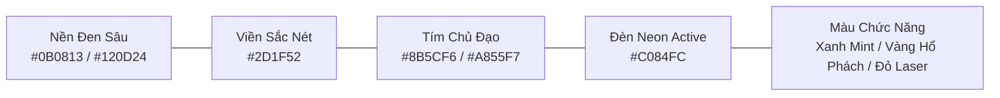
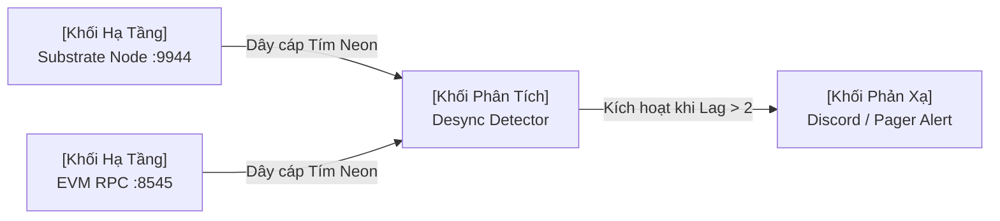

# Creative North Star: "The Portaldot Cyber Defense Control Center"

## 1. Aesthetic Archetype
- **Pure Tech DevOps & Zero AI Slop**: High information density, crisp 1px borders, monospace data alignment with tabular numbers, live pulsing status micro-LEDs.
- **Deep Violet / Electric Amethyst Spectrum**: `#0B0813` (Obsidian Base) + `#130E26` (Card Surface) + `#8B5CF6` (Primary Neon).
- **Dual-VM Engine Chromatic Identity**:
  - Substrate ink! WASM Core: `#E6007A` (Polkadot Magenta).
  - EVM Solidity Execution: `#6366F1` (Ethereum Indigo).

## 2. Craft Floor & Anti-Patterns (Enforced via Impeccable Skill)
- Never use generic low-density rounded cartoon cards.
- Never use rainbow gradient text or arbitrary floating chatbot widgets.
- Every number metric must be wrapped in `font-mono tabular-nums`.
- Always provide 5 lifecycle states: Loading, Active, Empty, Hover, Error.

# DotNexus — UI/UX Design Specification

> **Aesthetic Archetype:** Pure Tech DevOps & Cyber Defense Control Center  
> **Core Theme Color:** Deep Violet / Electric Amethyst (`#8B5CF6` / `#A855F7`)  
> **Design Philosophy:** **Zero AI Slop** — Loại bỏ hoàn toàn các hình họa bóng bẩy vô nghĩa, gradient mờ nhạt rẻ tiền, hay các card bo tròn hoạt hình. Tập trung 100% vào mật độ thông tin cao (High Information Density), độ sắc nét kỹ thuật (Crisp Technical Precision) theo tiêu chuẩn của **Datadog, Vercel, Linear, và Bloomberg Terminal for Web3**.

---

## 1. Triết Lý Thiết Kế: "Anti-AI Slop, Pure Engineering"

### ❌ Những gì BỊ CẤM TUYỆT ĐỐI (Blacklist):
* Không dùng bong bóng gradient mờ mờ vô thưởng vô phạt (Generic AI blobs/aurora).
* Không dùng hình minh họa hoạt hình 3D kiểu Canva/Dribbble.
* Không dùng các ô chat bot nổi lơ lửng chiếm không gian làm việc.
* Không làm các nút bấm quá to, bo tròn như kẹo ngọt (No pill buttons over-rounded).
* Không dùng khoảng trắng lãng phí (low information density).

### ✅ Những gì BẮT BUỘC PHẢI CÓ (The Pure Tech Aesthetic):
* **Crisp 1px Borders:** Đường viền sắc nét 1 pixel với độ tương phản vi mô (`#2D1F52`), phân tách rõ ràng từng module.
* **Monospace Data Density:** Mọi số liệu (Block height, Hash, Latency ms, TPS, Peer ID) hiển thị bằng font Monospace căn chỉnh tab chuẩn mực (`font-mono tabular-nums`).
* **Live Pulsing Telemetry:** Đèn tín hiệu nhấp nháy thời gian thực (Micro-pulsing LEDs) thể hiện nhịp tim node, ping socket và trạng thái sync.
* **Terminal Diagnostics Embed:** Tích hợp màn hình stream log đen sâu với syntax highlighting chuẩn Sysadmin.

---

## 2. Hệ Màu Chủ Đạo: The Violet Protocol

Toàn bộ hệ thống được xây dựng trên dải màu **Tím Điện Tử (Electric Violet)** kết hợp nền đen không gian sâu (Obsidian Space) để tạo cảm giác bảo mật, công nghệ cao và bí ẩn:



### Bảng Mã Màu (Design Tokens):

| Vai Trò | Tên Token | Hex Code | Ứng Dụng Thực Tế |
|---|---|---|---|
| **Background Base** | `bg-void` | `#0B0813` | Nền canvas và toàn bộ ứng dụng |
| **Card Surface** | `bg-surface` | `#130E26` | Mặt nền các widget, panel, inspector |
| **Panel Hover** | `bg-surface-hover` | `#1A1333` | Trạng thái hover chuột của các hàng và node |
| **Border Subtle** | `border-dim` | `#261B42` | Đường viền ngăn cách các card và header |
| **Border Active** | `border-violet` | `#4C2889` | Viền khi focus hoặc khi node đang chạy |
| **Primary Accent** | `color-violet-primary` | **`#8B5CF6`** | Màu nhận diện chính: Icon, Active tab, Nút CTA |
| **Electric Glow** | `color-violet-glow` | **`#A855F7`** | Dây nối Canvas phát sáng, Viền active, Slider |
| **High Neon** | `color-violet-high` | **`#C084FC`** | Chữ nhấn mạnh, Key metric số lớn |

### Màu Chức Năng (Semantic Status Colors — Tương phản cao):
* 🟢 **Sync OK / Live:** `#10B981` (Neon Mint) — Đèn báo Node khỏe, block sync 100%.
* 🟡 **Desync / Warning:** `#F59E0B` (Electric Amber) — Cảnh báo trễ block, latency cao.
* 🔴 **Slash Risk / Critical:** `#EF4444` (Laser Crimson) — Báo động đỏ: hở RPC, nguy cơ bị Slash.
* 🟣 **Substrate Stream:** `#E6007A` (Polkadot Magenta) — Luồng dữ liệu Substrate WASM.
* 🔷 **EVM Stream:** `#6366F1` (Ethereum Indigo) — Luồng dữ liệu EVM JSON-RPC.

---

## 3. Cấu Trúc Bố Cục (Layout Architecture)

Giao diện được tổ chức theo tiêu chuẩn của một **Trung Tâm Chỉ Huy (Command & Control Center)**:

```txt
+----------------------------------------------------------------------------------------------------+
|  DOTNEXUS  |  Best: #4,120,912  |  Finalized: #4,120,909 (Lag: 3)  |  Dual-VM: SYNCED  |  [0xBob]  |
+------------+---------------------------------------------------------------------------------------+
| [NAV]      |  MAIN WORKSPACE (Tab-driven)                                                          |
|            |                                                                                       |
| > Dual-VM  |  [ View 1: Dual-Engine Telemetry (Split WASM vs EVM metrics) ]                        |
| > Slashing |  [ View 2: Security Radar & Session Key Manager ]                                      |
| > Staking  |  [ View 3: NPoS Dynamic Re-Nomination Scorecard ]                                     |
| > Shield   |  [ View 4: RPC Shield & P2P Topology Map ]                                            |
| > Canvas   |  [ View 5: Visual DAG Automation Canvas (Trọng tâm kéo-thả) ]                         |
|            |                                                                                       |
+------------+---------------------------------------------------------------------------------------+
|  TERMINAL DRAWER (Collapsible): Live RPC Event Stream & Engine Logs [stdout / stderr]              |
+----------------------------------------------------------------------------------------------------+
```

### 1. Header Đa Thông Số (Global Cluster Bar)
- Nằm cố định trên cùng, chiều cao compact (`h-12`).
- Chứa các chip đo nhịp tim mạng lưới: **Best Block, Finalized Block, EVM Block Height, Dual-VM Delta (màu tím), Trạng thái WebSocket Socket (chấm xanh nhấp nháy)**.

### 2. Sidebar Tinh Gọn (Icon + Hotkey Rail)
- Chiều rộng hẹp (`w-16`), nền tối `#0F0A1F`, viền phải 1px.
- Các icon kỹ thuật sắc nét (Lucide Icons), khi click đổi sang màu tím sáng với vệt sáng viền trái (Active indicator bar).

### 3. Khung Log Terminal Bên Dưới (Collapsible Console)
- Cho phép thu gọn/mở rộng, font Monospace đen sâu, hiển thị log realtime từ engine Python/Node RPC, giúp dev có thể verify ngay kết quả bên dưới.

---

## 4. Thiết Kế Điểm Nhấn: Visual DAG Canvas

Canvas kéo-thả là "vũ khí tối thượng" của DotNexus, được thiết kế theo phong cách **Mạch Điện Tử / Microchip Board**:



### Đặc trưng của các khối Node trên Canvas:
1. **Node Chassis (Khung khối):**
   * Nền đen tím nguyên khối (`#130E26`), viền 1px tím mờ (`#2D1F52`), góc bo nhỏ sắc sảo (`rounded-md`, bo 6px, tuyệt đối không bo tròn xoe).
   * Header của mỗi node có gắn tag loại node: `INFRA`, `WATCHER`, `SECURITY`, `ACTION`.
2. **Ports (Chân cắm nối dây):**
   * Chân cắm dạng socket vi mạch nhỏ, phát sáng màu tím khi rê chuột lại gần.
3. **Connection Edges (Dây cáp tín hiệu):**
   * Dây nối dạng SmoothStep hoặc Bezier màu tím Neon (`#A855F7`), có hạt photon chạy dọc theo dây khi có tín hiệu truyền qua (Animated stroke).
4. **Mini Telemetry Badge:**
   * Ngay trên mỗi node có hiển thị số liệu sống (ví dụ: `Ping: 12ms`, `Status: Active`, `Sync: 100%`).

---

## 5. Quy Chuẩn Kiểu Chữ (Typography)

* **Font Giao Diện & Tiêu Đề:** `Geist Sans` hoặc `Inter` — Rõ ràng, trung tính, không uốn lượn.
* **Font Số Liệu, Mã Lệnh & Terminal:** `JetBrains Mono` hoặc `Geist Mono`.
  * Luôn bật thuộc tính `tabular-nums` để các con số khi nhảy realtime không bị rung lắc layout.
  * Kích thước chữ tối ưu hóa cho dân kỹ thuật:
    * Micro Badge: `text-[11px]` font-mono.
    * Body data: `text-[13px]`.
    * Metric Callout: `text-[24px]` hoặc `text-[32px]` font-mono bold tím sáng.

---

## 6. Điểm Khác Biệt Giúp Đánh Bại Mọi Đối Thủ Về UI/UX

| Tiêu Chí | Thiết Kế Thông Thường (AI Slop) | Thiết Kế Của DotNexus (Pure Tech) |
|---|---|---|
| **Tone & Mood** | Trắng/Tím nhạt mờ mờ, nhiều hình vẽ vô nghĩa. | **Dark Cyberpunk Obsidian + Deep Violet sắc nét.** |
| **Mật độ thông tin** | Thưa thớt, card to đùng chứa được 2 dòng chữ. | **Dày dặn, khoa học, tối ưu từng pixel hiển thị.** |
| **Trải nghiệm thao tác** | Chỉ nhìn được biểu đồ tĩnh (Grafana style). | **Vừa quan sát vừa kéo-thả điều khiển luồng (Actionable Canvas).** |
| **Cảm giác mang lại** | Giống bài tập lớn sinh viên làm vội bằng AI. | **Giống sản phẩm DevOps cấp Enterprise trị giá triệu đô.** |


Để xây dựng một **3D UI Component tùy chỉnh (Custom 3D UI)** sử dụng Three.js / React Three Fiber (R3F) thay vì dùng thẻ Canvas thô cứng của Spline, bạn cần kiểm soát hoàn toàn từng khối hộp, ánh sáng, vật liệu và sự kiện tương tác chuột (Raycaster).

Dưới đây là **bảng kế hoạch chi tiết các giai đoạn triển khai** để biến ý tưởng lưới 3D Boxes thành một giao diện UI hoàn chỉnh, mượt mà và tối ưu hiệu suất cho web của bạn:

---

### Bảng Kế Hoạch Triển Khai Custom 3D UI (Three.js / R3F)

| Giai đoạn | Nhiệm vụ chính | Chi tiết công việc & Kỹ thuật áp dụng | Mục tiêu đạt được |
| --- | --- | --- | --- |
| **Giai đoạn 1: Chuẩn bị & Kiến trúc** | **Setup môi trường R3F & Quản lý State** | • Khởi tạo project Next.js + Three.js (`@react-three/fiber`, `@react-three/drei`).<br>

<br>• Xây dựng khung cảnh cơ bản (`<Canvas>`, `<Camera>`, `<AmbientLight>`, `<DirectionalLight>`). | Sẵn sàng không gian 3D render ổn định trên trình duyệt. |
| **Giai đoạn 2: Dựng Lưới (Grid Geometry)** | **Tạo hệ thống Mesh các khối hộp 3D** | • Viết vòng lặp tính toán tọa độ $(x, y, z)$ để tạo ma trận lưới các khối Cube (Ví dụ: lưới $6 \times 4$).<br>

<br>• Tối ưu bằng **InstancedMesh** (hoặc Group) để đảm bảo hiệu suất (FPS cao, không giật lag khi render hàng chục khối). | Hiển thị toàn bộ các khối hộp 3D theo đúng thiết kế ban đầu. |
| **Giai đoạn 3: Tương tác & Hiệu ứng** | **Xử lý sự kiện Mouse Hover & Spring Physics** | • Bắt sự kiện `onPointerOver` / `onPointerOut` trên từng khối.<br>

<br>• Tích hợp thư viện **React Spring / Framer Motion** để tạo hiệu ứng chuyển động mượt mà khi khối hộp nhô lên (Translate Z) hoặc đổi màu.<br>

<br>• Đảm bảo không bị hiện tượng "giật cục" khi di chuyển chuột nhanh. | Các khối hộp phản hồi linh hoạt theo vị trí con trỏ chuột. |
| **Giai đoạn 4: Tích hợp HTML UI** | **Gắn chữ, nút bấm và tối ưu trải nghiệm** | • Dùng component `<Html>` từ thư viện `@react-three/drei` để neo các thẻ tiêu đề HTML chuẩn SEO, nút bấm hoặc tooltip đè lên không gian 3D chính xác.<br>

<br>• Xử lý responsive trên màn hình mobile (thu nhỏ lưới hoặc ẩn bớt chi tiết). | Giao diện vừa có chiều sâu 3D vừa giữ nguyên tính năng tương tác UI web truyền thống. |
| **Giai đoạn 5: Tối ưu & Hoàn thiện** | **Kiểm tra hiệu suất & Build sản phẩm** | • Tối ưu hóa vật liệu (`MeshStandardMaterial` hoặc `MeshPhysicalMaterial` với độ bóng Glassmorphism).<br>

<br>• Kiểm tra FPS, cấu hình ánh sáng đổ bóng nhẹ (`shadowMap`) để không làm nặng GPU người dùng.<br>

<br>• Deploy lên Vercel. | Bản hoàn thiện sẵn sàng đưa vào Production. |

---

## 7. Tài Liệu Nghiên Cứu Điển Hình: Zeabur Design Benchmark
Chi tiết phân tích ngôn ngữ thiết kế tối giản, kiến trúc thẻ Bento Grid và kế hoạch nâng cấp UI/UX cho DotNexus lấy cảm hứng từ [Zeabur](https://zeabur.com/) được lưu trữ đầy đủ tại:
📄 [`ZEABUR_UI_UX_ANALYSIS_AND_IMPROVEMENT_PLAN.md`](ZEABUR_UI_UX_ANALYSIS_AND_IMPROVEMENT_PLAN.md)
