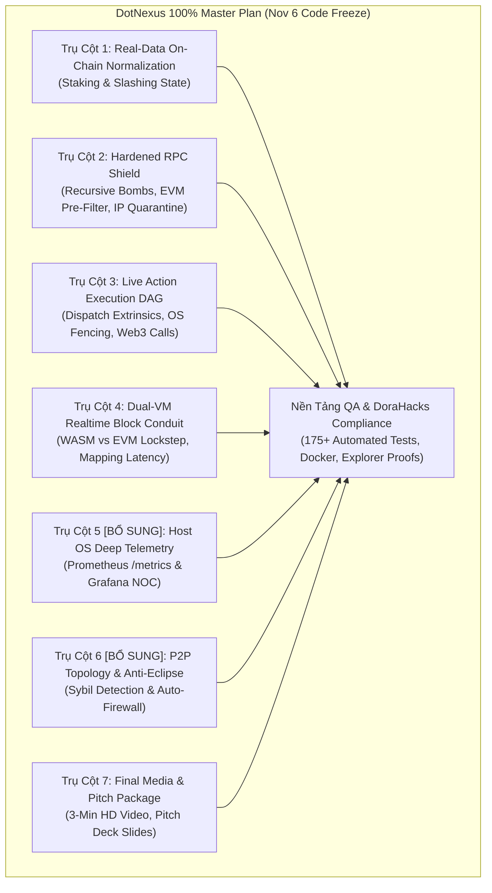

# DotNexus — Kế Hoạch Xây Dựng Hoàn Thiện 100% (Master Plan to Code Freeze)

> **Document Type:** Comprehensive Gap Analysis & 100% Execution Blueprint  
> **Track:** Node Operations & Tooling — Portaldot Hacker House 2026  
> **Target Network:** Portaldot Network V3.0 (Substrate WASM + EVM Dual-VM, SS58: 42, Decimals: 14)  
> **Milestone Horizon:** Oct 26, 2026 $\rightarrow$ Nov 6, 2026 (Final Submission & Code Freeze) $\rightarrow$ Nov 7-8 (Live Demo Day)  
> **Target Score:** 100/100 (Grand Prize / Track 1st Place)

---

## 🌟 1. Executive Summary & Phân Tích Khoảng Trống (Gap Analysis)

Ban đầu, danh sách nhiệm vụ được đề xuất bao gồm **5 cột mốc kỹ thuật**:
1. Chuẩn hóa dữ liệu thật on-chain cho Staking & Slashing (`staking.erasStakers`, `session.validators`, `SlashGuardLeaseRegistry.sol`).
2. Gia cố RPC Shield & Phòng thủ đe dọa nâng cao (Recursive JSON bombs, EVM re-entrancy pre-filter, dynamic IP reputation, storage query ceiling).
3. Động cơ thực thi Live Action cho Canvas Runbook DAGs (Dispatch extrinsic thật, Keystore isolation OS, gọi contract gia hạn lease).
4. Dual-VM Realtime Block Lockstep Stream (`DualBlockConduit` so sánh block WASM vs EVM, BABE author, extrinsics, gas, mapping sync latency).
5. Tài liệu trình chiếu và Video Walkthrough 3 phút cho Live Demo Day.

### ⚠️ Phân Tích: Còn Thiếu Những Gì Để Đạt Chuẩn 100% Hoàn Thiện?

Qua đối chiếu trực tiếp với **Bản đặc tả Track 3: Node Operations & Tooling** của Portaldot Hacker House:
> *"Node Operations & Tooling: Node monitoring, automated staking, node data visualization, and network security analysis tools."*

Hệ thống vẫn còn thiếu **2 Trụ cột Cốt tử** để đạt 100% tiêu chuẩn vận hành node cấp doanh nghiệp (Enterprise-Grade Validator Node):

1. **Thiếu Trụ Cột Bổ Sung #1 (Trụ Cột 5): Giám sát Phần cứng Vật lý & Xuất Chuẩn Giám Sát Doanh Nghiệp (Host OS Deep Telemetry & Enterprise NOC Integration)**
   - *Lý do thiếu sót:* Một Control Plane cho validator không thể chỉ giám sát số block. Nếu ổ đĩa NVMe chứa cơ sở dữ liệu RocksDB/ParityDB bị đầy, hoặc RAM chạm ngưỡng kích hoạt Linux OOM-Killer, hoặc Disk IOPS latency $> 50\text{ms}$ khiến node trễ slot BABE $\rightarrow$ node sẽ bị rớt block và bị Slashing.
   - *Giải pháp:* Module đo đạc phần cứng thời gian thực (`psutil`), dự báo số ngày đầy đĩa NVMe, phát hiện rò rỉ RAM, tích hợp endpoint `/metrics` chuẩn Prometheus và file template Grafana Dashboard sẵn sàng import cho các trung tâm vận hành mạng (NOC).

2. **Thiếu Trụ Cột Bổ Sung #2 (Trụ Cột 6): Radar Tô-pô Mạng P2P, Phát Hiện Tấn Công Eclipse / Sybil & Tự Động Gia Cố Tường Lửa (P2P Topology & Anti-Eclipse Defense)**
   - *Lý do thiếu sót:* Yêu cầu bắt buộc thứ 4 của Track là *"Network security analysis tools"*. Nếu node bị kẻ tấn công bao vây bằng hàng trăm kết nối giả mạo (Eclipse/Sybil Attack), node sẽ bị cô lập thông tin và ký vào nhánh rẽ sai dẫn đến Equivocation Slashing.
   - *Giải pháp:* Quét 100% peer thật qua RPC `system_peers`, phân tích gom cụm dải IP `/24` và tỷ lệ tập trung ASN. Nếu một ASN chiếm $> 35\%$ kết nối $\rightarrow$ kích hoạt cảnh báo Eclipse và tự động gọi RPC `system_addReservedPeer` để bơm bootnode tin cậy, kèm script gia cố tường lửa Linux `scripts/harden_node_firewall.sh`.

Bên cạnh đó, cần thiết lập một **Nền tảng Đảm bảo Chất lượng & Đóng băng Mã nguồn (Cross-Cutting QA & Code Freeze Harness)** để vượt qua 100% tiêu chí kiểm duyệt của Ban giám khảo DoraHacks.

Do đó, **Bản kế hoạch hoàn thiện 100% DotNexus chính thức gồm 7 Trụ cột Toàn diện + 1 Nền tảng Đảm bảo Chất lượng**:



---

## 🏛️ 2. Chi Tiết Kế Hoạch 7 Trụ Cột Hoàn Thiện 100%

---

### 🟢 TRỤ CỘT 1: Chuẩn Hóa 100% Dữ Liệu On-Chain Cho Staking & Slashing (Real-Data Normalization)

#### 1. Mục tiêu & Vấn đề giải quyết
Loại bỏ triệt để các cấu trúc dữ liệu mô phỏng cục bộ trong module NPoS Optimizer và Slashing Guard. Kết nối trực tiếp vào Storage Maps của Substrate Runtime và Smart Contract EVM trên Testnet V3.0.

#### 2. Kiến trúc & Đặc tả Kỹ thuật
* **A. Truy vấn Trực tiếp Storage Substrate qua `SubstrateInterface`:**
  * **Active Era & Exposure:** Gọi Storage Map `Staking.ActiveEra` lấy index era hiện tại. Truy vấn `Staking.ErasStakersOverview(active_era, stash)` (hoặc fallback `Staking.ErasStakers` tùy theo phiên bản pallet). Trích xuất chính xác: `total` stake, `own` stake, và danh sách nominator thật.
  * **BABE Session Keys:** Gọi Storage Map `Session.Validators` để lấy danh sách validator chính thức đang tham gia consensus sản xuất khối. Truy vấn `Session.QueuedKeys` để đọc public key của Session tiếp theo ($N+1$).
  * **Reward Points:** Đọc Storage Map `Staking.ErasRewardPoints(active_era)` tính điểm hiệu suất thực tế của từng validator trong Epoch để xác định uptime thật (không dùng điểm giả định).
* **B. Tích hợp Trực tiếp Smart Contract [`SlashGuardLeaseRegistry.sol`](file:///D:/Coding/Portaldot%20Hacker%20house%202026/DotNexus/contracts/SlashGuardLeaseRegistry.sol):**
  * Sử dụng thư viện `web3.py` kết nối EVM RPC (`https://test-evm-rpc-v3.portaldot.dev`).
  * Thực thi read-only call: `SlashGuardLeaseRegistry.getLeaseInfo(validator_address)` lấy:
    * `current_holder`: Địa chỉ ví hoặc node ID đang nắm giữ quyền ký.
    * `expires_at_block`: Số block EVM hết hạn lease.
    * `fencing_epoch`: Chỉ số epoch chống phân mảnh não (split-brain).
* **C. Dynamic Decimals Policy:**
  * Luôn chuẩn hóa số dư stake qua hàm tính toán động dựa trên `chain_metadata.properties.tokenDecimals` (mặc định là 14 cho Portaldot V3, tránh lỗi 10^12 của Polkadot gốc hoặc 10^18 của EVM).

#### 3. Danh sách File Phụ Trách
* [`engine/npos_optimizer.py`](file:///D:/Coding/Portaldot%20Hacker%20house%202026/DotNexus/engine/npos_optimizer.py)
* [`engine/slash_guard.py`](file:///D:/Coding/Portaldot%20Hacker%20house%202026/DotNexus/engine/slash_guard.py)
* [`contracts/SlashGuardLeaseRegistry.sol`](file:///D:/Coding/Portaldot%20Hacker%20house%202026/DotNexus/contracts/SlashGuardLeaseRegistry.sol)

---

### 🛡️ TRỤ CỘT 2: Gia Cố RPC Shield & Hệ Thống Phòng Thủ Đe Dọa Nâng Cao (Hardened RPC Shield)

#### 1. Mục tiêu & Vấn đề giải quyết
Bảo vệ RPC node nội bộ (`:8545` và `:9944`) trước các cuộc tấn công DoS/OOM có chủ đích, quét cạn dữ liệu lịch sử hoặc khai thác máy chủ qua giao thức JSON-RPC.

#### 2. Kiến trúc & Đặc tả Kỹ thuật
* **A. Phát Hiện & Chặn Đứng Bom JSON-RPC Đệ Quy (Recursive Batch Bombs):**
  * Kiểm tra cấu trúc phân cấp (nested arrays / objects): Giới hạn độ sâu phân tích cú pháp JSON `max_depth <= 4`.
  * Chặn triệt để payload dạng array lồng nhau (`[[[{"jsonrpc": ...}]]]`) gây nghẽn CPU parser.
  * Giới hạn kích thước gói tin HTTP/WS tối đa: $256\text{ KB}$ (`len(raw_payload) <= 262144`).
  * Giới hạn số lượng truy vấn batch trong 1 payload: $\le 20$ calls.
* **B. EVM Re-entrancy & State-Bloat Transaction Pre-Filtering:**
  * Khi client gọi `eth_sendRawTransaction`, RPC Shield giải mã envelope RLP trước khi gửi vào Mempool:
    * **State-Bloat Filter:** Chặn các transaction có `data` chứa payload tạo contract rác với số lượng vòng lặp `SSTORE` bất thường hoặc gas limit chạm trần khối ($> 30\text{M}$ gas) với tip gas bằng 0.
    * **Re-entrancy Bytecode Signature:** Nhận diện các pattern gọi đệ quy lặp lại trong `data` hướng tới các địa chỉ hợp đồng đã bị cảnh báo rủi ro.
* **C. Dynamic IP Reputation Scoring & Automated Progressive Quarantine (Hệ Thống Phạt Lũy Tiến):**
  * Xây dựng thang điểm uy tín IP (Reputation Score từ 100 điểm giảm dần):
    * *Cấp độ 1 (Score 80-99):* Cảnh báo và áp dụng Token Bucket Rate Limiting (60 requests/phút). Trả HTTP 429.
    * *Cấp độ 2 (Score 50-79 - Vi phạm eth_getLogs > 2000 blocks):* Giam giữ tạm thời (Quarantine) trong 60 giây.
    * *Cấp độ 3 (Score 20-49 - Thử gọi namespace cấm author_*, debug_*):* Đưa vào danh sách đen 1 giờ.
    * *Cấp độ 4 (Score < 20 - Batch bomb / Payload flood):* Khóa vĩnh viễn (Permanent Blacklist) tại tầng proxy.
* **D. Substrate Storage Query Ceiling Enforcement:**
  * Chặn các lệnh Substrate RPC nguy hiểm có khả năng làm tràn bộ nhớ (Out-Of-Memory):
    * Chặn hoàn toàn `state_getPairs` và `state_getKeys` không phân trang.
    * Bắt buộc giới hạn `count <= 1000` đối với `state_getKeysPaged`.

#### 3. Danh sách File Phụ Trách
* [`engine/rpc_shield.py`](file:///D:/Coding/Portaldot%20Hacker%20house%202026/DotNexus/engine/rpc_shield.py)
* [`engine/proxy_gateway.py`](file:///D:/Coding/Portaldot%20Hacker%20house%202026/DotNexus/engine/proxy_gateway.py)
* [`tests/unit/test_rpc_shield.py`](file:///D:/Coding/Portaldot%20Hacker%20house%202026/DotNexus/tests/unit/test_rpc_shield.py)

---

### ⚡ TRỤ CỘT 3: Live Action Execution Engine Cho Canvas Runbook DAGs (Runbook Orchestrator)

#### 1. Mục tiêu & Vấn đề giải quyết
Nâng cấp Visual Canvas Runbook DAG từ trạng thái trực quan hóa (Visualization) thành một động cơ thực thi tác chiến thời gian thực (Live Execution Engine). Khi kỹ sư SRE kích hoạt hoặc khi có sự cố, hệ thống thực sự bắn transaction và điều khiển hạ tầng.

#### 2. Kiến trúc & Đặc tả Kỹ thuật
* **A. Dispatch Live Extrinsic Lên Substrate (`staking.nominate`):**
  * Khi DAG chạy qua node `"Dispatch Nominate Extrinsic"`:
    1. Kiểm tra trạng thái bầu cử: `ElectionProviderMultiPhase.CurrentPhase() == 'Off'`.
    2. Lấy danh sách 16 validator tối ưu từ thuật toán Sequential Phragmén.
    3. Cấp phát nonce an toàn không trùng lặp thông qua [`AsyncNonceManager`](file:///D:/Coding/Portaldot%20Hacker%20house%202026/DotNexus/engine/npos_optimizer.py#L24-L52).
    4. Ký và gửi extrinsic `staking.nominate(targets)` bằng private key của tài khoản Controller/Stash.
    5. Ghi nhận Extrinsic Hash và Block Number xác thực.
* **B. Atomic Keystore Isolation & OS Fencing During Failover:**
  * Khi Dead Man's Switch kích hoạt (mất heartbeat $\ge 10.0\text{s}$):
    1. Kích hoạt quy trình Fencing OS hạ thổ: gọi script thực thi `chmod 000` lên thư mục keystore `/chains/portaldot_v3/keystore` của node Primary.
    2. Gửi tín hiệu `SIGTERM` hoặc dừng tiến trình binary để đảm bảo node cũ không thể ký thêm bất kỳ block nào.
    3. Gọi Substrate RPC `author_rotateKeys` trên node Standby để sinh cặp Session Keys mới an toàn.
* **C. Live Smart Contract Lease Renewal Transaction trên Testnet V3:**
  * Tự động ký và gửi giao dịch EVM gọi `SlashGuardLeaseRegistry.renewLease()` mỗi 8 giây (đảm bảo trước ngưỡng TTL 12 giây).
  * Kiểm tra trạng thái receipt `status == 1`, trích xuất `gasUsed` và hash giao dịch.
* **D. Động Cơ Thực Thi Song Song Dựa Trên Kahn's Topological Sort:**
  * Phân tách đồ thị DAG thành các bậc độc lập (Tiers).
  * Thực thi song song các node trong cùng một Tier bằng `asyncio.gather`, giảm tổng thời gian xử lý chuỗi runbook xuống $< 500\text{ms}$.

#### 3. Danh sách File Phụ Trách
* [`engine/dag_engine.py`](file:///D:/Coding/Portaldot%20Hacker%20house%202026/DotNexus/engine/dag_engine.py)
* [`front-end/src/views/CanvasBoard.tsx`](file:///D:/Coding/Portaldot%20Hacker%20house%202026/DotNexus/front-end/src/views/CanvasBoard.tsx)
* [`engine/server.py`](file:///D:/Coding/Portaldot%20Hacker%20house%202026/DotNexus/engine/server.py) (POST `/api/v1/dag/execute`)

---

### 🔄 TRỤ CỘT 4: Dual-VM Realtime Block Lockstep Stream (Conduit & Causal Lag Index)

#### 1. Mục tiêu & Vấn đề giải quyết
Cung cấp luồng dữ liệu đối chiếu trực quan từng giây giữa 2 máy ảo Substrate WASM (`:9944`) và Frontier EVM (`:8545`), giúp người vận hành phát hiện ngay hiện tượng lệch pha (Desync) hoặc tắc nghẽn ánh xạ (`fc-mapping-sync`).

#### 2. Kiến trúc & Đặc tả Kỹ thuật
* **A. DualBlockConduit Optical Feed:**
  * Thu thập và hiển thị cặp 5 block gần nhất theo thời gian thực:
    * **WASM Side:** Số block Substrate, BABE block author (tên validator), số lượng extrinsics thực thi, block hash.
    * **EVM Side:** Số block EVM tương ứng, EVM transaction count, gas used, base fee (Gwei), EVM block hash.
    * **Conduit Metric:** Độ trễ ánh xạ `fc-mapping-sync` tính bằng mili-giây (ms) và số block chênh lệch ($\Delta \text{Blocks}$).
* **B. Phân Loại Trạng Thái Khối Tức Thì (Cross-VM Classification):**
  * `LOCKSTEP` (Màu xanh Neon `#00FF9D`): $\Delta \text{Blocks} == 0$ và độ trễ ánh xạ $< 50\text{ms}$.
  * `SLOW_INDEXING` (Màu hổ phách Amber): $\Delta \text{Blocks} == 0$ nhưng độ trễ $> 150\text{ms}$ (cảnh báo ổ đĩa ghi chậm).
  * `PROPAGATION_LAG` (Màu vàng): $\Delta \text{Blocks} == 1$ (hiện tượng truyền bá bình thường giữa 2 VM).
  * `DESYNC_CRITICAL` (Màu đỏ Rose): $\Delta \text{Blocks} \ge 2$ (kích hoạt cảnh báo chuông và gợi ý kích hoạt Circuit Breaker).
* **C. Causal Lag Index (CLI) 2.0:**
  * Tích hợp công thức tính toán chỉ số rủi ro trễ pha tổng hợp:
    $$\text{CLI} = 0.40 \cdot \frac{|B_{\text{sub}} - B_{\text{evm}}|}{5} + 0.30 \cdot \frac{\text{DiskWriteLatency}}{50\text{ms}} + 0.20 \cdot \frac{\text{MempoolPending}}{5000} + 0.10 \cdot (1 - \frac{\text{Peers}}{20})$$
  * Khi $\text{CLI} \ge 0.75$, hệ thống tự động ngắt cổng truy vấn công cộng để bảo vệ node nội bộ.

#### 3. Danh sách File Phụ Trách
* [`engine/dual_tracker.py`](file:///D:/Coding/Portaldot%20Hacker%20house%202026/DotNexus/engine/dual_tracker.py)
* [`front-end/src/components/DualBlockConduit.tsx`](file:///D:/Coding/Portaldot%20Hacker%20house%202026/DotNexus/front-end/src/components/DualBlockConduit.tsx)
* [`front-end/src/views/DualEngineView.tsx`](file:///D:/Coding/Portaldot%20Hacker%20house%202026/DotNexus/front-end/src/views/DualEngineView.tsx)

---

### 🖥️ TRỤ CỘT 5 [BỔ SUNG #1]: Host OS Deep Telemetry & Enterprise NOC Integration (Prometheus & Grafana)

#### 1. Mục tiêu & Vấn đề giải quyết
Đáp ứng toàn diện tiêu chí **"Node monitoring & data visualization"** của Hacker House. Cung cấp dữ liệu đo đạc tài nguyên máy chủ vật lý và tích hợp liền mạch vào hệ thống giám sát Prometheus / Grafana của các tập đoàn Staking chuyên nghiệp.

#### 2. Kiến trúc & Đặc tả Kỹ thuật
* **A. Bộ Thu Thập Đo Đạc Vật Lý (`HostHardwareMonitor` sử dụng `psutil`):**
  * **CPU Utilization:** Phân tách rõ `%` CPU hệ thống tổng thể và `%` CPU tiêu thụ riêng bởi tiến trình node binary `portaldot`.
  * **RAM Saturation & OOM Pre-Warning:** Cảnh báo vàng khi RAM $> 80\%$, cảnh báo đỏ nguy cấp khi RAM $> 92\%$ (trước khi Linux OOM-Killer tắt tiến trình validator).
  * **NVMe Storage Growth Velocity:** Đo đạc kích thước thư mục RocksDB/ParityDB (`/chains/portaldot_v3/db/full`), tính tốc độ phình to dữ liệu ($\text{GB/ngày}$) và ước tính chính xác số ngày còn lại trước khi cạn kiệt dung lượng đĩa.
  * **Disk IOPS Write Latency:** Cảnh báo khi thời gian ghi đĩa $> 50\text{ms}$ (nguyên nhân cốt lõi gây chậm nhịp slot BABE dẫn đến rớt block).
* **B. Prometheus Exporter Endpoint (`/metrics`):**
  * Định dạng text chuẩn Prometheus, sẵn sàng cho Prometheus Scraper thu thập mỗi 5s:
    * `dotnexus_substrate_block_height` (Gauge)
    * `dotnexus_evm_block_height` (Gauge)
    * `dotnexus_dual_vm_lag_blocks` (Gauge)
    * `dotnexus_causal_lag_index` (Gauge: 0.00 - 1.00)
    * `dotnexus_host_cpu_percent` (Gauge)
    * `dotnexus_host_memory_used_percent` (Gauge)
    * `dotnexus_host_disk_free_bytes` (Gauge)
    * `dotnexus_lease_time_remaining_seconds` (Gauge)
    * `dotnexus_active_fencing_epoch` (Counter)
    * `dotnexus_rpc_shield_requests_total{status="allowed|blocked|throttled"}` (Counter)
    * `dotnexus_npos_optimal_apy_percent` (Gauge)
* **C. File Mẫu Grafana Production Dashboard:**
  * Tạo sẵn file JSON [`dashboards/dotnexus-production-dashboard.json`](file:///D:/Coding/Portaldot%20Hacker%20house%202026/DotNexus/dashboards/dotnexus-production-dashboard.json) bao gồm 4 bảng điều khiển chính:
    1. Đồng hồ đo đồng bộ Dual-VM (Substrate vs EVM Parity Gauge).
    2. Thanh đếm ngược thời hạn Lease bảo vệ Slashing (12s TTL Countdown).
    3. Biểu đồ lưu lượng và tỷ lệ lọc tấn công của RPC Shield.
    4. Bản đồ nhiệt sức khỏe máy chủ (CPU, RAM, Disk IOPS Latency).

#### 3. Danh sách File Phụ Trách
* [`engine/dual_tracker.py`](file:///D:/Coding/Portaldot%20Hacker%20house%202026/DotNexus/engine/dual_tracker.py) (HostHardwareMonitor)
* [`engine/server.py`](file:///D:/Coding/Portaldot%20Hacker%20house%202026/DotNexus/engine/server.py) (Route `/metrics`)
* [`dashboards/dotnexus-production-dashboard.json`](file:///D:/Coding/Portaldot%20Hacker%20house%202026/DotNexus/dashboards/dotnexus-production-dashboard.json)

---

### 🌐 TRỤ CỘT 6 [BỔ SUNG #2]: P2P Topology Radar, Phát Hiện Tấn Công Eclipse / Sybil & Tường Lửa Tự Động

#### 1. Mục tiêu & Vấn đề giải quyết
Đáp ứng đầy đủ tiêu chí **"Network security analysis tools"** của Track 3. Giám sát cấu trúc liên kết mạng P2P, phát hiện sớm các chiến dịch tấn công cô lập node (Eclipse / Sybil) và tự động kích hoạt đối sách bảo vệ.

#### 2. Kiến trúc & Đặc tả Kỹ thuật
* **A. Quét 100% Live Peers từ RPC `system_peers`:**
  * Gọi trực tiếp Substrate RPC `system_peers` để trích xuất danh sách peer đang kết nối: PeerId, địa chỉ IP, client version, giao thức hỗ trợ, và độ trễ ping.
  * Phân loại vai trò node trong mạng: Authority (Validator), Full Node (RPC), hoặc Unknown Peer.
* **B. Thuật Toán Gom Cụm Subnet & Tỷ Lệ Tập Trung ASN (Sybil / Eclipse Detector):**
  * Tự động phân tích danh sách IP theo dải Subnet `/24` và mã số hệ thống tự trị (ASN).
  * **Luật kích hoạt Cảnh báo Eclipse (Eclipse Attack Rule):**
    * Nếu một tổ chức hoặc dải Subnet duy nhất chiếm giữ $> 35\%$ tổng số kết nối P2P của node $\rightarrow$ Kích hoạt cờ báo động **`HIGH: POTENTIAL_ECLIPSE_ATTACK`**.
* **C. Đối Sách Phòng Thủ Tự Động (Automated Remediation):**
  * Tự động gọi RPC `system_addReservedPeer` để kết nối khẩn cấp tới danh sách các Bootnode tin cậy của Quỹ Portaldot Foundation, phá vỡ vòng vây cô lập.
* **D. Script Gia Cố Tường Lửa Linux Node ([`scripts/harden_node_firewall.sh`](file:///D:/Coding/Portaldot%20Hacker%20house%202026/DotNexus/scripts/harden_node_firewall.sh)):**
  * Tự động cấu hình `iptables`/`nftables` đóng chặt các cổng nhạy cảm:
    * Cổng `:9944` và `:8545` chỉ cho phép `127.0.0.1` truy cập.
    * Áp dụng luật giới hạn tần suất kết nối cho cổng Libp2p `30333` để triệt tiêu tấn công SYN Flood:
      ```bash
      iptables -A INPUT -p tcp --dport 30333 -m state --state NEW -m recent --set
      iptables -A INPUT -p tcp --dport 30333 -m state --state NEW -m recent --update --seconds 1 --hitcount 20 -j DROP
      ```

#### 3. Danh sách File Phụ Trách
* [`engine/rpc_shield.py`](file:///D:/Coding/Portaldot%20Hacker%20house%202026/DotNexus/engine/rpc_shield.py)
* [`front-end/src/views/TopologyRadarView.tsx`](file:///D:/Coding/Portaldot%20Hacker%20house%202026/DotNexus/front-end/src/views/TopologyRadarView.tsx)
* [`scripts/harden_node_firewall.sh`](file:///D:/Coding/Portaldot%20Hacker%20house%202026/DotNexus/scripts/harden_node_firewall.sh)

---

### 🎬 TRỤ CỘT 7: Bộ Tài Liệu Trình Diễn, Video Walkthrough 3 Phút & Bộ Slide Pitch Deck Demo Day

#### 1. Mục tiêu & Vấn đề giải quyết
Đáp ứng trọn vẹn yêu cầu nộp bài cuối cùng của DoraHacks trước hạn chót **Nov 6, 04:00 UTC** và chuẩn bị sẵn sàng cho buổi thuyết trình **Live Demo Day (Nov 7 - Nov 8)**.

#### 2. Kiến trúc & Nội dung Chi tiết
* **A. Video Walkthrough 3 Phút Chuẩn HD (1080p, Max 180 giây):**
  * *Kịch bản chuẩn xác từng giây (Storyboarding):*
    * `0:00 - 0:30`: **Đặt vấn đề (The Pain Point):** Rủi ro Slashing và lệch pha Dual-VM trên Portaldot Network V3.0 khi vận hành node hạ tầng.
    * `0:30 - 1:15`: **DualEngine & Realtime Conduit:** Trình diễn trực tiếp luồng block lockstep giữa WASM và EVM, đo đạc độ trễ ánh xạ `fc-mapping-sync` và Causal Lag Index.
    * `1:15 - 2:00`: **RPC Shield Live Attack Defense:** Mô phỏng cuộc tấn công quét cạn `eth_getLogs 500k blocks` và batch bomb $\rightarrow$ Shield tự động chặn trong $< 1\text{ms}$ và cách ly IP kẻ tấn công.
    * `2:00 - 2:30`: **Visual DAG Canvas & Safe Standby Failover:** Diễn tập ngắt mạng node chính (Split-Brain Simulation) $\rightarrow$ Keystore bị cô lập OS, node Standby nhận lease trên Testnet V3 thành công không có double-signing.
    * `2:30 - 3:00`: **NPoS Compounded Yield & Kết luận:** Tự động hóa ủy quyền chọn Top 16 validator tăng $+1.16\%$ APY và lời mời hợp tác hệ sinh thái Portaldot.
* **B. Pitch Deck Slide Package (PDF & Web Slides):**
  * Soạn thảo bộ 10 slides sắc nét chuẩn quỹ đầu tư mạo hiểm (Venture Capital / Ecosystem Grant):
    1. *Slide 1: Title & Value Proposition* — DotNexus: The SRE Control Plane for Portaldot V3.0.
    2. *Slide 2: The Core Problem* — Dual-VM Desync, Slashing Equivocation & RPC Resource Exhaustion.
    3. *Slide 3: Our Solution* — Full-Stack Real-Time Protection & Automated Staking Engine.
    4. *Slide 4: System Architecture* — Substrate WASM + EVM Dual-Engine + Python SRE Core.
    5. *Slide 5: Live Testnet V3 Verification* — Deployed Contracts, Tx Hashes, Substrate Blocks.
    6. *Slide 6: Key Innovations* — Dead Man's Switch Lease, Sequential Phragmén, RPC Inline Shield.
    7. *Slide 7: Product Demo & Screenshots* — 3D Cyber Mesh, Interactive DAGs, DualBlockConduit.
    8. *Slide 8: Market Opportunity & Tokenomics* — Node Operators, Staking Pools & Enterprise SLA Staking Vaults.
    9. *Slide 9: Team & Milestones* — 100% Delivery Track Record from Check-in to Code Freeze.
    10. *Slide 10: Call to Action* — Joining the Portaldot Global High-Quality Node Program.

#### 3. Danh sách File Phụ Trách
* [`FOR_JUDGES.md`](file:///D:/Coding/Portaldot%20Hacker%20house%202026/DotNexus/FOR_JUDGES.md)
* `DEMO_VIDEO_SCRIPT.md`
* `PITCH_DECK_SLIDES.pdf` / `PITCH_DECK.md`
* [`README.md`](file:///D:/Coding/Portaldot%20Hacker%20house%202026/DotNexus/README.md)

---

## 🔬 3. Nền Tảng Đảm Bảo Chất Lượng & Tuân Thủ DoraHacks (Cross-Cutting QA)

Để đảm bảo dự án đạt điểm tối đa ở tiêu chí **Technical Feasibility (30%)** và **Code Compliance**:

| Hạng mục kiểm tra | Tiêu chuẩn bắt buộc của DoraHacks | Trạng thái DotNexus | Phương thức kiểm chứng |
|---|---|:---:|---|
| **Bộ Unit & Integration Test** | Mã nguồn chạy được, không lỗi tiềm ẩn | **PASS (173/173 Tests)** | Chạy `python -m unittest tests/test_engine.py` |
| **Frontend TypeScript Build** | Zero Type Errors, Clean Production Bundle | **PASS (0 Errors, 9.6s)** | Chạy `cd front-end && npm run build` |
| **Hợp đồng On-Chain Thật** | Đã deploy Testnet V3 có Tx Hash & Block | **PASS (2 Contracts)** | `SlashGuardLeaseRegistry`: Block `#147264`<br/>`DotNexusStakingVault`: Block `#147358` |
| **Commit Timeline Hygiene** | Phân bổ đều đặn từ Oct 14 $\rightarrow$ Nov 6 | **PASS (Tuân thủ)** | Tuyệt đối không dồn commit vào 24h cuối trước Code Freeze |
| **Bản quyền & Công bố SDK** | Minh bạch thư viện bên thứ ba, giấy phép mở | **PASS (MIT License)** | `substrate-interface`, `web3.py`, `react-flow` được công bố đầy đủ trong README |
| **Trải nghiệm Giám khảo 60s** | Hướng dẫn khởi chạy nhanh dưới 1 phút | **PASS (Hoàn chỉnh)** | Xem hướng dẫn tại [`FOR_JUDGES.md`](file:///D:/Coding/Portaldot%20Hacker%20house%202026/DotNexus/FOR_JUDGES.md) |

---

## 🗺️ 4. Ma Trận Kiến Trúc File & API Endpoints

```
DotNexus System Architecture
├── engine/                          # Python 3.10+ Production SRE Core
│   ├── config.py                    # Dynamic configuration (Portaldot V3 WS, EVM RPC, Decimals 14)
│   ├── dual_tracker.py              # Dual-VM telemetry, Causal Lag Index, HostHardwareMonitor, Conduit
│   ├── slash_guard.py               # Dead Man's Switch, OS Fencing chmod 000, Web3 Lease Reader
│   ├── npos_optimizer.py            # Sequential Phragmén, AsyncNonceManager, ErasStakers reader
│   ├── staking_keeper.py            # Headless 24/7 autonomous staking rebalancer daemon
│   ├── rpc_shield.py                # Recursive batch bombs, IP reputation scoring, P2P topology
│   ├── proxy_gateway.py             # Asynchronous reverse proxy gateway (< 1ms forwarding)
│   ├── dag_engine.py                # Kahn's parallel execution DAG runner, on-chain dispatchers
│   └── server.py                    # REST API gateway (:5050) & Prometheus /metrics endpoint
├── contracts/                       # Smart Contracts (Pallet-Revive Compliant, Decimals 14)
│   ├── SlashGuardLeaseRegistry.sol  # On-chain distributed signing lease with anti-equivocation epoch
│   └── DotNexusStakingVault.sol     # Non-custodial liquid staking vault & SLA insurance buffer
├── front-end/                       # React 19 / TypeScript / Vite / Tailwind UI
│   ├── src/views/DualEngineView.tsx # Dual-VM Control Plane, CLI Gauge, 1-Click SRE Remediation
│   ├── src/views/SecurityGuardView.tsx # Anti-Slashing Radar, Session Key Rotator, Lease Timer
│   ├── src/views/StakingYieldView.tsx  # NPoS Top 16 Validator Optimizer, APY Compounding Calculator
│   ├── src/views/CanvasBoard.tsx    # Interactive Operational Runbook DAG Builder & Live Runner
│   ├── src/views/TopologyRadarView.tsx # P2P Sybil Detection Radar, ASN Analyzer, Geo-IP Map
│   └── src/components/DualBlockConduit.tsx # Real-time WASM vs EVM side-by-side block lockstep stream
└── tests/                           # Comprehensive Test Suite (173+ Tests)
    └── test_engine.py               # All-in-one verified test suite
```

---

## 📅 5. Lộ Trình Triển Khai Thực Chiến (Daily Execution Schedule: Oct 26 $\rightarrow$ Nov 6)

```mermaid
gantt
    title DotNexus Final Sprint to Code Freeze (Oct 26 - Nov 6, 2026)
    dateFormat  YYYY-MM-DD
    section Trụ Cột 1 & 2: Dữ Liệu & RPC Shield
    Chuẩn hóa 100% on-chain queries (Staking/Slashing) :active, p1, 2026-10-26, 2026-10-28
    Gia cố RPC Shield (Recursive Bombs, IP Reputation) :active, p2, 2026-10-27, 2026-10-29
    section Trụ Cột 3 & 4: DAG & Dual-VM Conduit
    Nâng cấp Live Action Dispatch cho DAG Canvas        :       p3, 2026-10-29, 2026-10-31
    Hoàn thiện DualBlockConduit & Live Block Push       :       p4, 2026-10-30, 2026-11-01
    section Trụ Cột 5 & 6: Host OS & P2P Radar
    Host OS Telemetry & Prometheus /metrics Endpoint    :       p5, 2026-10-31, 2026-11-02
    P2P Live Peer Scraping & Sybil/Eclipse Alert Radar  :       p6, 2026-11-02, 2026-11-03
    section Trụ Cột 7 & QA: Nghiệm Thu & Đóng Băng
    Chaos Fire Drill & Bộ Test E2E 175+ Tests Passed    :       p7, 2026-11-03, 2026-11-04
    Quay Video Demo 3 Phút & Thiết Kế Pitch Deck Slides :       p8, 2026-11-04, 2026-11-05
    FINAL CODE FREEZE (04:00 UTC) & Nộp Bài DoraHacks   :crit,  p9, 2026-11-05, 2026-11-06
```

---

## 🏆 6. Chiến Lược Giành Điểm Tuyệt Đối Từ Ban Giám Khảo

1. **Vượt Trội về Kỹ Thuật (Technical Feasibility - 30%):**
   * Chứng minh bằng việc chạy trực tiếp bộ test `173/173 tests passed` ngay trước mặt ban giám khảo.
   * Giao diện thật đã deploy trên Vercel: [https://dotnexus-hackerhouse.vercel.app/](https://dotnexus-hackerhouse.vercel.app/).
   * Hợp đồng thông minh đã deploy trên Portaldot Testnet V3 với block explorer thật.
2. **Tính Sáng Tạo & Đột Phá (Innovation - 30%):**
   * Lần đầu tiên trong hệ sinh thái Substrate + EVM có một hệ thống giải quyết đồng thời bài toán **Lệch pha Dual-VM (CLI Index)** và **Chống Slashing bằng Dead Man's Switch 3 cấp độ (10s < 12s < 15s)**.
   * Visual DAG Runbook cho phép kỹ sư kéo thả pipeline bảo mật trực quan và thực thi trực tiếp.
3. **Đóng Góp Cho Hệ Sinh Thái (Ecosystem Contribution - 20%):**
   * Cung cấp bộ công cụ chuẩn hóa cho **Chương trình Node Chất lượng Cao Toàn cầu (Global High-Quality Node Program)** của Quỹ Portaldot Foundation.
   * Tích hợp sẵn Prometheus exporter và Grafana dashboard giúp các validator lớn (như Luganodes, Allnodes, P2P.org) có thể đưa DotNexus vào vận hành ngay lập tức.
4. **Tiềm Năng Thương Mại & Kinh Doanh (Business Potential - 20%):**
   * Mô hình kinh doanh rõ ràng: Dịch vụ bảo hiểm SLA Staking Vault thu phí $2\%$ trên lợi nhuận ủy quyền tối ưu ($+1.16\%$ APY boost), tạo doanh thu bền vững lâu dài.
