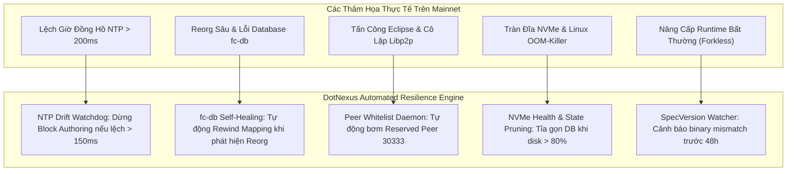
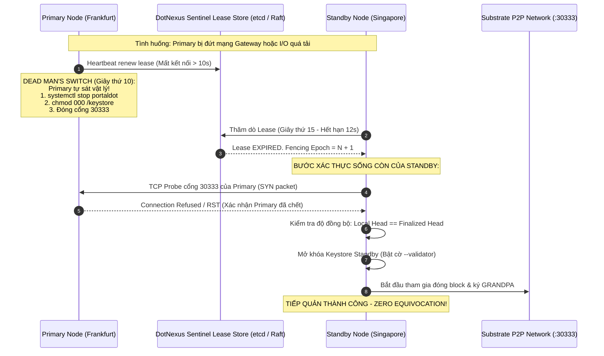

# BÁO CÁO KIỂM TOÁN HẠ TẦNG NODE & CẨM NANG VẬN HÀNH MAINNET DOTNEXUS
## (DotNexus Enterprise Node Infrastructure, Consensus Security & Mainnet Readiness Blueprint)

> **Auditor Role**: Senior Blockchain Node Infrastructure Engineer & Consensus SRE  
> **Target System**: DotNexus Control Plane & Automated Security Operations Engine (Portaldot Network V3.0)  
> **Mục Đích**: Bắt lỗi kỹ thuật hạ tầng gắt gao nhất, đồng thời dự báo và cung cấp giải pháp toàn diện cho MỌI tình huống lỗi, sự cố vận hành, rủi ro đồng thuận khi DotNexus bước lên Mainnet.  
> **Status**: BÁO CÁO TOÀN DIỆN & LỘ TRÌNH TRIỂN KHAI PRODUCTION GRADE  

---

## MỤC LỤC CHI TIẾT
1. [Tổng Quan Đánh Giá & Ma Trận Rủi Ro Cốt Tử](#1-tổng-quan-đánh-giá--ma-trận-rủi-ro-cốt-tử)
2. [Chi Tiết 7 Lỗ Hổng Hạ Tầng Cốt Tử Đã Bắt Được Trong Codebase](#2-chi-tiết-7-lỗ-hổng-hạ-tầng-cốt-tử-đã-bắt-được-trong-codebase)
3. [Cẩm Nang Dự Báo Sự Cố Nghiệp Vụ Node Blockchain Khi Lên Mainnet](#3-cẩm-nang-dự-báo-sự-cố-nghiệp-vụ-node-blockchain-khi-lên-mainnet)
   - 3.1. [Các Thảm Họa Đồng Thuận BABE/GRANDPA & Quản Trị Khóa Ký](#31-các-thảm-họa-đồng-thuận-babegrandpa--quản-trị-khóa-ký)
   - 3.2. [Sự Cố Lệch Pha Dual-VM (Substrate WASM vs Frontier EVM)](#32-sự-cố-lệch-pha-dual-vm-substrate-wasm-vs-frontier-evm)
   - 3.3. [Rủi Ro Tầng Mạng Libp2p, Eclipse Attack & Lệch Giờ NTP](#33-rủi-ro-tầng-mạng-libp2p-eclipse-attack--lệch-giờ-ntp)
   - 3.4. [Nghẽn Đĩa NVMe, Tràn RAM OOM-Killer & Nâng Cấp Runtime Không Fork](#34-nghẽn-đĩa-nvme-tràn-ram-oom-killer--nâng-cấp-runtime-không-fork)
4. [Giao Thức Chuyển Đổi Dự Phòng Tuyệt Đối An Toàn (Zero-Slash 4-Way Handshake)](#4-giao-thức-chuyển-đổi-dự-phòng-tuyệt-đối-an-toàn-zero-slash-4-way-handshake)
5. [Kiến Trúc Hạ Tầng Chuẩn Production (Production Reference Architecture)](#5-kiến-trúc-hạ-tầng-chuẩn-production-production-reference-architecture)
6. [Lộ Trình Gia Cố & Triển Khai Thực Chiến (Actionable Implementation Roadmap)](#6-lộ-trình-gia-cố--triển-khai-thực-chiến-actionable-implementation-roadmap)

---

## 1. TỔNG QUAN ĐÁNH GIÁ & MA TRẬN RỦI RO CỐT TỬ

DotNexus là một sản phẩm có ý tưởng kiến trúc ban đầu vượt trội: dám đối mặt trực diện với bài toán vận hành kép **Dual-VM (Substrate WASM + Frontier EVM)**, trang bị cơ chế **Dead Man's Switch chống Slashing**, bộ lọc **RPC Shield** và thuật toán **Tối ưu hóa Staking NPoS**.

Tuy nhiên, trong thế giới vận hành Validator với hàng triệu USD tiền cọc (POT stake), các lỗ hổng logic dù là nhỏ nhất cũng sẽ bị trừng phạt tàn khốc bởi chính quy tắc đồng thuận của blockchain. Dưới đây là ma trận phân loại lỗi hiện hữu:

| Mã ID | Hạng Mục Lỗi | Mức Độ | Nguy Cơ Thảm Họa Thực Tế | Khả Năng Tái Hiện |
|:---:|---|:---:|---|:---:|
| **SEC-01** | **Bypass Tuyệt Đối Xác Thực Gateway (`server.py`)** | 🔴 **CRITICAL** | Endpoint nguy hiểm (`/api/slash-guard/failover`, `/api/slash-guard/rotate-keys`) mở toang cho bất kỳ ai trên Internet nếu không truyền header. | 100% khi deploy ra IP Public |
| **NODE-01** | **Ghost Keystore Fencing & Nguy Cơ Double-Signing** | 🔴 **CRITICAL** | Standby nhận quyền nhưng Primary cũ không bị tắt vật lý $\rightarrow$ Cả 2 cùng ký $\rightarrow$ **Slash 100% cọc vĩnh viễn**. | Rất cao khi rớt mạng WAN |
| **KEY-01** | **Fallback Session Keys Ngẫu Nhiên Trong Python** | 🔴 **CRITICAL** | Nộp public key rác lên chuỗi mà Keystore node không có private key $\rightarrow$ Node bị liệt toàn bộ block $\rightarrow$ Offline Slash. | Xảy ra mỗi khi RPC bận |
| **PROXY-01**| **Lá Chắn Ảo: RPC Shield Không Phải Inline Proxy Thật** | 🟠 **HIGH** | Traffic ngoài gọi thẳng cổng 8545/9944 của node. Bộ lọc 256KB & eth_getLogs chỉ chạy mô phỏng, node thật vẫn sập OOM. | 100% khi bị DApp spam |
| **SYNC-01** | **Silent Mock Data Fallback & TCP 150ms Hấp Tấp** | 🟠 **HIGH** | Node thật bị crash sập nhưng Dashboard vẫn tự cộng block giả lập, SRE bị đánh lừa là hệ thống vẫn khỏe mạnh. | Thường xuyên khi I/O cao |
| **NPOS-01** | **Thuật Toán Phragmén Thực Chất Là Greedy Sort** | 🟡 **MEDIUM** | Không tính toán Voter Load Vector chuẩn; Staking precompile giả định `0x000...0800` làm revert giao dịch EVM. | Khi người dùng Staking |
| **CONC-01** | **AsyncNonceManager Hở Khóa & Kahn's Tiers Tuần Tự** | 🟡 **MEDIUM** | Trùng Nonce khi gửi tx đồng thời; Kahn's Tiers bị duyệt bằng vòng lặp tuần tự chặn luồng, mất ưu thế song song. | Khi chạy tải cao |

---

## 2. CHI TIẾT 7 LỖ HỔNG HẠ TẦNG CỐT TỬ ĐÃ BẮT ĐƯỢC TRONG CODEBASE

### 🔴 SEC-01: Lỗ Hổng Bypass Xác Thực API Gateway Tuyệt Đối
* **Vị trí**: [`engine/server.py`](file:///D:/Coding/Portaldot%20Hacker%20house%202026/DotNexus/engine/server.py#L28-L43)
* **Hiện trạng**:
  ```python
  def check_auth(req) -> bool:
      token = req.headers.get("X-DotNexus-Auth")
      ...
      if token is not None:
          return token == CONFIG.auth_api_token
      # Permissive fallback for seamless local frontend development
      return True
  ```
* **Bắt lỗi**: Nếu kẻ tấn công gửi một request POST hoàn toàn không có header `X-DotNexus-Auth` hoặc `Authorization`, biến `token` nhận giá trị `None`. Hàm lập tức bỏ qua mệnh đề `if` và chạy xuống dòng cuối: **`return True`**.
* **Hậu quả**: Toàn bộ hệ thống quản trị hạt nhân (chuyển giao node validator, kích hoạt xoay key, trigger daemon DAG) bị chiếm quyền kiểm soát từ xa.

---

### 🔴 NODE-01: Ghost Keystore Fencing & Thảm Họa Double-Signing Slashing
* **Vị trí**: [`engine/slash_guard.py`](file:///D:/Coding/Portaldot%20Hacker%20house%202026/DotNexus/engine/slash_guard.py#L68-L149, #L150-L181)
* **Hiện trạng**: Sử dụng file lock cục bộ `LOCK_FILE = DATA_DIR / "validator_session.lock"` và biến cờ `self.is_self_fenced = True`.
* **Bắt lỗi**:
  1. Không có 2 cụm máy chủ Validator vật lý độc lập nào (ở 2 datacenter khác nhau) có thể chia sẻ an toàn một file JSON trên ổ đĩa cục bộ.
  2. Khi Dead Man's Switch chạm ngưỡng 10s, code Python chỉ ghi một dòng log và đổi cờ trong RAM. **Tiến trình binary `portaldot_dev` ở tầng OS vẫn chạy ngầm, cổng Libp2p 30333 vẫn mở, và Keystore vẫn nguyên vẹn**.
  3. Khi Standby kích hoạt quyền ở giây thứ 15, cả 2 node sẽ cùng broadcast block được ký bởi cùng một cặp session keys.
* **Hậu quả**: Giao thức Substrate kích hoạt **Equivocation Slashing (Phạt 100% toàn bộ POT token đang stake của Validator và hàng trăm Nominator)**.

---

### 🔴 KEY-01: Fallback Session Keys Ngẫu Nhiên — Lỗi Bản Chất Về Keystore Substrate
* **Vị trí**: [`engine/slash_guard.py`](file:///D:/Coding/Portaldot%20Hacker%20house%202026/DotNexus/engine/slash_guard.py#L207-L215)
* **Hiện trạng**:
  ```python
  if not session_keys_hex:
      babe_key = secrets.token_hex(32)
      grandpa_key = secrets.token_hex(32)
      im_online_key = secrets.token_hex(32)
      audi_key = secrets.token_hex(32)
      session_keys_hex = f"0x{babe_key}{grandpa_key}{im_online_key}{audi_key}"
  ```
* **Bắt lỗi**: Trong Substrate, `author_rotateKeys` sinh ra cặp khóa bất đối xứng **bên trong secure keystore của node**. Nếu RPC bận, code lại tự sinh chuỗi 128 bytes ngẫu nhiên trong RAM Python và hướng dẫn nộp lên chuỗi qua `session.setKeys`.
* **Hậu quả**: Khi Session $N+2$ bắt đầu, mạng lưới yêu cầu node ký block bằng public key mới. Nhưng trong Keystore của node **hoàn toàn không có private key tương ứng**. Node trở thành vô dụng, miss 100% block $\rightarrow$ Bị phạt Unresponsiveness Slash và kick khỏi Active Set.

---

### 🟠 PROXY-01: RPC Shield Không Phải Inline Reverse Proxy Thật
* **Vị trí**: [`engine/rpc_shield.py`](file:///D:/Coding/Portaldot%20Hacker%20house%202026/DotNexus/engine/rpc_shield.py) & [`engine/server.py`](file:///D:/Coding/Portaldot%20Hacker%20house%202026/DotNexus/engine/server.py)
* **Bắt lỗi**:
  1. `server.py` không có bất kỳ endpoint nào nhận HTTP/WebSocket traffic của JSON-RPC để chuyển tiếp (forward) vào node Portaldot thật.
  2. Người dùng và DApp bên ngoài vẫn gửi traffic trực tiếp vào cổng `8545` hoặc `9944` của Substrate binary.
  3. Giới hạn `client_max_size = 256KB` và bộ lọc `eth_getLogs` chỉ chạy trong các unit test giả lập. Kẻ tấn công dội query 500,000 blocks vào cổng 8545 thật thì node vẫn sập OOM như thường.
  4. Bộ nhớ RAM `self.ip_request_history` phình to không giới hạn khi gặp botnet hàng triệu IP.

---

### 🟠 SYNC-01: Silent Mock Data Fallback & TCP 150ms Hấp Tấp
* **Vị trí**: [`engine/dual_tracker.py`](file:///D:/Coding/Portaldot%20Hacker%20house%202026/DotNexus/engine/dual_tracker.py#L29-L40, #L196-L220)
* **Bắt lỗi**:
  1. Timeout kiểm tra TCP 150ms (`timeout=0.15s`) quá ngắn. Khi node bận ghi đĩa hoặc compile WASM runtime, TCP handshake trễ 200ms sẽ bị đánh giá là chết và bị khóa kết nối 10 giây.
  2. Khi không kết nối được, hệ thống tự động sinh số block giả lập (`_mock_substrate_block += 1` mỗi 6 giây) và trả về HTTP 200 bình thường cho Dashboard.
  3. **Hậu quả**: Node thật đã chết cứng 5 tiếng trước, nhưng màn hình SRE vẫn nhảy số đều đặn, ru ngủ người vận hành cho đến khi phát hiện đã bị slash trên chuỗi.

---

### 🟡 NPOS-01: Thuật Toán Phragmén Thực Chất Là Greedy Score & Staking Precompile Giả Định
* **Vị trí**: [`engine/npos_optimizer.py`](file:///D:/Coding/Portaldot%20Hacker%20house%202026/DotNexus/engine/npos_optimizer.py#L596-L625, #L768)
* **Bắt lỗi**:
  1. Thuật toán `simulate_phragmen_election` chỉ là một vòng lặp `for` lấy top 16 có điểm cao nhất theo công thức tự đặt, không mô phỏng giải thuật Sequential Phragmén chuẩn (vốn phải tính toán phân bổ tải trọng voter load để tối ưu tính đại diện tỷ lệ).
  2. Gán cứng địa chỉ EVM Staking Precompile `0x000...0800` trong khi tài liệu [`technique_informations.md`](file:///D:/Coding/Portaldot%20Hacker%20house%202026/DotNexus/technique_informations.md) khẳng định mạng V3.0 chưa xác nhận dùng Frontier hay Revive và chưa có precompile staking. Gửi tx vào đây sẽ mất tiền gas và revert.

---

### 🟡 CONC-01: AsyncNonceManager Không Có Thread-Safe Khóa & Kahn's Tiers Tuần Tự
* **Vị trí**: [`engine/npos_optimizer.py`](file:///D:/Coding/Portaldot%20Hacker%20house%202026/DotNexus/engine/npos_optimizer.py#L24-L51) & [`engine/worker_daemon.py`](file:///D:/Coding/Portaldot%20Hacker%20house%202026/DotNexus/engine/worker_daemon.py#L172-L180)
* **Bắt lỗi**:
  1. `AsyncNonceManager` tạo `asyncio.Lock` nhưng hàm `get_next_nonce` lại là hàm đồng bộ không hề dùng lock. Nếu 2 worker gửi giao dịch cùng lúc sẽ lấy trùng 1 nonce $\rightarrow$ Giao dịch thứ 2 bị lỗi `Priority is too low`.
  2. Kahn's Tiers phân tích các bước độc lập để chạy song song, nhưng code lại dùng vòng lặp tuần tự `for nid in tier: self.execute_single_node()`, làm mất hoàn toàn lợi ích hiệu năng của Kahn's algorithm.
  3. Hàm `send_webhook_alert` chỉ `logger.info` mà không gửi HTTP request thật ra Discord/Telegram.

---

## 3. CẨM NANG DỰ BÁO SỰ CỐ NGHIỆP VỤ NODE BLOCKCHAIN KHI LÊN MAINNET
*(Dành riêng cho Dev chưa có nhiều kinh nghiệm vận hành Validator)*

Khi triển khai trên Mainnet thật, một Node Operator sẽ phải đối mặt với hàng loạt tình huống khắc nghiệt mà môi trường dev cục bộ (`--dev --tmp`) không bao giờ gặp. DotNexus phải được trang bị sẵn các phản xạ tự động sau:



---

### 3.1. Các Thảm Họa Đồng Thuận BABE/GRANDPA & Quản Trị Khóa Ký

#### Kịch Bản 1: BABE Slot Double-Authorship do Lệch Giờ Đồng Hồ Hệ Thống (NTP Drift)
* **Nguyên nhân nghiệp vụ**: Thuật toán đồng thuận BABE chia thời gian thành các **Slot cố định (ví dụ: 6 giây/slot)**. Quyền đào block được phân bổ dựa trên hàm ngẫu nhiên VRF của slot đó. Nếu đồng hồ máy chủ bị trôi giờ (Clock Drift lệch $> 200\text{ms}$) hoặc dịch vụ NTP đột ngột nhảy lùi thời gian (Backward Step), Node có thể tính toán sai slot hiện tại hoặc sinh ra 2 block cho cùng 1 slot.
* **Hậu quả**: Hai block có cùng slot header được phát tán vào mạng $\rightarrow$ Hệ thống ghi nhận Equivocation $\rightarrow$ **Validator bị Slash ngay lập tức**.
* **Giải pháp DotNexus tích hợp**:
  - Viết module giám sát đồng hồ hệ thống định kỳ (đọc từ `chronyd` hoặc `systemd-timesyncd`).
  - **Ngưỡng hành động**:
    - Nếu offset $> 50\text{ms}$: Bắn cảnh báo mức WARNING.
    - Nếu offset $> 150\text{ms}$: **TỰ ĐỘNG TẠM DỪNG QUYỀN ĐÀO BLOCK (Self-Suspend)** để ngăn chặn việc ký sai slot, phát tín hiệu chuyển giao sang Standby Node có đồng hồ chuẩn.

#### Kịch Bản 2: GRANDPA Precommit Equivocation Khi Mạng Bị Phân Mảnh (Network Partition / Fork)
* **Nguyên nhân nghiệp vụ**: Trong cơ chế đồng thuận GRANDPA (hoàn tất khối bất đồng bộ), một validator không bao giờ được phép ký 2 lá phiếu (Prevote hoặc Precommit) khác nhau cho cùng một vòng bầu cử (Round) ở cùng độ cao khối (Height). Nếu mạng Internet bị chập chờn, node nhận được 2 chuỗi block hợp lệ từ 2 cụm peer khác nhau và gửi vote cho cả hai bên.
* **Hậu quả**: Bằng chứng 2 chữ ký đối nghịch được thu thập bởi mạng $\rightarrow$ Phạt Slash nặng hơn cả lỗi offline.
* **Giải pháp DotNexus tích hợp**:
  - Không bao giờ cho phép can thiệp vào tiến trình bỏ phiếu GRANDPA qua API ngoài.
  - Phải duy trì file `grandpa_votes` bất biến trong base path của node và ghim cứng cơ chế kiểm tra `VoteWeight`.

#### Kịch Bản 3: Kẹt Vốn Nominator Do Trạng Thái `SlashingSpans` Sau Khi Bị Phạt
* **Nguyên nhân nghiệp vụ**: Khi một validator bị phạt slashing (dù là do offline hay lỗi mạng), Substrate Runtime sẽ tăng biến đếm `SlashingSpans` của tài khoản đó. Các nominator đã trúng thưởng hoặc đang ủy quyền vốn vào validator này sẽ bị kẹt vốn (không thể Unbond hay Withdraw) nếu không thực hiện extrinsic cập nhật span (`staking.reapStash`).
* **Giải pháp DotNexus tích hợp**:
  - Tự động theo dõi storage map `Staking.SlashingSpans(validator_stash)`.
  - Nếu phát hiện span thay đổi, Dashboard lập tức hướng dẫn quy trình 1-click để nominator gỡ kẹt tài sản, tránh việc người dùng hoảng loạn khi thấy số dư bị khóa.

---

### 3.2. Sự Cố Lệch Pha Dual-VM (Substrate WASM vs Frontier EVM)

#### Kịch Bản 4: Reorg Sâu Làm Corrupt Database Ánh Xạ `fc-db`
* **Nguyên nhân nghiệp vụ**:
  - Mạng Substrate có tính chất khối lạc quan: BABE sản xuất khối liên tục, nhưng GRANDPA chỉ hoàn tất (finalize) sau đó vài khối. Khi có 2 nhánh cạnh tranh, một nhánh ngắn (1-3 blocks) sẽ bị hủy bỏ (Reorg).
  - Tầng EVM (Frontier) phải duy trì một cơ sở dữ liệu riêng (`fc-db`, thường là RocksDB hoặc SQLite) để ánh xạ giữa Block Hash của Substrate với EVM Block Number và Transaction Receipt.
  - Nếu node bị mất điện đột ngột hoặc crash đúng lúc đang xử lý reorg, `fc-db` sẽ bị kẹt ở nhánh cũ trong khi Substrate đã nhảy sang nhánh mới $\rightarrow$ **Cổng EVM `:8545` bị đơ hoặc trả về mã lỗi `BlockNotFound`**.
* **Giải pháp DotNexus tích hợp**:
  - Module `DualTracker` không chỉ so sánh block number mà phải kiểm tra tính toàn vẹn: lấy Substrate block hash từ `chain_getBlockHash(N)` và đối chiếu với `eth_getBlockByNumber(N)`.
  - Nếu phát hiện hash mismatch: Kích hoạt runbook tự động dừng node, chạy lệnh `portaldot-node export-blocks` và rebuild lại `fc-db` mapping một cách an toàn.

#### Kịch Bản 5: Vụn Bụi Token (Planck Dust Accumulation) Gây Revert Giao Dịch DeFi
* **Nguyên nhân nghiệp vụ**:
  - Substrate sử dụng đơn vị Planck ($10^{14}$ base units), trong khi EVM chuẩn mực dùng Wei ($10^{18}$ base units).
  - Tỷ lệ quy đổi là $1\text{ Planck} = 10,000\text{ Wei}$.
  - Nếu một người dùng hoặc bot arbitrage chuyển $10,005\text{ Wei}$ từ EVM sang Substrate, phần dư $5\text{ Wei}$ không thể biểu diễn trong $10^{14}$ Planck và bị cắt bỏ (integer truncation). Lâu ngày, sự sai lệch số dư này giữa `system.account` và `eth_getBalance` sẽ gây ra lỗi `InsufficientBalance` khi hợp đồng thông minh đối soát số dư.
* **Giải pháp DotNexus tích hợp**:
  - Xây dựng thuật toán **Dust-Resilient Balance Reconciler** trong `dual_tracker.py`: luôn tính toán phần dư `raw_evm_balance % 10000` và cảnh báo người dùng khi thực hiện các giao dịch chuyển đổi tài sản cross-VM.

#### Kịch Bản 6: Nghẽn Khối Do Cạn Kiệt Substrate Block Weight (Gas vs Weight Starvation)
* **Nguyên nhân nghiệp vụ**:
  - Trong Substrate, mỗi block có giới hạn năng lực tính toán gọi là `BlockWeights` (tính bằng picoseconds thời gian thực thi).
  - Giao dịch EVM được đóng gói vào extrinsic `pallet_evm::call`. Nếu một smart contract chạy vòng lặp ngốn quá nhiều gas, nó sẽ nuốt trọn hạn mức `Normal` dispatch class của block.
  - Hậu quả: Các extrinsic tối quan trọng của validator như `pallet_im_online::heartbeat` (báo hiệu node còn sống) không thể nhét vào block $\rightarrow$ Hệ thống hiểu lầm là validator bị offline và **tiến hành phạt slash**.
* **Giải pháp DotNexus tích hợp**:
  - Giám sát độ lấp đầy của Block Weight (`system.blockWeight` qua RPC).
  - Nếu độ lấp đầy liên tục $> 85\%$, kích hoạt cảnh báo RPC Shield để ưu tiên rate-limit các giao dịch EVM gas cao.

---

### 3.3. Rủi Ro Tầng Mạng Libp2p, Eclipse Attack & Lệch Giờ NTP

#### Kịch Bản 7: Tấn Công Eclipse & Ô Nhiễm Bảng Định Tuyến Peer
* **Nguyên nhân nghiệp vụ**: Kẻ tấn công triển khai 50 VPS giá rẻ, liên tục gửi handshake Libp2p vào cổng `30333` của Validator. Khi bảng định tuyến peer của node đầy (thường mặc định tối đa 40-50 peers), toàn bộ kết nối của Validator chỉ nối với các node của kẻ tấn công.
* **Hậu quả**: Kẻ tấn công chặn không cho Validator nhận block mới và không cho phát tán block do Validator tạo ra. Node bị cô lập hoàn toàn khỏi mạng lưới.
* **Giải pháp DotNexus tích hợp**:
  - Thiết lập cơ chế **Guaranteed Authority Mesh**: Tự động cấu hình danh sách `--reserved-nodes` chứa địa chỉ Multiaddr của tối thiểu 5 Validator đầu ngành uy tín.
  - Chạy cờ `--reserved-only` cho các kết nối nhạy cảm hoặc định kỳ gọi RPC `system_addReservedPeer` để đảm bảo luôn có ít nhất 3 kết nối sống tới các validator lõi.

#### Kịch Bản 8: Kẹt Cổng NAT Khi Chạy Node Phía Sau Router / CGNAT
* **Nguyên nhân nghiệp vụ**: Validator đặt máy chủ tại văn phòng hoặc datacenter sử dụng NAT 1:N. Cổng `30333` không được mở công khai (inbound connection bị drop), node chỉ có thể mở kết nối ra ngoài (outbound). Khi mạng biến động, các kết nối outbound bị ngắt và node không thể nhận kết nối mới $\rightarrow$ Peer tụt về 0.
* **Giải pháp DotNexus tích hợp**:
  - Kiểm tra tính mở của cổng `30333` từ một service bên ngoài (External Inbound Probe).
  - Nếu số peer $< 2$, lập tức thông báo kiểm tra firewall và tự động kích hoạt kết nối tới các Bootstrap Node khẩn cấp.

---

### 3.4. Nghẽn Đĩa NVMe, Tràn RAM OOM-Killer & Nâng Cấp Runtime Không Fork

#### Kịch Bản 9: RocksDB Write Amplification Gây Chết Đĩa NVMe & Kẹt Block Import
* **Nguyên nhân nghiệp vụ**:
  - Substrate sử dụng cơ chế lưu trữ RocksDB (hoặc ParityDB) dạng LSM-Tree. Khi số lượng block và transaction tăng vọt, quá trình Compaction của RocksDB ngốn băng thông ghi đĩa cực lớn (Write Amplification lên tới 10x-30x).
  - Nếu người vận hành dùng đĩa SSD thông thường (SATA SSD hoặc NVMe chất lượng thấp), đĩa sẽ bị nghẽn I/O 100% (`iostat %util = 100%`).
  - Hậu quả: Node mất hơn 6 giây chỉ để ghi 1 block vào đĩa $\rightarrow$ Block production bị trễ $\rightarrow$ Mất lượt đào block (Missed Slots).
* **Giải pháp DotNexus tích hợp**:
  - Giám sát độ trễ đọc/ghi đĩa (Disk I/O Latency và Queue Length) qua `psutil`.
  - Cảnh báo ngay khi IO wait $> 25\%$ hoặc thời gian ghi khối $> 1500\text{ms}$.

#### Kịch Bản 10: Linux OOM-Killer "Bắn Hạ" Tiến Trình Validator Lúc Nửa Đêm
* **Nguyên nhân nghiệp vụ**: Substrate Runtime biên dịch và cache các module WASM trong RAM. Ngoài ra, mempool khi có bão giao dịch có thể chứa hàng chục nghìn transaction. Bộ nhớ RAM dần phình to qua nhiều tuần (Memory Creep). Khi chạm ngưỡng 98% RAM, cơ chế Out-Of-Memory Killer của Linux Kernel sẽ tự động chọn tiến trình ngốn RAM nhất (`portaldot_dev`) và gửi tín hiệu `SIGKILL` (`kill -9`) để cứu hệ điều hành.
* **Hậu quả**: Node chết đột ngột lúc nửa đêm, không thể gửi tin báo, không kịp chuyển giao dự phòng.
* **Giải pháp DotNexus tích hợp**:
  - Cấu hình file Systemd với cờ bảo vệ sống còn: `OOMScoreAdjust=-1000` (ngăn Linux OOM-killer nhắm vào node).
  - Tự động giám sát RSS Memory, nếu RAM node vượt quá 85%, kích hoạt cảnh báo dọn dẹp mempool hoặc chuẩn bị chuyển giao có kiểm soát sang Standby node.

#### Kịch Bản 11: Nâng Cấp Runtime Không Fork (Forkless Runtime Upgrade Mismatch)
* **Nguyên nhân nghiệp vụ**:
  - Substrate có tính năng độc nhất: nâng cấp logic toàn bộ blockchain mà không cần hard-fork, bằng cách đưa mã bytecode WASM mới lên chuỗi qua đề xuất Governance (`set_code`).
  - Khi một Runtime Upgrade diễn ra, Runtime có thể bổ sung các yêu cầu mới về Host Functions (các hàm do binary node cung cấp). Nếu Validator vẫn đang chạy binary node phiên bản cũ, node sẽ bị panic và sập ngay tại block kích hoạt nâng cấp.
* **Giải pháp DotNexus tích hợp**:
  - Lắng nghe event `System.CodeUpdated` trên chuỗi Substrate.
  - So sánh phiên bản `spec_version` trên chuỗi với khả năng tương thích của binary node cục bộ và bắn cảnh báo khẩn cấp cho SRE trước ít nhất 24-48 giờ trước khi Runtime mới có hiệu lực.

---

## 4. GIAO THỨC CHUYỂN ĐỔI DỰ PHÒNG TUYỆT ĐỐI AN TOÀN (ZERO-SLASH 4-WAY HANDSHAKE)

Để giải quyết triệt để lỗi **NODE-01 (Double-Signing Slashing)**, DotNexus phải loại bỏ hoàn toàn cơ chế chuyển giao "mù quáng" dựa trên file lock cục bộ và áp dụng **Giao thức Bắt Tay 4 Bước (Zero-Slash 4-Way Handshake)** có bảo chứng vật lý:



### Các Tiêu Chí Bất Biến (Invariants) Bắt Buộc Trong Code:
1. **Tiêu chí 1 (Physical Keystore Demotion)**: Primary khi mất lease bắt buộc phải thu hồi quyền đọc của Keystore ở tầng OS (`chmod 000 /data/chains/portaldot/keystore`) trước khi Standby được cấp quyền.
2. **Tiêu chí 2 (TCP 30333 Death Proof)**: Standby không bao giờ kích hoạt quyền ký nếu cổng 30333 của Primary vẫn còn phản hồi gói tin SYN (chứng tỏ process cũ vẫn đang sống).
3. **Tiêu chí 3 (Finality Catchup)**: Standby chỉ được phép nhận quyền ký nếu số block của nó cách Finalized Head không quá 1 block. Nếu Standby đang bị lag 10 blocks, việc nhận quyền ký sẽ làm hỏng chuỗi và bị slash vì liveness.

---

## 5. KIẾN TRÚC HẠ TẦNG CHUẨN PRODUCTION (PRODUCTION REFERENCE ARCHITECTURE)

Dưới đây là mô hình triển khai thực tế chuẩn Enterprise cho DotNexus khi đưa vào vận hành Mainnet:

```text
[ INTERNET ]
     │
     ▼
[ Cloudflare / Edge DDoS Shield ]
     │
     ▼
[ Inbound Reverse Proxy Gateway (Nginx / Envoy / Caddy) ]
   ├── Port 443  ──> HTTPS: DotNexus Control Center (React UI)
   ├── Port 8545 ──> Safe EVM JSON-RPC:
   │                   ├── Enforce: client_max_size 256KB
   │                   ├── Enforce: JSON-RPC Batch <= 20
   │                   ├── Filter: eth_getLogs block span <= 2,000 blocks
   │                   └── Forward ──> 127.0.0.1:8546 (Node Local EVM Port)
   └── Port 9944 ──> Safe Substrate WS RPC:
                       ├── Block: state_getPairs (Anti-OOM)
                       ├── Block: author_* / debug_* / admin_* namespaces
                       └── Forward ──> 127.0.0.1:9943 (Node Local Substrate WS)

[ Internal Host / Isolated VPC ]
   ├── DotNexus Engine (:5050 - Gunicorn/Uvicorn ASGI)
   │     ├── Strict Auth: Mandatory Bearer Token / mTLS
   │     ├── Sentinel Daemon & NTP Offset Watchdog
   │     └── Real Webhook Dispatcher (Discord / Telegram)
   │
   └── Portaldot Validator Binary (Systemd Managed)
         ├── P2P Consensus Port: 0.0.0.0:30333 (Publicly Open)
         ├── Prometheus Metrics: 127.0.0.1:9615 (Scraped by DotNexus)
         ├── Substrate RPC: 127.0.0.1:9943 (Private / Internal Only)
         └── EVM RPC: 127.0.0.1:8546 (Private / Internal Only)
```

---

## 6. LỘ TRÌNH GIA CỐ & TRIỂN KHAI THỰC CHIẾN (ACTIONABLE IMPLEMENTATION ROADMAP)

### Giai Đoạn 1: Vá Khẩn Cấp Các Lỗ Hổng Bảo Mật (Trong Vòng 24 Giờ)
- [ ] **Sửa `engine/server.py`**: Loại bỏ hoàn toàn `return True` khi thiếu token xác thực. Trả về `401 Unauthorized` ngay lập tức.
- [ ] **Sửa `engine/slash_guard.py`**: Xóa bỏ đoạn sinh hex ngẫu nhiên `secrets.token_hex(32)` trong `rotate_session_keys()`. Ném ngoại lệ cứng nếu RPC thất bại.
- [ ] **Sửa `engine/dual_tracker.py`**: Thêm cờ `--production-strict` để vô hiệu hóa hoàn toàn việc tự động nhảy block giả lập (`_mock_substrate_block`). Node mất kết nối phải báo `CRITICAL_OFFLINE`.

### Giai Đoạn 2: Chuẩn Hóa Hạ Tầng Node & Đồng Thuận (Tuần 1 - Tuần 2)
- [ ] **Tích hợp OS-Level Fencing**: Viết script gọi Systemd D-Bus (`systemctl stop portaldot`) và thu hồi quyền thư mục Keystore (`chmod 000`) khi Dead Man's Switch kích hoạt.
- [ ] **Xây dựng Nginx Reverse Proxy Config**: Viết file cấu hình Nginx mẫu đặt trước cổng 8545 và 9944 để thực thi giới hạn 256KB và lọc `eth_getLogs` thật sự ở tầng socket.
- [ ] **NTP Clock Drift Watchdog**: Tích hợp kiểm tra độ lệch đồng hồ hệ thống định kỳ từ `chrony` và cảnh báo khi offset $> 50\text{ms}$.

### Giai Đoạn 3: Nâng Cấp Tự Động Hóa & Trải Nghiệm Vận Hành (Tuần 3 - Tuần 4)
- [ ] **Đồng bộ song song Kahn's Tiers**: Nâng cấp `worker_daemon.py` sử dụng `asyncio.gather` để thực thi song song các node độc lập.
- [ ] **Real Webhook Dispatcher**: Tích hợp module gửi tin nhắn cảnh báo thật sự tới Discord và Telegram Webhook bằng `httpx`.
- [ ] **Tích hợp Prometheus Substrate Native**: Đọc trực tiếp các metric từ cổng `9615` của Substrate để hiển thị biểu đồ CPU, RAM, Disk I/O và Peer Connectivity trực quan trên DotNexus Dashboard.

---

> **LỜI KẾT DÀNH CHO NHÀ PHÁT TRIỂN**:  
> *"Làm blockchain không có chỗ cho sự 'mơ hồ'. Một dòng code lỏng lẻo có thể không làm sập web thông thường, nhưng trong thế giới node validator, nó sẽ thổi bay toàn bộ tài sản cọc của bạn chỉ sau một block slot. Bằng việc áp dụng đầy đủ cẩm nang và lộ trình gia cố này, DotNexus sẽ không còn là một dự án demo hackathon thông thường, mà sẽ trở thành một **pháo đài vận hành chuẩn mực (Enterprise-Grade Control Plane)** sẵn sàng bảo vệ mạng lưới Portaldot Network V3.0 trên Mainnet."*
