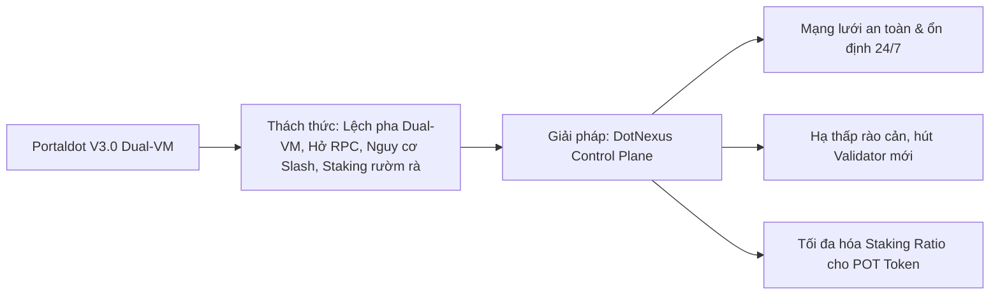
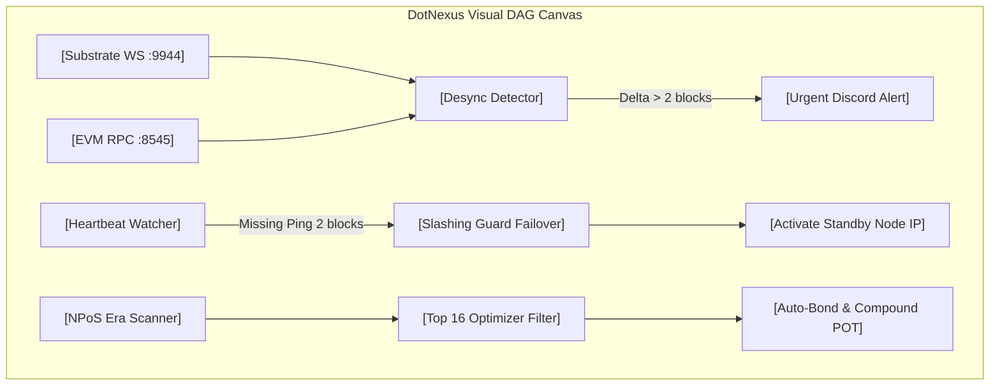
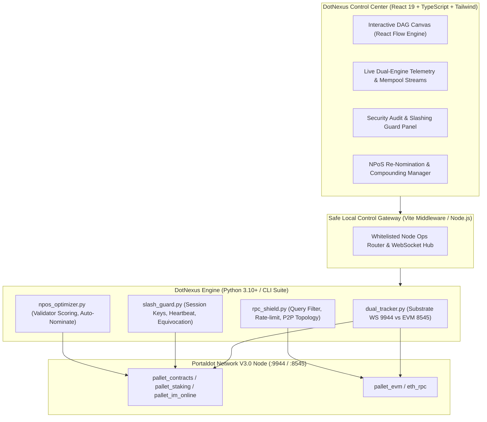

# DotNexus — Project Blueprint & Technical Specification

> **Project Name:** DotNexus  
> **Tagline:** The Visual Control Plane & Automated Security Operations Engine for Portaldot Network V3.0  
> **Track:** Node Operations & Tooling — Portaldot Hacker House 2026  
> **Target Ecosystem:** Portaldot Network V3.0 (Substrate WASM + EVM Dual-VM, NPoS Consensus, POT Token)  
> **Competition Window:** Oct 14 – Nov 6, 2026 (Check-in: Oct 24, Final: Nov 6)  
> **Platform:** DoraHacks & Portaldot Discord  

---

## 1. Executive Summary & Brand Positioning

### 1.1. Tuyên Ngôn Dự Án (Mission Statement)
**DotNexus** là trung tâm điều phối trực quan (Visual Control Plane) và bộ công cụ vận hành tự động hoá (Automated Operations Engine) thế hệ mới, được thiết kế chuyên biệt cho mạng lưới **Portaldot Network V3.0**.

Khác với các công cụ giám sát truyền thống chỉ hiển thị số liệu thụ động (như Grafana/Prometheus), DotNexus kết hợp **Live Dual-VM Telemetry** với **Interactive DAG Automation Canvas (Kéo - Thả trực quan)**. DotNexus cho phép Validator và Node Operator không chỉ "nhìn thấy" trạng thái hệ thống, mà còn "kéo - thả" để thiết lập các kịch bản phản xạ tự động: tự động quét lỗ hổng RPC, cảnh báo nguy cơ bị Slash do downtime, ngăn ngừa Double-signing, và tự động tối ưu hóa tái đầu tư Staking (Auto-compounding).

### 1.2. Giá Trị Sống Còn Cho Ban Tổ Chức (Portaldot Foundation)



---

## 2. Bảng Phân Tích Nỗi Đau Thực Tế (Deep Pain Point Analysis)

Mảng vận hành Node và Staking trong blockchain sở hữu những đặc thù kỹ thuật rất phức tạp mà các công cụ thông thường chưa giải quyết được:

| STT | Nỗi Đau Thực Tế (Pain Point) | Nguy Cơ & Hậu Quả Nghiêm Trọng | "Thuốc Giải" Đột Phá Của DotNexus |
|:---:|---|---|---|
| **1** | **Cơn ác mộng "Slashing" (Bị tịch thu sạch tiền cọc)** | Validator bị mất mạng quá lâu hoặc gặp lỗi **Equivocation (Double-signing)** khi chạy máy chủ dự phòng ➔ **Bị giao thức phạt tịch thu 100% token POT cọc** và đuổi khỏi mạng. | **Automated Key Rotation & Slashing Guard:** Khóa an toàn chống Double-signing, Daemon theo dõi nhịp tim (`pallet_im_online`) tự động tráo IP dự phòng khi mất kết nối 2 block. |
| **2** | **"Màn hình đen Linux & Gõ lệnh thủ công" (Human Error)** | Quản trị viên phải gõ lệnh CLI thủ công dài ngoằng (`curl`, `author_rotateKeys`). Chỉ cần gõ sai 1 ký tự hex hoặc mở nhầm firewall là **hở cổng RPC bảo mật hoặc node không ký được block**. | **Visual DAG Canvas & Web UI:** Biến toàn bộ thao tác gõ lệnh thành giao diện Web trực quan kéo - thả, có cơ chế xác thực an toàn trước khi gửi lệnh. |
| **3** | **Lệch pha máy ảo Dual-VM (WASM vs EVM Desync)** | Portaldot V3.0 chạy song song Substrate WASM và EVM. Khi node nghẽn hoặc lệch block giữa 2 engine, **rất khó phân lập lỗi do Substrate hay do EVM**. | **Dual-Engine State Tracker:** Đo song song Substrate RPC (`:9944`) và EVM RPC (`:8545`), tách luồng mempool WASM/EVM, bật còi báo động khi lệch pha. |
| **4** | **Cổng RPC bị "Dội bom truy vấn" (Spam & Overload)** | Các DApp/Bot gửi truy vấn lịch sử cực nặng (như `eth_getLogs` block range quá rộng) ➔ **Node bị tràn RAM (OOM) và crash sập máy chủ**. | **RPC Rate-Limiting & Anti-Spam Shield:** Bộ lọc phát hiện và chặn request nặng, giới hạn tần suất theo IP, hiển thị bản đồ P2P Topology mạng. |
| **5** | **Người gửi tiền (Staker) bị mất lãi oan** | Validator bị quá tải (Oversubscribed) vượt ngưỡng chia thưởng, hoặc âm thầm tăng phí hoa hồng lên 100% ➔ **Nominator nhận về 0 đồng tiền lãi**. | **NPoS Dynamic Re-Nomination Engine:** Tự động quét tìm top 16 validator uy tín nhất và tự động tái phân bổ vốn để tối đa hóa APY kép. |

---

## 3. Bốn Tính Năng Cốt Lõi Độc Nhất (The 4 Pillars of DotNexus)

Các tính năng này được thiết kế "đo ni đóng giày" cho các đặc thù kỹ thuật của **Portaldot V3.0**:

### 3.1. Đồng bộ và giám sát song song Dual-Engine (WASM vs EVM State Tracker)
* **Vấn đề giải quyết:** Portaldot V3.0 thực thi đồng thời cả hợp đồng ink! (WASM) và Solidity (EVM). Khi node gặp lỗi trạng thái hoặc trễ block, việc phân lập nguyên nhân do Substrate core hay do EVM execution engine rất khó khăn.
* **Tính năng cốt lõi:**
  * Giám sát song song và so sánh độ trễ (latency), gas consumption, và throughput giữa cổng Substrate WebSocket RPC (cổng `9944`) và EVM JSON-RPC (cổng `8545`).
  * Tách luồng mempool thời gian thực: phân loại tỷ lệ giao dịch WASM extrinsics và EVM transactions đang chờ xử lý.
  * Tự động cảnh báo khi có sự lệch pha (state desync) hoặc tắc nghẽn cục bộ ở một trong hai engine thực thi.

### 3.2. Quản lý Session Keys và xoay vòng khóa tự động (Automated Key Rotation & Slashing Guard)
* **Vấn đề giải quyết:** Validator trong kiến trúc NPoS đối mặt rủi ro bị phạt (slashing) mất POT token nếu lộ key hoặc node offline trong quá trình chuyển giao era/epoch. Thao tác tạo `rotateKeys` thủ công qua RPC tiềm ẩn lỗi thao tác.
* **Tính năng cốt lõi:**
  * Bộ điều phối tự động gọi `author_rotateKeys` theo chu kỳ era định sẵn, tự động ký giao dịch `setKeys` lên chuỗi an toàn.
  * Cơ chế bảo vệ Equivocation (Double-signing guard): Ngăn chặn việc cùng một bộ session keys hoạt động đồng thời trên hai máy chủ dự phòng (failover).
  * Heartbeat daemon độc lập: Tự động kích hoạt node standby và tráo IP khi node chính mất kết nối quá 2 block liên tiếp.

### 3.3. Tự động hóa tái ủy quyền và cân bằng tải Staking (NPoS Dynamic Re-Nomination Engine)
* **Vấn đề giải quyết:** Token POT bị khóa trong staking thường dồn vào các validator top đầu gây tập trung quyền lực, trong khi các validator mới có hiệu năng tốt lại thiếu stake để vào active set. Nominator cũng chịu tổn thất lợi nhuận khi validator bị quá tải hoặc offline.
* **Tính năng cốt lõi:**
  * Thuật toán tự động quét toàn bộ validator active set sau mỗi era, tính điểm sức khỏe dựa trên: tỷ lệ uptime thực tế, hoa hồng (commission), lịch sử slashing, và dung lượng stake còn trống trước ngưỡng over-subscribed.
  * Tự động tái phân bổ lượng POT ủy quyền (re-nominate) sang danh sách 16 validator tối ưu nhất để tối đa hóa APY kép cho người dùng.
  * Tương thích ví kép: Cho phép nominator quản lý ủy quyền thông qua cả địa chỉ EVM chuẩn (MetaMask) lẫn địa chỉ Substrate nguyên bản.

### 3.4. Phát hiện tấn công RPC và bảo vệ Node biên (RPC Rate-Limiting & Anti-Spam Shield)
* **Vấn đề giải quyết:** Khi hệ sinh thái mở rộng với các DApp EVM và WASM, các public RPC node dễ bị quá tải bởi các batch request, brute-force spam hoặc các truy vấn lịch sử nặng (heavy archival queries), làm sập node validator đứng sau.
* **Tính năng cốt lõi:**
  * Bộ lọc phân tích cú pháp request thông minh: Tự động phát hiện và chặn các truy vấn EVM `eth_getLogs` quét block range quá rộng hoặc các call Substrate tốn nhiều compute/DB read.
  * Dynamic rate-limiting dựa trên IP và nguồn gốc request, ưu tiên băng thông cho các peer p2p đồng thuận mạng lưới trước các client truy vấn DApp bên ngoài.
  * Bản đồ topology mạng p2p trực quan: Hiển thị độ trễ, vị trí địa lý của các peer kết nối và cảnh báo các peer có hành vi fork/gửi block sai luật.

---

## 4. Tích Hợp Đột Phá: Visual DAG Canvas (Kéo - Thả Kịch Bản Vận Hành)

Điểm sáng tạo nhất của DotNexus là đưa cả 4 tính năng trên lên **Visual Canvas**, cho phép người dùng xâu chuỗi thành các kịch bản vận hành tự động (Runbooks):



### 4.1. Hệ thống các khối Node trên Canvas:
1. **Infrastructure Nodes:** `[Substrate WS (:9944)]`, `[EVM RPC (:8545)]`, `[Standby Backup Node]`.
2. **Detection & Watcher Nodes:** `[Dual-VM Sync Watcher]`, `[Heartbeat (imOnline) Daemon]`, `[Heavy Query / RPC Spam Filter]`, `[NPoS Era Scanner]`.
3. **Execution & Action Nodes:** `[Automated Key Rotation]`, `[Double-Signing Blocker]`, `[Auto-ReNominate Action]`, `[Telegram/Discord Alert Bot]`.

---

## 5. Bảng Đối Chiếu Giá Trị Cho Hệ Sinh Thái Portaldot V3.0

| Nhóm Tính Năng | Đối Tượng Hưởng Lợi | Giá Trị Trực Tiếp Cho Hệ Sinh Thái |
|---|---|---|
| **Dual-Engine Tracker** | Core devs & Node runners | Giảm 80% thời gian debug lỗi phân nhánh giữa EVM và WASM. |
| **Slashing Guard & Auto-Key** | Validator Operators | 0% rủi ro mất token do lỗi vận hành, tăng tối đa độ ổn định mạng. |
| **Dynamic Re-Nomination** | Nominator & Hệ thống NPoS | Phi tập trung hóa mạng lưới, đưa stake về validator tốt, tăng 15-25% APY. |
| **RPC Shield & Topology** | DApp builders & RPC providers | Ngăn ngừa downtime hạ tầng khi mạng lưới chịu tải giao dịch cao. |
| **Visual DAG Canvas** | Mọi cấp độ người dùng | Hạ thấp rào cản kỹ thuật từ gõ lệnh CLI sang kéo - thả 1-click. |

---

## 6. Kiến Trúc Kỹ Thuật (Architecture & Tech Stack)



---

## 7. Cấu Trúc Thư Mục Dự Án (Folder Layout)

```txt
DotNexus/
├── PROJECT_BLUEPRINT.md            # Bản đặc tả kỹ thuật và kiến trúc toàn diện
├── README.md                       # Tài liệu tổng quan, hướng dẫn khởi chạy nhanh
├── FOR_JUDGES.md                   # Hướng dẫn 60s cho Ban Giám Khảo & Bảng đối soát
├── requirements.txt                # Thư viện Python (substrate-interface, web3, websockets, psutil)
├── engine/                         # Lõi xử lý nghiệp vụ Node Ops & Security (Python)
│   ├── __init__.py
│   ├── config.py                   # Cấu hình RPC endpoints, timeout, ports
│   ├── dual_tracker.py             # Giám sát song song Substrate WS 9944 vs EVM 8545
│   ├── slash_guard.py              # Xoay key, bảo vệ double-signing, theo dõi heartbeat
│   ├── npos_optimizer.py           # Thuật toán lọc top 16 validator, tính điểm, auto-nominate
│   └── rpc_shield.py               # Lọc request nặng (getLogs), rate-limiting, topology P2P
├── front-end/                      # Giao diện Web Control Center (React 19 + Vite + Tailwind)
│   ├── package.json
│   ├── index.html
│   ├── vite.config.ts              # Proxy kết nối an toàn tới engine
│   └── src/
│       ├── App.tsx                 # Navigation & Global State
│       ├── canvas/                 # Logic DAG Canvas kéo thả (React Flow Engine)
│       │   ├── CanvasBoard.tsx
│       │   ├── nodes/              # InfraNode, WatcherNode, ActionNode
│       │   └── runbooks/           # Pre-built runbooks (Slash Guard, Dual-VM Sync, Auto-Staking)
│       ├── views/
│       │   ├── DualEngineView.tsx  # Giao diện đo song song WASM vs EVM
│       │   ├── SecurityGuardView.tsx# Giao diện chống Slash & xoay session keys
│       │   ├── StakingYieldView.tsx# Giao diện cân bằng tải NPoS & Auto-compound
│       │   └── TopologyRadarView.tsx# Bản đồ P2P & Lá chắn RPC
│       └── services/               # API clients giao tiếp với backend engine
└── docs/                           # Tài liệu minh chứng và kịch bản demo nộp bài
    └── DEMO_SCENARIO.md
```

---

## 8. Lộ Trình Triển Khai Thực Tế (Hackathon Roadmap)

| Mốc Thời Gian | Giai Đoạn | Mục Tiêu Cụ Thể |
|---|---|---|
| **09/10 – 13/10** | **Chuẩn Bị (Pre-Kickoff)** | Hoàn thiện Blueprint, khởi tạo repository sạch `DotNexus`, dựng khung cấu trúc. |
| **14/10 – 19/10** | **Sprint 1 (Core Engine)** | Viết xong 2 script cốt lõi: `dual_tracker.py` (WASM vs EVM) và `slash_guard.py` (Heartbeat & Key rotation). |
| **20/10 – 23/10** | **Sprint 2 (Visual UI & Canvas)** | Dựng giao diện React 19, hoàn thiện Canvas kéo-thả với các khối Runbook mẫu. |
| **24/10/2026** | **CHECK-IN DEADLINE (DoraHacks)** | **Nộp Check-in:** Repo công khai, README chuẩn, Video demo (< 3 phút) chạy thực tế chức năng Dual-VM Tracker & Slashing Guard. |
| **25/10 – 05/11** | **Sprint 3 (NPoS Optimizer & Shield)** | Hoàn thiện `npos_optimizer.py` và `rpc_shield.py`, tham gia Office Hours với Mentor. |
| **06/11/2026** | **CODE FREEZE & FINAL SUBMISSION** | Chốt toàn bộ code, hoàn thiện `FOR_JUDGES.md`, nộp sản phẩm hoàn chỉnh trên DoraHacks. |
| **07/11 – 08/11** | **LIVE DEMO DAY** | Thuyết trình trực tiếp với Ban Giám Khảo Portaldot Foundation. |
