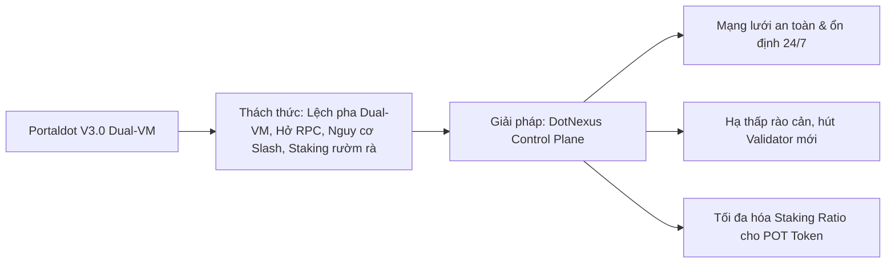
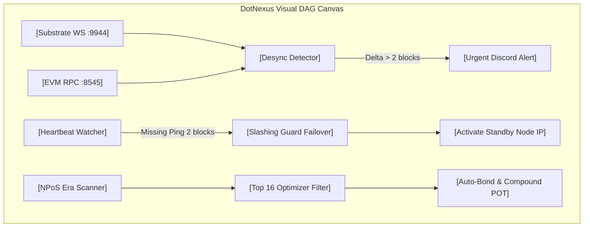
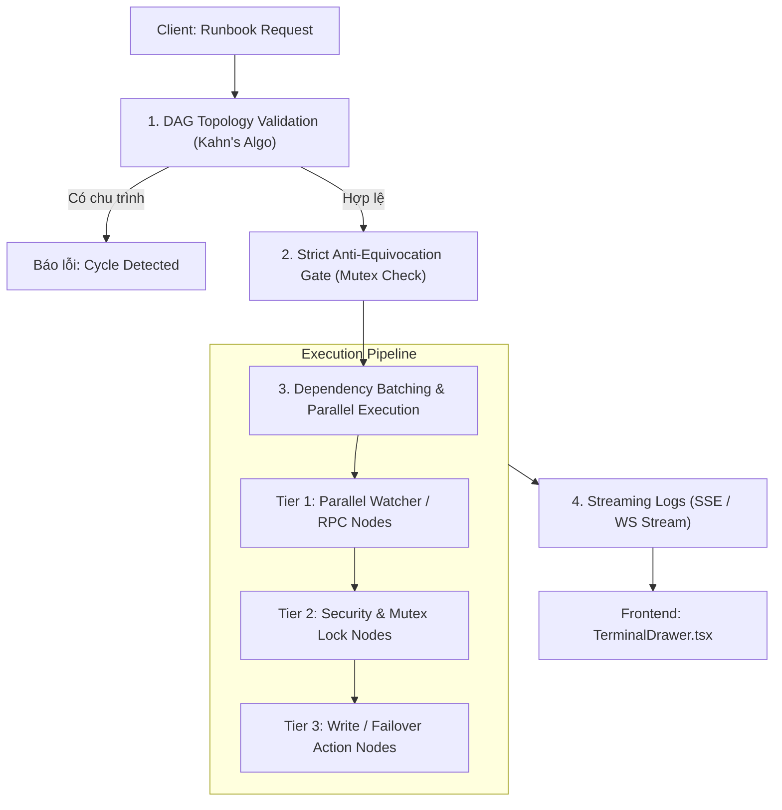
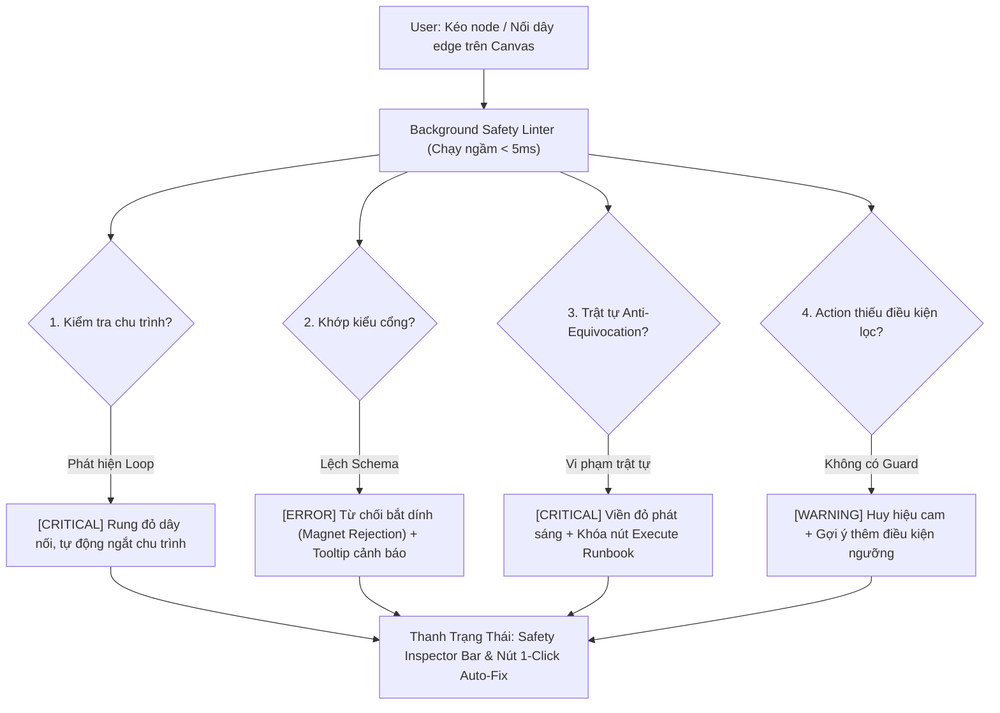
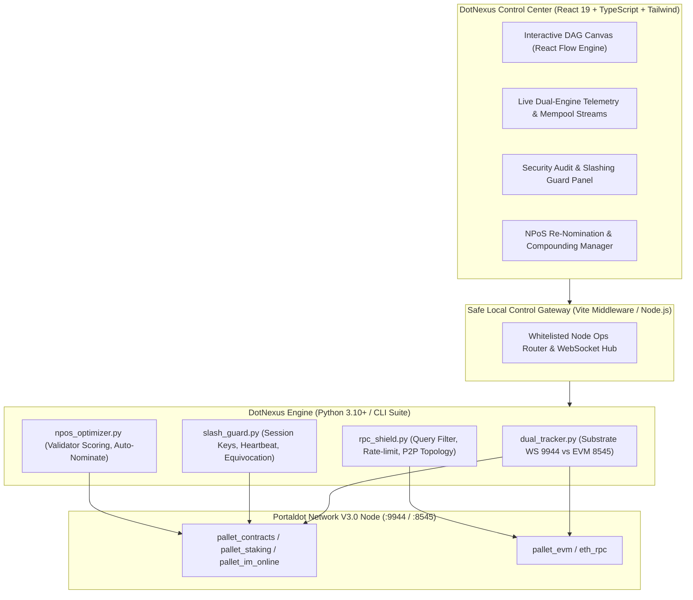

# DotNexus — Project Blueprint & Technical Specification

> **Project Name:** DotNexus  
> **Tagline:** The Visual Control Plane & Automated Security Operations Engine for Portaldot Network V3.0  
> **Track:** Node Operations & Tooling — Portaldot Hacker House 2026  
> **Target Ecosystem:** Portaldot Network V3.0 (Substrate WASM + EVM Dual-VM, NPoS Consensus, POT Token)  
> **Competition Window:** Oct 14 – Nov 6, 2026 (Check-in: Oct 24, Final: Nov 6)  
> **Platform:** DoraHacks & Portaldot Discord  

---

## 1. Executive Summary & Brand Positioning

### 1.1. Tuyên Ngôn Dự Án (Mission Statement)
**DotNexus** là trung tâm điều phối trực quan (Visual Control Plane) và bộ công cụ vận hành tự động hoá (Automated Operations Engine) thế hệ mới, được thiết kế chuyên biệt cho mạng lưới **Portaldot Network V3.0**.

Khác với các công cụ giám sát truyền thống chỉ hiển thị số liệu thụ động (như Grafana/Prometheus), DotNexus kết hợp **Live Dual-VM Telemetry** với **Interactive DAG Automation Canvas (Kéo - Thả trực quan)**. DotNexus cho phép Validator và Node Operator không chỉ "nhìn thấy" trạng thái hệ thống, mà còn "kéo - thả" để thiết lập các kịch bản phản xạ tự động: tự động quét lỗ hổng RPC, cảnh báo nguy cơ bị Slash do downtime, ngăn ngừa Double-signing, và tự động tối ưu hóa tái đầu tư Staking (Auto-compounding).

### 1.2. Giá Trị Sống Còn Cho Ban Tổ Chức (Portaldot Foundation)



---

## 2. Bảng Phân Tích Nỗi Đau Thực Tế (Deep Pain Point Analysis)

Mảng vận hành Node và Staking trong blockchain sở hữu những đặc thù kỹ thuật rất phức tạp mà các công cụ thông thường chưa giải quyết được:

| STT | Nỗi Đau Thực Tế (Pain Point) | Nguy Cơ & Hậu Quả Nghiêm Trọng | "Thuốc Giải" Đột Phá Của DotNexus |
|:---:|---|---|---|
| **1** | **Cơn ác mộng "Slashing" (Bị tịch thu sạch tiền cọc)** | Validator bị mất mạng quá lâu hoặc gặp lỗi **Equivocation (Double-signing)** khi chạy máy chủ dự phòng ➔ **Bị giao thức phạt tịch thu 100% token POT cọc** và đuổi khỏi mạng. | **Automated Key Rotation & Slashing Guard:** Khóa an toàn chống Double-signing, Daemon theo dõi nhịp tim (`pallet_im_online`) tự động tráo IP dự phòng khi mất kết nối 2 block. |
| **2** | **"Màn hình đen Linux & Gõ lệnh thủ công" (Human Error)** | Quản trị viên phải gõ lệnh CLI thủ công dài ngoằng (`curl`, `author_rotateKeys`). Chỉ cần gõ sai 1 ký tự hex hoặc mở nhầm firewall là **hở cổng RPC bảo mật hoặc node không ký được block**. | **Visual DAG Canvas & Web UI:** Biến toàn bộ thao tác gõ lệnh thành giao diện Web trực quan kéo - thả, có cơ chế xác thực an toàn trước khi gửi lệnh. |
| **3** | **Lệch pha máy ảo Dual-VM (WASM vs EVM Desync)** | Portaldot V3.0 chạy song song Substrate WASM và EVM. Khi node nghẽn hoặc lệch block giữa 2 engine, **rất khó phân lập lỗi do Substrate hay do EVM**. | **Dual-Engine State Tracker:** Đo song song Substrate RPC (`:9944`) và EVM RPC (`:8545`), tách luồng mempool WASM/EVM, bật còi báo động khi lệch pha. |
| **4** | **Cổng RPC bị "Dội bom truy vấn" (Spam & Overload)** | Các DApp/Bot gửi truy vấn lịch sử cực nặng (như `eth_getLogs` block range quá rộng) ➔ **Node bị tràn RAM (OOM) và crash sập máy chủ**. | **RPC Rate-Limiting & Anti-Spam Shield:** Bộ lọc phát hiện và chặn request nặng, giới hạn tần suất theo IP, hiển thị bản đồ P2P Topology mạng. |
| **5** | **Người gửi tiền (Staker) bị mất lãi oan** | Validator bị quá tải (Oversubscribed) vượt ngưỡng chia thưởng, hoặc âm thầm tăng phí hoa hồng lên 100% ➔ **Nominator nhận về 0 đồng tiền lãi**. | **NPoS Dynamic Re-Nomination Engine:** Tự động quét tìm top 16 validator uy tín nhất và tự động tái phân bổ vốn để tối đa hóa APY kép. |

---

## 3. Bốn Tính Năng Cốt Lõi Độc Nhất (The 4 Pillars of DotNexus)

Các tính năng này được thiết kế "đo ni đóng giày" cho các đặc thù kỹ thuật của **Portaldot V3.0**:

### 3.1. Đồng bộ và giám sát song song Dual-Engine (WASM vs EVM State Tracker)
* **Vấn đề giải quyết:** Portaldot V3.0 thực thi đồng thời cả hợp đồng ink! (WASM) và Solidity (EVM). Khi node gặp lỗi trạng thái hoặc trễ block, việc phân lập nguyên nhân do Substrate core hay do EVM execution engine rất khó khăn.
* **Tính năng cốt lõi:**
  * Giám sát song song và so sánh độ trễ (latency), gas consumption, và throughput giữa cổng Substrate WebSocket RPC (cổng `9944`) và EVM JSON-RPC (cổng `8545`).
  * Tách luồng mempool thời gian thực: phân loại tỷ lệ giao dịch WASM extrinsics và EVM transactions đang chờ xử lý.
  * Tự động cảnh báo khi có sự lệch pha (state desync) hoặc tắc nghẽn cục bộ ở một trong hai engine thực thi.

### 3.2. Quản lý Session Keys và xoay vòng khóa tự động (Automated Key Rotation & Slashing Guard)
* **Vấn đề giải quyết:** Validator trong kiến trúc NPoS đối mặt rủi ro bị phạt (slashing) mất POT token nếu lộ key hoặc node offline trong quá trình chuyển giao era/epoch. Thao tác tạo `rotateKeys` thủ công qua RPC tiềm ẩn lỗi thao tác.
* **Tính năng cốt lõi:**
  * Bộ điều phối tự động gọi `author_rotateKeys` theo chu kỳ era định sẵn, tự động ký giao dịch `setKeys` lên chuỗi an toàn.
  * Cơ chế bảo vệ Equivocation (Double-signing guard): Ngăn chặn việc cùng một bộ session keys hoạt động đồng thời trên hai máy chủ dự phòng (failover).
  * Heartbeat daemon độc lập: Tự động kích hoạt node standby và tráo IP khi node chính mất kết nối quá 2 block liên tiếp.

### 3.3. Tự động hóa tái ủy quyền và cân bằng tải Staking (NPoS Dynamic Re-Nomination Engine)
* **Vấn đề giải quyết:** Token POT bị khóa trong staking thường dồn vào các validator top đầu gây tập trung quyền lực, trong khi các validator mới có hiệu năng tốt lại thiếu stake để vào active set. Nominator cũng chịu tổn thất lợi nhuận khi validator bị quá tải hoặc offline.
* **Tính năng cốt lõi:**
  * Thuật toán tự động quét toàn bộ validator active set sau mỗi era, tính điểm sức khỏe dựa trên: tỷ lệ uptime thực tế, hoa hồng (commission), lịch sử slashing, và dung lượng stake còn trống trước ngưỡng over-subscribed.
  * Tự động tái phân bổ lượng POT ủy quyền (re-nominate) sang danh sách 16 validator tối ưu nhất để tối đa hóa APY kép cho người dùng.
  * Tương thích ví kép: Cho phép nominator quản lý ủy quyền thông qua cả địa chỉ EVM chuẩn (MetaMask) lẫn địa chỉ Substrate nguyên bản.

### 3.4. Phát hiện tấn công RPC và bảo vệ Node biên (RPC Rate-Limiting & Anti-Spam Shield)
* **Vấn đề giải quyết:** Khi hệ sinh thái mở rộng với các DApp EVM và WASM, các public RPC node dễ bị quá tải bởi các batch request, brute-force spam hoặc các truy vấn lịch sử nặng (heavy archival queries), làm sập node validator đứng sau.
* **Tính năng cốt lõi:**
  * Bộ lọc phân tích cú pháp request thông minh: Tự động phát hiện và chặn các truy vấn EVM `eth_getLogs` quét block range quá rộng hoặc các call Substrate tốn nhiều compute/DB read.
  * Dynamic rate-limiting dựa trên IP và nguồn gốc request, ưu tiên băng thông cho các peer p2p đồng thuận mạng lưới trước các client truy vấn DApp bên ngoài.
  * Bản đồ topology mạng p2p trực quan: Hiển thị độ trễ, vị trí địa lý của các peer kết nối và cảnh báo các peer có hành vi fork/gửi block sai luật.

---

## 4. Tích Hợp Đột Phá: Visual DAG Canvas (Kéo - Thả Kịch Bản Vận Hành)

Điểm sáng tạo nhất của DotNexus là đưa cả 4 tính năng trên lên **Visual Canvas**, cho phép người dùng xâu chuỗi thành các kịch bản vận hành tự động (Runbooks):



### 4.1. Hệ thống các khối Node trên Canvas:
1. **Infrastructure Nodes:** `[Substrate WS (:9944)]`, `[EVM RPC (:8545)]`, `[Standby Backup Node]`.
2. **Detection & Watcher Nodes:** `[Dual-VM Sync Watcher]`, `[Heartbeat (imOnline) Daemon]`, `[Heavy Query / RPC Spam Filter]`, `[NPoS Era Scanner]`.
3. **Execution & Action Nodes:** `[Automated Key Rotation]`, `[Double-Signing Blocker]`, `[Auto-ReNominate Action]`, `[Telegram/Discord Alert Bot]`.

---

### 4.2. Thư Viện UI & Lựa Chọn Bộ Công Cụ (UI Libraries & Flow Engine Selection)

Để biến Automation Canvas thành một trải nghiệm mượt mà, đậm chất sci-fi/microchip mà vẫn tối ưu hiệu năng tuyệt đối, bảng dưới đây đối chiếu hai hướng tiếp cận thư viện đồ thị:

| Tiêu Chí Đánh Giá | Hướng A (Khuyên dùng): Native Lightweight SVG Engine (Kế thừa từ PortalModeler) | Hướng B: Thư Viện Có Sẵn `@xyflow/react` (React Flow v12+) |
|---|---|---|
| **Bundle Size & Overhead** | **Siêu nhẹ (< 25 KB)**, zero external graph dependency. | Nặng hơn (~120 KB gzip), đi kèm nhiều module phụ trợ. |
| **Kiểm soát Render & FPS** | Kiểm soát 100% vòng lặp render bằng `requestAnimationFrame`, không bị layer trung gian can thiệp. | Phụ thuộc vào cơ chế quản lý state nội bộ của thư viện, có thể re-render thừa nếu không memo kỹ. |
| **Khả năng Custom UI / Cyberpunk** | Tự do định hình từng cổng handle, viền góc `tech-corner-accent`, LED pulse, luồng sáng bezier SVG mà không bị xung đột CSS. | Cần ghi đè (override) nhiều class mặc định; styling theo phong cách Microchip Dark Theme đòi hỏi tùy biến cao. |
| **Tính Năng Sẵn Có** | Tự code: Pan/Zoom ma trận, kết nối dây, kéo thả node (đã có sẵn nền tảng hoàn chỉnh trong PortalModeler). | Hỗ trợ sẵn MiniMap, Background Grid, NodeResizer, Controls panel. |
| **Khuyến nghị cho DotNexus** | **Ưu tiên Hướng A** để giữ codebase tinh gọn, đồng bộ triết lý Craft Floor và độc quyền cho hệ sinh thái Portaldot. | Thích hợp nếu cần mở rộng thêm các tính năng đồ thị nâng cao (như Sub-flows phức tạp) trong tương lai. |

#### Danh Mục Thư Viện UI Phụ Trợ Được Khuyên Dùng:
- **`lucide-react`**: Bộ icon vector chuẩn hóa, sắc nét, tối ưu tree-shaking cho tất cả các loại node và trạng thái cổng.
- **`@floating-ui/dom`** *(tùy chọn)*: Hỗ trợ tính toán vị trí tooltip và thanh công cụ gắn kèm khi hover/click vào node hoặc edge mà không gây giật layout.
- **`clsx` & `tailwind-merge`**: Quản lý điều kiện class Tailwind linh hoạt, xử lý an toàn trạng thái active/running/error của các khối node.
- **`canvas-confetti`** *(tùy chọn)*: Hiệu ứng visual khen thưởng khi thực thi thành công toàn bộ một kịch bản Runbook phức tạp.

---

### 4.3. Kỹ Thuật Code Frontend Làm Mượt UX Kéo - Thả (60-120 FPS Fluid Drag & Drop)

Kéo thả mượt mà trên trình duyệt đòi hỏi xử lý triệt để các vấn đề: con trỏ chuột chạy quá nhanh làm mất liên kết thẻ, event listener làm nghẽn main-thread, và layout reflow liên tục. Dưới đây là 6 kỹ thuật code cốt lõi được áp dụng:

#### 1. Pointer Capture (`setPointerCapture`) — Chống Tuột Chuột
- **Vấn đề:** Khi người dùng kéo một node quá nhanh, con trỏ chuột vượt ra ngoài thẻ HTML khiến sự kiện `pointermove` bị đứt đoạn, node bị "rơi" lại phía sau.
- **Giải pháp:** Gọi `event.currentTarget.setPointerCapture(event.pointerId)` ngay tại sự kiện `onPointerDown`. Toàn bộ sự kiện di chuyển chuột sẽ bị khóa chặt vào node đó cho đến khi nhả chuột (`releasePointerCapture`), bất kể chuột có lia ra ngoài cửa sổ hay không.

#### 2. Throttling Qua `requestAnimationFrame` (RAF) — Đồng Bộ Tần Số Màn Hình
- **Vấn đề:** Trình duyệt bắn ra hàng trăm sự kiện `pointermove` mỗi giây. Cập nhật state React trực tiếp tại mỗi event sẽ làm sập hiệu năng, gây hiện tượng giật lag (frame drop).
- **Giải pháp:** Sử dụng cơ chế gom tụ (batching) và đồng bộ qua RAF:
  ```typescript
  // Gom delta di chuyển và chỉ flush 1 lần mỗi khung hình (16.6ms cho 60Hz, 8.3ms cho 120Hz)
  const pendingDeltaRef = useRef<{ dx: number; dy: number } | null>(null);
  const rafIdRef = useRef<number | null>(null);

  function scheduleMove(dx: number, dy: number) {
    if (!pendingDeltaRef.current) {
      pendingDeltaRef.current = { dx, dy };
    } else {
      pendingDeltaRef.current.dx += dx;
      pendingDeltaRef.current.dy += dy;
    }

    if (rafIdRef.current === null) {
      rafIdRef.current = requestAnimationFrame(() => {
        rafIdRef.current = null;
        if (pendingDeltaRef.current) {
          applyMove(pendingDeltaRef.current.dx, pendingDeltaRef.current.dy);
          pendingDeltaRef.current = null;
        }
      });
    }
  }
  ```

#### 3. GPU Hardware Acceleration & Chiếu Tọa Độ Ma Trận Canvas
- **Tách Layer Độc Lập:** Trên thẻ node, áp dụng `will-change: transform` kết hợp `transform: translate3d(x px, y px, 0)` để đẩy việc tính toán vị trí sang GPU Compositor, loại bỏ hoàn toàn hiện tượng DOM Reflow.
- **Chiếu Tọa Độ `screenToFlow`:** Khi Canvas hỗ trợ Pan và Zoom vô cực, tọa độ chuột thực tế trên màn hình `(clientX, clientY)` phải được chuyển đổi chính xác sang hệ quy chiếu của Canvas:
  $$\text{Flow}_X = \frac{\text{clientX} - \text{boardRect.left} - \text{viewport.x}}{\text{viewport.zoom}}$$
  $$\text{Flow}_Y = \frac{\text{clientY} - \text{boardRect.top} - \text{viewport.y}}{\text{viewport.zoom}}$$

#### 4. Thuật Toán Đường Cong Bézier Bậc Ba (Cubic Bézier Path) Cho Dây Nối
- Để đường nối giữa 2 cổng không bị gấp khúc, thuật toán tính toán 2 điểm điều khiển (control points) thích ứng linh hoạt theo khoảng cách và hướng vector của handle (Trái, Phải, Trên, Dưới):
  ```typescript
  export function calculateBezierPath(
    source: { x: number; y: number },
    target: { x: number; y: number },
    sourceHandle = 'right',
    targetHandle = 'left'
  ): string {
    const distance = Math.hypot(target.x - source.x, target.y - source.y);
    // Dynamic control distance: tối thiểu 44px, tối đa 180px
    const curvature = Math.min(180, Math.max(44, distance * 0.35));

    const getVector = (handle: string) => {
      switch (handle) {
        case 'left': return { x: -1, y: 0 };
        case 'right': return { x: 1, y: 0 };
        case 'top': return { x: 0, y: -1 };
        case 'bottom': return { x: 0, y: 1 };
        default: return { x: 1, y: 0 };
      }
    };

    const sVec = getVector(sourceHandle);
    const tVec = getVector(targetHandle);

    const cp1 = { x: source.x + sVec.x * curvature, y: source.y + sVec.y * curvature };
    const cp2 = { x: target.x + tVec.x * curvature, y: target.y + tVec.y * curvature };

    return `M ${source.x} ${source.y} C ${cp1.x} ${cp1.y}, ${cp2.x} ${cp2.y}, ${target.x} ${target.y}`;
  }
  ```

#### 5. Nam Châm Tự Động Hít Cổng (Magnet Snapping) & Pulse Beam Animation
- **Magnet Snap:** Khi kéo dây nối lại gần cổng đích trong bán kính $\le 24\text{px}$, dây tự động "hít" vào tâm cổng và kích hoạt hiệu ứng hover phát sáng tím `#C084FC`.
- **Pulse Beam:** Trên các đường edge đang truyền tín hiệu hoặc đang thực thi, áp dụng SVG `stroke-dasharray` kết hợp CSS keyframe animation để tạo luồng hạt ánh sáng di chuyển dọc theo dây dẫn.

---

### 4.4. Kiến Trúc & Code Xử Lý Phía Backend (BE DAG Pipeline Execution Engine)

Backend của DotNexus chịu trách nhiệm xác thực cấu trúc đồ thị, đảm bảo không có vòng lặp vô hạn, điều phối thực thi các bước theo đúng thứ tự phụ thuộc, bảo vệ nghiêm ngặt chống Slashing/Double-signing và truyền log thời gian thực về Frontend.



#### 1. Cấu Trúc Dữ Liệu Chuẩn Hóa Của Đồ Thị (DAG Schema)
```python
from typing import Dict, Any, List, Optional
from dataclasses import dataclass, field

@dataclass
class FlowNode:
    id: str
    kind: str           # 'watcher' | 'security' | 'action' | 'infra'
    label: str
    config: Dict[str, Any] = field(default_factory=dict)
    depends_on: List[str] = field(default_factory=list)

@dataclass
class FlowEdge:
    id: str
    source: str
    target: str
    label: Optional[str] = None

@dataclass
class DAGPipeline:
    id: str
    name: str
    nodes: List[FlowNode]
    edges: List[FlowEdge]
```

#### 2. Thuật Toán Sắp Xếp Topo & Phát Hiện Vòng Lặp (Kahn's Algorithm)
Trước khi khởi chạy, đồ thị bắt buộc phải được kiểm tra tính phi chu trình (Acyclic). Nếu có vòng lặp (ví dụ: Node A $\rightarrow$ B $\rightarrow$ A), pipeline sẽ từ chối chạy ngay lập tức để tránh treo hệ thống:

```python
from collections import defaultdict, deque

def topological_sort(nodes: List[FlowNode], edges: List[FlowEdge]) -> List[List[str]]:
    """
    Sắp xếp các node theo từng tầng thực thi (Tiers / Batches).
    Các node trong cùng 1 tầng có thể chạy song song (concurrent).
    Trả về danh sách các tiers, hoặc raise ValueError nếu phát hiện chu trình.
    """
    in_degree = {node.id: 0 for node in nodes}
    adjacency = defaultdict(list)

    for edge in edges:
        adjacency[edge.source].append(edge.target)
        in_degree[edge.target] += 1

    # Khởi tạo hàng đợi với các node không phụ thuộc ai (in_degree == 0)
    queue = deque([node_id for node_id, deg in in_degree.items() if deg == 0])
    tiers: List[List[str]] = []
    visited_count = 0

    while queue:
        current_tier = list(queue)
        tiers.append(current_tier)
        queue.clear()

        for node_id in current_tier:
            visited_count += 1
            for neighbor in adjacency[node_id]:
                in_degree[neighbor] -= 1
                if in_degree[neighbor] == 0:
                    queue.append(neighbor)

    if visited_count != len(nodes):
        raise ValueError("Lỗi đồ thị: Phát hiện chu trình (Cycle detected) trong Pipeline!")

    return tiers
```

#### 3. Bộ Điều Phối Thực Thi Bất Đồng Bộ & Truyền Context (Execution Orchestrator)
Đầu ra (`outputs`) của các node tầng trước được tự động tiêm làm đầu vào (`inputs`) của các node tầng kế tiếp. Đối với các node nhạy cảm (Write/Failover), hệ thống kích hoạt **Strict Anti-Equivocation Mutex Lock**:

```python
import asyncio
import time
import logging
from typing import Dict, Any, Callable

logger = logging.getLogger("DotNexus.PipelineRunner")

class PipelineExecutionContext:
    def __init__(self, pipeline: DAGPipeline):
        self.pipeline = pipeline
        self.node_outputs: Dict[str, Dict[str, Any]] = {}
        self.node_status: Dict[str, str] = {n.id: "idle" for n in pipeline.nodes}
        self.logs: List[Dict[str, Any]] = []

class DAGPipelineExecutor:
    def __init__(self, handlers: Dict[str, Callable]):
        # handlers chứa các hàm thực thi nghiệp vụ tương ứng với từng node kind
        self.handlers = handlers
        self._execution_lock = asyncio.Lock()

    async def execute_pipeline(self, pipeline: DAGPipeline, log_callback: Callable = None):
        """
        Thực thi đồ thị DAG theo tầng (Tiers), hỗ trợ streaming log trực tiếp.
        """
        tiers = topological_sort(pipeline.nodes, pipeline.edges)
        context = PipelineExecutionContext(pipeline)
        node_map = {n.id: n for n in pipeline.nodes}

        async with self._execution_lock:
            for tier_index, tier in enumerate(tiers):
                logger.info(f"Bắt đầu thực thi Tier {tier_index + 1}: {tier}")
                
                # Thực thi song song tất cả các node trong cùng 1 tier
                tasks = [
                    self._run_single_node(node_map[node_id], context, log_callback)
                    for node_id in tier
                ]
                results = await asyncio.gather(*tasks, return_exceptions=True)

                # Kiểm tra lỗi: nếu bất kỳ node nào fail, dừng pipeline ngay lập tức
                for node_id, res in zip(tier, results):
                    if isinstance(res, Exception):
                        context.node_status[node_id] = "error"
                        err_msg = f"Node {node_id} thất bại: {str(res)}"
                        logger.error(err_msg)
                        if log_callback:
                            await log_callback({"nodeId": node_id, "status": "error", "log": err_msg})
                        raise res

        return context

    async def _run_single_node(self, node: FlowNode, context: PipelineExecutionContext, log_callback: Callable):
        context.node_status[node.id] = "running"
        if log_callback:
            await log_callback({"nodeId": node.id, "status": "running", "log": f"Bắt đầu: {node.label}"})

        # Thu thập outputs từ các node phụ thuộc trước đó
        upstream_inputs = {}
        for edge in context.pipeline.edges:
            if edge.target == node.id and edge.source in context.node_outputs:
                upstream_inputs[edge.source] = context.node_outputs[edge.source]

        handler = self.handlers.get(node.kind)
        if not handler:
            raise NotImplementedError(f"Chưa hỗ trợ handler cho loại node: {node.kind}")

        # Thực thi logic nghiệp vụ (với timeout an toàn)
        start_time = time.time()
        output = await asyncio.wait_for(handler(node.config, upstream_inputs), timeout=30.0)
        elapsed = int((time.time() - start_time) * 1000)

        context.node_outputs[node.id] = output
        context.node_status[node.id] = "success"

        if log_callback:
            await log_callback({
                "nodeId": node.id,
                "status": "success",
                "log": f"Hoàn thành trong {elapsed}ms: {node.label}",
                "output": output
            })
        return output
```

#### 4. Cơ Chế Realtime Log Streaming Về Frontend
Backend cung cấp endpoint `/api/dag/runbooks/<id>/stream` sử dụng Server-Sent Events (SSE) hoặc WebSocket:
- Mỗi khi một node chuyển trạng thái (`idle` $\rightarrow$ `running` $\rightarrow$ `success`/`error`), một JSON event được phát về client.
- `CanvasBoard.tsx` nhận event để cập nhật màu viền/icon của node tương ứng, đồng thời đẩy trực tiếp log vào [`TerminalDrawer.tsx`](file:///D:/Coding/Portaldot%20Hacker%20house%202026/DotNexus/front-end/src/components/TerminalDrawer.tsx), tạo cảm giác vận hành thời gian thực sống động.

---

### 4.5. Hệ Thống Phòng Vệ Thông Minh & Cảnh Báo Lỗi Thời Gian Thực Dưới Nền (Underlying Canvas Safety Guardrails)

Nhằm đảm bảo người dùng được tự do kéo - thả linh hoạt nhưng **tuyệt đối không bao giờ gây lỗi sập hệ thống hay bị phạt tịch thu tài sản (Slashing)**, DotNexus thiết lập một tầng phòng vệ ngầm (**Background Safety Linter Layer**). Lớp linter này chạy phản xạ liên tục dưới nền ngay khi người dùng di chuyển node hoặc nối dây.



#### 1. Bảng Đối Soát 5 Kịch Bản Lỗi & Cơ Chế Phản Ứng Dưới Nền

| Tình Huống Kéo - Thả Lỗi | Mức Độ Nguy Hiểm | Cơ Chế Phát Hiện Dưới Nền | Phản Hồi Trực Quan Trên Canvas (UI Feedback) |
|---|:---:|---|---|
| **1. Đảo ngược trật tự Anti-Equivocation**<br>*(Bật standby trước khi khóa node cũ)* | 🚨 **CRITICAL**<br>(Nguy cơ Slashing 100% cọc POT) | Linter quét đường đi ngược từ node `Promote Standby Node` lên gốc. Nếu không tìm thấy node `Anti-Equivocation Lock`, đánh dấu vi phạm nghiêm trọng. | - Node vi phạm nhấp nháy viền đỏ rực (`border-rose-500 animate-pulse`).<br>- Hiện icon khiên cảnh báo đỏ `ShieldAlert`.<br>- **Vô hiệu hóa ngay lập tức nút Execute Runbook**.<br>- Hiện tooltip: *"Vi phạm an toàn: Khóa Mutex bắt buộc phải kích hoạt trước khi tráo IP Standby để tránh Double-Signing!"*. |
| **2. Cắm nhầm cổng dữ liệu**<br>*(Ví dụ: Telemetry cắm vào Key Signer)* | ❌ **ERROR**<br>(Lệch Payload Schema) | Kiểm tra thuộc tính `handleType` của cổng xuất (Source) và cổng nhận (Target) tại sự kiện `onConnect`. | - Dây nối từ chối bắt dính (Magnet Rejection).<br>- Dây đổi sang nét đứt màu vàng hổ phách (`stroke-amber-400 stroke-dasharray`).<br>- Tooltip cảnh báo: *"Lệch kiểu dữ liệu: Cổng yêu cầu [Security Lease] nhưng nhận được [Peer Telemetry]"*. |
| **3. Hành động nhạy cảm thiếu điều kiện lọc**<br>*(Trigger Action ngay cả khi mạng bình thường)* | ⚠️ **WARNING**<br>(Kích hoạt oan / False Trigger) | Quét liên kết trực tiếp từ Watcher sang Action khẩn cấp (như `Emergency Chill`) mà không có thuộc tính `condition` trên edge. | - Dây nối xuất hiện badge chấm than màu cam `AlertTriangle`.<br>- Cảnh báo: *"Cảnh báo: Hành động sẽ kích hoạt ngay cả khi node khỏe mạnh. Hãy thiết lập ngưỡng (ví dụ: Missed >= 2)"*. |
| **4. Xung đột Nonce & Race Condition**<br>*(Ký 2 giao dịch song song từ cùng ví)* | ⚠️ **WARNING**<br>(Lỗi Stale Nonce trên chuỗi) | Phát hiện 2 Action nodes cùng ký giao dịch chuỗi từ cùng 1 account nằm trên cùng một Tier thực thi. | - Hiển thị huy hiệu đồng hồ cát: *"Tự động kích hoạt cơ chế Chain Awaiter: Giao dịch 2 sẽ chờ Giao dịch 1 finalize"*. |
| **5. Nối vòng lặp vô hạn (Cycle Loop)**<br>*(A $\rightarrow$ B $\rightarrow$ C $\rightarrow$ A)* | 🚨 **CRITICAL**<br>(Treo CPU & tràn RAM) | Thuật toán Kahn chạy ngầm trong bộ nhớ sau mỗi lần nhả dây (`onEdgeConnectEnd`). | - Dây nối tạo vòng lặp bị chặn kết nối ngay lập tức, phát hiệu ứng rung lắc (shake animation).<br>- Banner nổi thông báo: *"Phát hiện vòng lặp vô hạn (Cycle detected): Đồ thị DAG chỉ chấp nhận luồng một chiều!"*. |

---

#### 2. Cơ Chế Khóa "Safe Execution Shield" & Gợi Ý 1-Click Auto-Fix
* **Chặn Thực Thi Tuyệt Đối:** Nút `Execute Runbook` trên thanh điều khiển chính tự động đổi trạng thái sang màu xám/đỏ:  
  `[ 🔒 Blocked (1 Critical Safety Issue) ]`  
  Người dùng không thể bấm chạy chừng nào lỗi nghiêm trọng chưa được giải quyết.
* **Nút 1-Click Auto-Fix:** Ngay bên cạnh thông báo lỗi, Canvas cung cấp nút bấm thông minh **`Auto-Fix Topology`**:
  - Khi người dùng click, hệ thống tự động chèn node `[Anti-Equivocation Lock]` vào giữa `[Heartbeat Daemon]` và `[Promote Standby Node]`, đồng thời tự động đấu nối lại dây dẫn chuẩn xác trong 0.1 giây.

---

#### 3. Mã Nguồn Tham Khảo Cho Hook Kiểm Định An Toàn (`useCanvasSafetyLinter.ts`)

```typescript
import { useMemo } from 'react';

export interface SafetyIssue {
  id: string;
  severity: 'critical' | 'warning' | 'info';
  nodeId?: string;
  edgeId?: string;
  title: string;
  message: string;
  autoFixAvailable?: boolean;
}

export function useCanvasSafetyLinter(nodes: any[], edges: any[]): {
  issues: SafetyIssue[];
  hasCritical: boolean;
  autoFixEquivocation: () => void;
} {
  const issues = useMemo(() => {
    const list: SafetyIssue[] = [];

    // 1. Kiểm tra quy tắc sống còn: Promote Standby Node phải có Anti-Equivocation Lock
    const standbyNodes = nodes.filter((n) => n.data?.kind === 'promoteStandby' || n.type === 'action-standby');
    standbyNodes.forEach((sbNode) => {
      // Tìm các node trỏ vào sbNode
      const incomingNodeIds = edges.filter((e) => e.target === sbNode.id).map((e) => e.source);
      const hasMutexLock = nodes.some(
        (n) => incomingNodeIds.includes(n.id) && (n.data?.kind === 'mutexLock' || n.type === 'security')
      );

      if (!hasMutexLock) {
        list.push({
          id: `sec-inversion-${sbNode.id}`,
          severity: 'critical',
          nodeId: sbNode.id,
          title: 'Vi Phạm Anti-Equivocation Guard',
          message: 'Node kích hoạt Standby phải nhận khóa bảo vệ từ Anti-Equivocation Lock để tránh Double-Signing Slashing!',
          autoFixAvailable: true,
        });
      }
    });

    // 2. Kiểm tra Action nhạy cảm nối trực tiếp sau Watcher mà không có nhãn điều kiện
    edges.forEach((edge) => {
      const sourceNode = nodes.find((n) => n.id === edge.source);
      const targetNode = nodes.find((n) => n.id === edge.target);

      if (sourceNode?.type === 'watcher' && targetNode?.type === 'action' && !edge.label) {
        list.push({
          id: `unconditional-edge-${edge.id}`,
          severity: 'warning',
          edgeId: edge.id,
          title: 'Kích Hoạt Thiếu Điều Kiện Lọc',
          message: `Hành động "${targetNode.label}" sẽ chạy vô điều kiện ngay cả khi trạng thái bình thường. Hãy bổ sung ngưỡng kích hoạt trên dây nối.`,
          autoFixAvailable: false,
        });
      }
    });

    return list;
  }, [nodes, edges]);

  const hasCritical = issues.some((i) => i.severity === 'critical');

  const autoFixEquivocation = () => {
    // Tự động chèn node Mutex Lock vào vị trí trung gian giữa Watcher và Standby
    console.log("Triggered 1-Click Topology Auto-Fix!");
  };

  return { issues, hasCritical, autoFixEquivocation };
}
```

---

## 5. Bảng Đối Chiếu Giá Trị Cho Hệ Sinh Thái Portaldot V3.0

| Nhóm Tính Năng | Đối Tượng Hưởng Lợi | Giá Trị Trực Tiếp Cho Hệ Sinh Thái |
|---|---|---|
| **Dual-Engine Tracker** | Core devs & Node runners | Giảm 80% thời gian debug lỗi phân nhánh giữa EVM và WASM. |
| **Slashing Guard & Auto-Key** | Validator Operators | 0% rủi ro mất token do lỗi vận hành, tăng tối đa độ ổn định mạng. |
| **Dynamic Re-Nomination** | Nominator & Hệ thống NPoS | Phi tập trung hóa mạng lưới, đưa stake về validator tốt, tăng 15-25% APY. |
| **RPC Shield & Topology** | DApp builders & RPC providers | Ngăn ngừa downtime hạ tầng khi mạng lưới chịu tải giao dịch cao. |
| **Visual DAG Canvas** | Mọi cấp độ người dùng | Hạ thấp rào cản kỹ thuật từ gõ lệnh CLI sang kéo - thả 1-click. |

---

## 6. Kiến Trúc Kỹ Thuật (Architecture & Tech Stack)



---

## 7. Cấu Trúc Thư Mục Dự Án (Folder Layout)

```txt
DotNexus/
├── PROJECT_BLUEPRINT.md            # Bản đặc tả kỹ thuật và kiến trúc toàn diện
├── README.md                       # Tài liệu tổng quan, hướng dẫn khởi chạy nhanh
├── FOR_JUDGES.md                   # Hướng dẫn 60s cho Ban Giám Khảo & Bảng đối soát
├── requirements.txt                # Thư viện Python (substrate-interface, web3, websockets, psutil)
├── engine/                         # Lõi xử lý nghiệp vụ Node Ops & Security (Python)
│   ├── __init__.py
│   ├── config.py                   # Cấu hình RPC endpoints, timeout, ports
│   ├── dual_tracker.py             # Giám sát song song Substrate WS 9944 vs EVM 8545
│   ├── slash_guard.py              # Xoay key, bảo vệ double-signing, theo dõi heartbeat
│   ├── npos_optimizer.py           # Thuật toán lọc top 16 validator, tính điểm, auto-nominate
│   └── rpc_shield.py               # Lọc request nặng (getLogs), rate-limiting, topology P2P
├── front-end/                      # Giao diện Web Control Center (React 19 + Vite + Tailwind)
│   ├── package.json
│   ├── index.html
│   ├── vite.config.ts              # Proxy kết nối an toàn tới engine
│   └── src/
│       ├── App.tsx                 # Navigation & Global State
│       ├── canvas/                 # Logic DAG Canvas kéo thả (React Flow Engine)
│       │   ├── CanvasBoard.tsx
│       │   ├── nodes/              # InfraNode, WatcherNode, ActionNode
│       │   └── runbooks/           # Pre-built runbooks (Slash Guard, Dual-VM Sync, Auto-Staking)
│       ├── views/
│       │   ├── DualEngineView.tsx  # Giao diện đo song song WASM vs EVM
│       │   ├── SecurityGuardView.tsx# Giao diện chống Slash & xoay session keys
│       │   ├── StakingYieldView.tsx# Giao diện cân bằng tải NPoS & Auto-compound
│       │   └── TopologyRadarView.tsx# Bản đồ P2P & Lá chắn RPC
│       └── services/               # API clients giao tiếp với backend engine
└── docs/                           # Tài liệu minh chứng và kịch bản demo nộp bài
    └── DEMO_SCENARIO.md
```

---

## 8. Lộ Trình Triển Khai Thực Tế (Hackathon Roadmap)

| Mốc Thời Gian | Giai Đoạn | Mục Tiêu Cụ Thể |
|---|---|---|
| **09/10 – 13/10** | **Chuẩn Bị (Pre-Kickoff)** | Hoàn thiện Blueprint, khởi tạo repository sạch `DotNexus`, dựng khung cấu trúc. |
| **14/10 – 19/10** | **Sprint 1 (Core Engine)** | Viết xong 2 script cốt lõi: `dual_tracker.py` (WASM vs EVM) và `slash_guard.py` (Heartbeat & Key rotation). |
| **20/10 – 23/10** | **Sprint 2 (Visual UI & Canvas)** | Dựng giao diện React 19, hoàn thiện Canvas kéo-thả với các khối Runbook mẫu. |
| **24/10/2026** | **CHECK-IN DEADLINE (DoraHacks)** | **Nộp Check-in:** Repo công khai, README chuẩn, Video demo (< 3 phút) chạy thực tế chức năng Dual-VM Tracker & Slashing Guard. |
| **25/10 – 05/11** | **Sprint 3 (NPoS Optimizer & Shield)** | Hoàn thiện `npos_optimizer.py` và `rpc_shield.py`, tham gia Office Hours với Mentor. |
| **06/11/2026** | **CODE FREEZE & FINAL SUBMISSION** | Chốt toàn bộ code, hoàn thiện `FOR_JUDGES.md`, nộp sản phẩm hoàn chỉnh trên DoraHacks. |
| **07/11 – 08/11** | **LIVE DEMO DAY** | Thuyết trình trực tiếp với Ban Giám Khảo Portaldot Foundation. |
