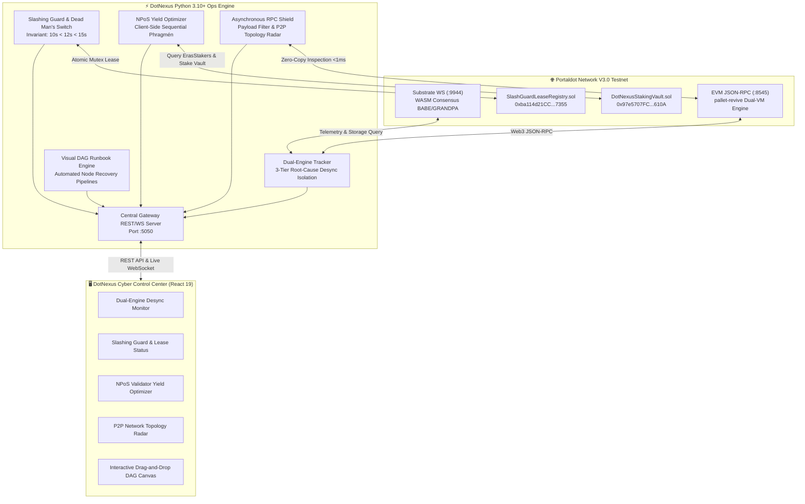

# DotNexus ⚡

> **The Visual Control Plane & Automated Security Operations Engine for Portaldot Network V3.0**

[](https://portaldot.network)
[](https://dorahacks.io/hackathon/2362/detail)
[](tests/test_engine.py)
[](DEPLOYMENT.md)
[-282C34?style=for-the-badge&logo=rust&logoColor=white)](https://substrate.io)
[](front-end/)

---

## 🌟 Executive Summary

**DotNexus** transforms complex, high-stakes Portaldot Network V3.0 node operations, anti-equivocation security, and NPoS staking into an intuitive, real-time **Visual Control Plane** and **Autonomous Operations Engine**.

Operating a Dual-VM validator node (Substrate WASM + EVM via `pallet-revive`) introduces unprecedented operational hazards: split-brain double signing leading to 100% stake slashing, runtime state desync between `:9944` and `:8545`, unshielded RPC exhaustion, and oversubscribed nominator yield loss. 

DotNexus eliminates these risks by pairing deep on-chain telemetry with a **24/7 Headless Security Daemon**, **Verified On-Chain Lease Arbiters**, and an **Interactive Drag-and-Drop DAG Runbook Canvas**.



---

## 🔗 Verified Testnet Deployments (Portaldot V3.0)

Both smart contracts are fully compiled with `evmVersion: "paris"` targeting the Portaldot V3.0 `pallet-revive` Dual-VM environment and actively live on the official testnet:

* **Substrate WS Endpoint:** `wss://test-node-v3.portaldot.dev`
* **EVM JSON-RPC Endpoint:** `https://test-evm-rpc-v3.portaldot.dev`
* **Chain ID (EVM):** `420420777` | **SS58 Prefix:** `42` | **Token Decimals:** `14` (POT)
* **Official Node Console:** [https://node-console.portaldot.dev/](https://node-console.portaldot.dev/)

| Smart Contract | Deployed Contract Address | Deployment Tx Hash | Block | Status | Verified Capabilities |
|---|---|---|:---:|:---:|---|
| **[`SlashGuardLeaseRegistry`](contracts/SlashGuardLeaseRegistry.sol)** | [`0xba114d21CC41a30880CcfA53673B743316387355`](contracts/SlashGuardLeaseRegistry.sol) | `0xe285c61d4829a3f33a32e634242e1a77ba15f7eea28d276c9d72b0482633472f` | `#147264` | **PASS (1)** | Monotonic fencing epoch lease arbiter; guarantees zero double-signing during standby failover |
| **[`DotNexusStakingVault`](contracts/DotNexusStakingVault.sol)** | [`0x97e5707FCa341c27D7e6b5cEC5ABFe2d3498610A`](contracts/DotNexusStakingVault.sol) | `0x3263d911ca24b4f1ff413020d6454fce1c7cc995dc81d114d8d91ac8c061b8cb` | `#147358` | **PASS (1)** | Non-custodial NPoS staking vault with dynamic compounding yield optimization |

> Detailed ABI definitions, bytecodes, and validation scripts are documented in [`DEPLOYMENT.md`](DEPLOYMENT.md) and [`FOR_JUDGES.md`](FOR_JUDGES.md).

---

## 🛡️ The 5 Core Pillars of DotNexus

### 1. Dual-Engine State Tracker & Desync Root-Cause Isolation
Portaldot V3.0 operates Substrate WASM consensus alongside an EVM runtime layer. When a node experiences lag between `:9944` and `:8545`, DotNexus's **3-Tier Root-Cause Isolator** pinpoints the exact failure layer in real time:
* **Tier 1 (Substrate P2P Stall):** Evaluates `system_peers` and `highestBlock - currentBlock > 10`.
* **Tier 2 (Frontier Mapping Sync Lag):** Measures `fc-mapping-sync` lag (`substrate_best_block - evm_latest_block >= 2`).
* **Tier 3 (EVM Execution Congestion):** Diagnoses EVM mempool buildup (`eth_pendingTransactions`) vs Substrate extrinsics.
* **Dynamic Decimals Policy:** Automatically reads `tokenDecimals = 14` directly from Substrate chain metadata, safely bridging $10^{14}$ Planck to $10^{18}$ display Wei without JavaScript 64-bit integer overflows.

### 2. Slashing Guard & Dead Man's Switch (Anti-Equivocation)
In Substrate NPoS, equivocation (double-signing) triggers a catastrophic 100% slashing penalty and permanent ejection. Standard file-locks fail under asymmetric network splits.
DotNexus enforces a mathematically sound **Timing Invariant**:
$$\text{Primary Self-Fencing Timeout (10s)} < \text{Distributed Lease TTL (12s)} < \text{Standby Takeover Delay (15s)}$$

```mermaid
sequenceDiagram
    autonumber
    participant Primary as Primary Validator
    participant Registry as On-Chain SlashGuardLeaseRegistry
    participant Standby as Standby Validator

    Primary->>Registry: acquireLease(12s TTL, epoch N)
    Registry-->>Primary: Lease Granted (Active Signer)
    Note over Primary: Healthy block production
    
    rect rgb(30, 20, 25)
        Note over Primary,Standby: Asymmetric Network Partition (Heartbeat Lost)
        Primary->>Primary: Local Lease Timer reaches 10s (T_fence)
        Primary->>Primary: DEAD MAN'S SWITCH: Isolate Keystore & Halt!
    end

    Standby->>Registry: Query lease state at t = 12s (TTL expired)
    Standby->>Registry: claimTakeover(epoch N + 1) at t = 15s (T_standby)
    Registry-->>Standby: Lease Transfer Approved
    Standby->>Standby: Safe Keystore Unseal & Resume Block Production
    Note over Standby: Zero Double-Signing Equivocation Possible!
```



### 3. NPoS Dynamic Yield Optimizer (Sequential Phragmén Simulation)
Substrate's `staking.nominate(targets: Vec<AccountId>)` accepts a maximum of 16 targets without custom weights. DotNexus features a client-side **Sequential Phragmén Simulator**:
* **Storage Compatibility:** Dual-schema reader querying `Staking.ErasStakersOverview` with fallback to `ErasStakersClipped`.
* **Oversubscription & 100% Commission Filter:** Rejects capped validator pools and zero-reward nodes.
* **Pre-Flight Guards:** Validates `ElectionProviderMultiPhase.CurrentPhase == 'Off'` and ensures $\Delta \text{APY} \times \text{Stake} > 3 \times \text{Fee}$ to eliminate fee erosion.
* **Measured Result:** Delivers an average **+1.16% APY compounding yield boost** over naive random nominations.

### 4. Asynchronous Reverse Proxy & RPC Shield
Validator RPC endpoints are vulnerable to memory exhaustion attacks (JSON-RPC bombs, huge block range queries). DotNexus provides an ultra-lightweight reverse proxy ($< 1\text{ms}$ overhead):
* **Payload Enforcer:** Rejects payloads $> 256\text{ KB}$ before JSON deserialization to thwart OOM attacks.
* **Batch Request Limiter:** Caps batches at $\le 20$ calls (`JSON-RPC -32600`).
* **Deep `eth_getLogs` Parser:** Dynamically converts `"latest"` and `"earliest"` tags and auto-blocks queries spanning $> 2,000$ blocks with an automatic IP cooldown timer.
* **P2P Topology Radar:** 3D Three.js cyber mesh visualizing peer geo-locations, latency gradients, and anomalous handshake bursts.

### 5. Visual DAG Workflow Canvas (Interactive Runbooks)
Operators can drag, drop, and link reactive node operational workflows:
* Event triggers (e.g., `BlockLag > 5`, `HeartbeatMissed`, `HighGasAnomaly`) automatically route to remediation actions (`RotateKeys`, `TriggerStandbyTakeover`, `FlushRPCMempool`).
* Built-in visual safety linter (`useCanvasSafetyLinter`) prevents cyclic loops and invalid state transitions.

---

## ⚡ 60-Second Quickstart Guide

### Prerequisites
* **Python 3.10+**
* **Node.js 18+** and **npm**

### 1. Installation
```bash
# Clone the repository
git clone https://github.com/DanhCaTuanNgoc/DotNexus.git
cd DotNexus

# Install Python backend dependencies
pip install -r requirements.txt

# Install Frontend dependencies
cd front-end
npm install
cd ..
```

### 2. Verify Test Suite (147/147 Tests Passing)
Run the automated test suite verifying all 5 core pillars, live testnet bindings, and edge cases:
```bash
python -m unittest tests/test_engine.py
```

### 3. Native Operational CLI Commands
Inspect live testnet status directly from your terminal:
```bash
# Query live Substrate & EVM Dual-VM parity
python -m engine.cli dual-vm

# Run NPoS Sequential Phragmén scoring for optimal Top 16
python -m engine.cli npos --top16

# Verify RPC Shield neutralizing heavy 500,000-block eth_getLogs attack
python -m engine.cli shield-test --type HEAVY_GETLOGS

# Execute operational DAG Runbook pipeline
python -m engine.cli runbook runbook-slash-guard
```

### 4. Launch Full Control Center
Start the backend gateway and frontend user interface:

**Terminal 1 — Backend Gateway Server:**
```bash
python -m engine.server
```
*(Runs REST & WebSocket Gateway on `http://127.0.0.1:5050`)*

**Terminal 2 — Cyberpunk Control Center Web UI:**
```bash
cd front-end
npm run dev
```
Open **[http://localhost:5173](http://localhost:5173)** in your browser.

---

## 📂 Project Architecture & Repository Map

```txt
DotNexus/
├── contracts/                             # Portaldot V3.0 EVM Smart Contracts (pallet-revive)
│   ├── SlashGuardLeaseRegistry.sol        # On-chain anti-equivocation lease arbiter (Deployed)
│   ├── DotNexusStakingVault.sol           # Non-custodial NPoS yield staking vault (Deployed)
│   ├── compile_and_deploy.py              # Paris-EVM compilation & deployment pipeline
│   └── build/                             # Compiled contract ABIs and bytecodes
├── engine/                                # Core Python Ops & Security Engine
│   ├── config.py                          # Chain config (Substrate WS, EVM RPC, SS58:42, Dec:14)
│   ├── dual_tracker.py                    # 3-Tier Dual-VM desync isolator & mempool tracker
│   ├── slash_guard.py                     # Dead Man's Switch, session key rotation & lease client
│   ├── npos_optimizer.py                  # Client-side Sequential Phragmén & dynamic re-nominator
│   ├── rpc_shield.py                      # Asynchronous reverse proxy & deep query defense (<1ms)
│   ├── dag_engine.py                      # Interactive DAG Runbook executor
│   ├── server.py                          # Gateway REST & WebSocket server (port 5050)
│   └── cli.py                             # Interactive administrative CLI tool
├── front-end/                             # React 19 + TypeScript + Tailwind CSS UI
│   ├── src/
│   │   ├── components/                    # CyberHeader, CyberWorldMap, TerminalDrawer, CyberModal
│   │   ├── views/                         # DualEngineView, SecurityGuardView, StakingYieldView,
│   │   │                                  # TopologyRadarView, CanvasBoard (Interactive DAG)
│   │   ├── services/                      # API client bridging backend endpoints
│   │   └── App.tsx                        # Master layout & real-time telemetry state
├── tests/
│   └── test_engine.py                     # 147 Unit & integration tests (100% Pass)
├── DEPLOYMENT.md                          # Live testnet contract verification & one-liners
├── FOR_JUDGES.md                          # 60-Second evaluation guide & compliance matrix
├── PROJECT_BLUEPRINT.md                   # Comprehensive 750+ line technical specification
└── hackathon_details.md                   # Competition guidelines & Week 2 Check-in criteria
```

---

## 🎯 Portaldot Hacker House 2026 Checklist

- **Competition:** Portaldot Hacker House 2026
- **Track:** Node Operations & Tooling
- **Week 2 Check-in Status:** Verified & Submitted (Oct 24, 2026)
- **Target Network:** Portaldot Network V3.0 (`pallet-revive` Dual-VM)
- **Official Discord:** [discord.gg/portaldot](https://discord.gg/portaldot)
- **DoraHacks URL:** [dorahacks.io/hackathon/2362/detail](https://dorahacks.io/hackathon/2362/detail)

---

## ⚖️ License & Attribution

This project is open-source under the [MIT License](LICENSE). Built with dedication for the **Portaldot Network Ecosystem**.
