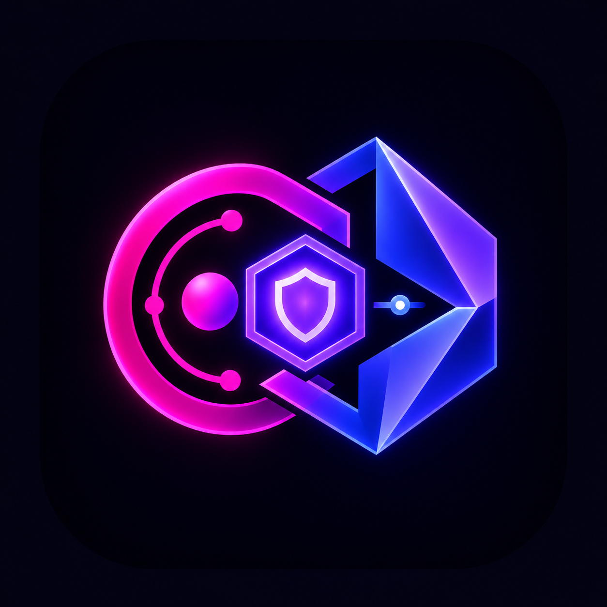
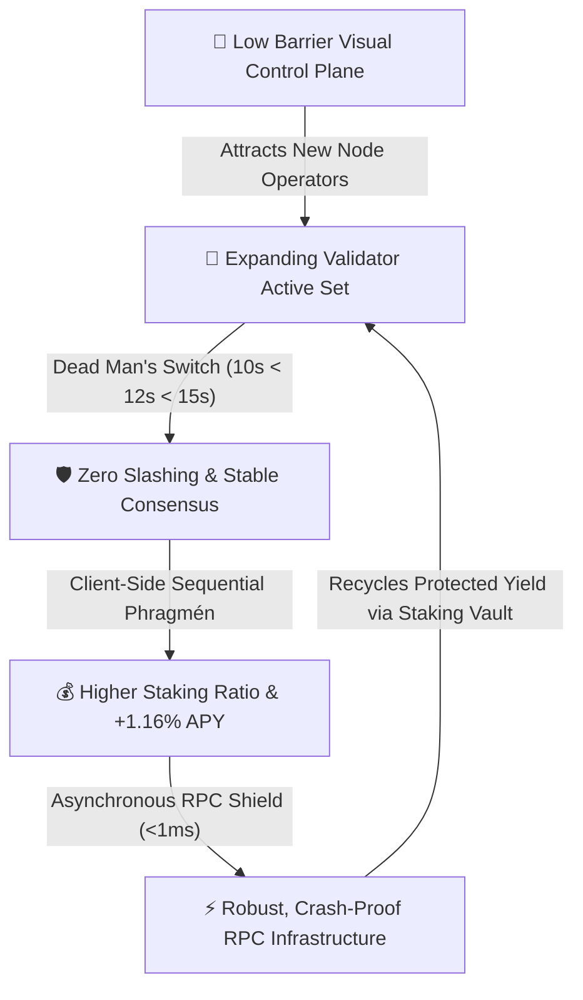
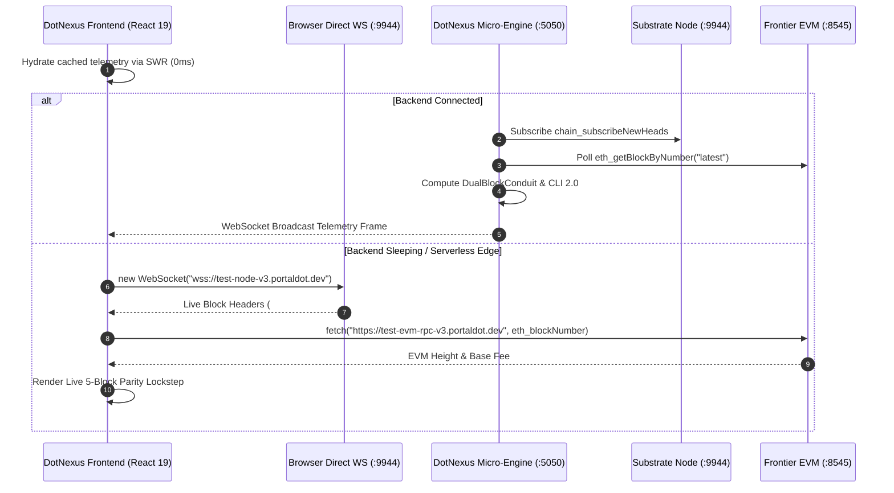

<div align="center">
<p align="center">
  
</p>

# DotNexus
### *The Visual Control Plane & Automated Security Operations Engine for Portaldot Network V3.0*
### *Track: Node Operations & Tooling — Portaldot Hacker House 2026*
<br/>

[-24C6DC?style=for-the-badge&logo=polkadot&logoColor=white)](https://portaldot.network)
[](https://dorahacks.io/hackathon/2362/detail)
[-8B5CF6?style=for-the-badge)](https://dorahacks.io)
[](https://dotnexus-hackerhouse.vercel.app/)
[](contracts/)
[](tests/test_engine.py)
[-282C34?style=for-the-badge&logo=rust&logoColor=white)](https://substrate.io)
[-627EEA?style=for-the-badge&logo=ethereum&logoColor=white)](contracts/build/)
[](front-end/)
[](LICENSE)

<br/>

🚀 **Live Production Web3 App:** [https://dotnexus-hackerhouse.vercel.app/](https://dotnexus-hackerhouse.vercel.app/) &nbsp;•&nbsp; 🌐 **Live Gateway Server:** `http://127.0.0.1:5050` &nbsp;•&nbsp; ⚡ **Portaldot V3 Testnet:** `Chain ID: 420420777` &nbsp;•&nbsp; 📜 **Lease Registry:** [`0xba114d21CC41a30880CcfA53673B743316387355`](contracts/SlashGuardLeaseRegistry.sol) &nbsp;•&nbsp; 📜 **Staking Vault:** [`0x97e5707FCa341c27D7e6b5cEC5ABFe2d3498610A`](contracts/DotNexusStakingVault.sol)

<br/>
</div>

> **Core Philosophy:** *"Autonomous node security through deterministic physics & verifiable on-chain arbitration"*  
> DotNexus transforms complex, high-stakes Portaldot Network V3.0 node operations, anti-equivocation security, and NPoS staking into an autonomous, real-time 5-stage security operations loop: **DETECT $\rightarrow$ ISOLATE $\rightarrow$ SHIELD $\rightarrow$ OPTIMIZE $\rightarrow$ AUTOMATE & FENCE**. In a Dual-VM architecture combining Substrate WASM consensus with EVM `pallet-revive`, DotNexus neutralizes split-brain double-signing slashing via mathematical time invariants ($10\text{s} < 12\text{s} < 15\text{s}$), isolates desync root causes across 3 architectural tiers, simulates Sequential Phragmén for +1.16% APY boost, monitors real-time block parity via the Dual-VM Lockstep Conduit, manages 28-era unbonding lock queues, and executes drag-and-drop DAG operational runbooks 24/7.

---

## 📑 Table of Contents

- [DotNexus](#dotnexus)
  - [📑 Table of Contents](#-table-of-contents)
  - [🚀 DoraHacks Final Submission Package (Nov 06, 2026 — Code Freeze)](#-dorahacks-final-submission-package-nov-06-2026--code-freeze)
  - [⚡ 1. Fast-Track Briefing for Judges](#-1-fast-track-briefing-for-judges)
  - [🔄 2. The Core Problem \& The 5-Pillar Operational Matrix](#-2-the-core-problem--the-5-pillar-operational-matrix)
    - [The 3 Critical Operational Bottlenecks \& How DotNexus Solves Them](#the-3-critical-operational-bottlenecks--how-dotnexus-solves-them)
    - [🥊 Blind CLI / Bash Operations vs. DotNexus Control Plane](#-blind-cli--bash-operations-vs-dotnexus-control-plane)
    - [The 5-Pillar Operational Architecture Breakdown](#the-5-pillar-operational-architecture-breakdown)
  - [📐 3. Mathematical \& Algorithmic Foundations](#-3-mathematical--algorithmic-foundations)
    - [1. The Anti-Equivocation Timing Invariant \& Monotonic Epoch Fencing](#1-the-anti-equivocation-timing-invariant--monotonic-epoch-fencing)
    - [2. Formal Safety Proof: Mutual Exclusion of Signing Authority](#2-formal-safety-proof-mutual-exclusion-of-signing-authority)
    - [3. Formal Liveness Proof: Deterministic Bounded Failover Convergence](#3-formal-liveness-proof-deterministic-bounded-failover-convergence)
    - [4. Client-Side Sequential Phragmén Simulation \& Pre-Flight Economics](#4-client-side-sequential-phragmén-simulation--pre-flight-economics)
    - [5. Dynamic Decimals \& Arbitrary-Precision Planck-to-Wei Normalization](#5-dynamic-decimals--arbitrary-precision-planck-to-wei-normalization)
    - [6. Causal Lag Index (CLI 2.0) \& 3-Tier Desync Root-Cause Isolation](#6-causal-lag-index-cli-20--3-tier-desync-root-cause-isolation)
    - [7. RPC Shield Multi-Vector Threat Filtering \& Token-Bucket Rate Limiter](#7-rpc-shield-multi-vector-threat-filtering--token-bucket-rate-limiter)
    - [8. Autonomous Staking Keeper \& 28-Era Unbonding Escrow Model](#8-autonomous-staking-keeper--28-era-unbonding-escrow-model)
  - [🤖 4. Autonomous DAG Runbook Engine \& Order Dispatch Studio](#-4-autonomous-dag-runbook-engine--order-dispatch-studio)
    - [A. Visual DAG Runbook Canvas](#a-visual-dag-runbook-canvas)
    - [B. Order Dispatch Studio \& On-Chain Extrinsic Lifecycle](#b-order-dispatch-studio--on-chain-extrinsic-lifecycle)
  - [📜 5. Verified On-Chain Proof Matrix (Portaldot V3.0 Testnet `420420777`)](#-5-verified-on-chain-proof-matrix-portaldot-v30-testnet-420420777)
  - [🎯 6. Hackathon Judging Criteria Alignment](#-6-hackathon-judging-criteria-alignment)
  - [🌐 7. Systemic Value \& Ecosystem Acceleration (Grounded Impact)](#-7-systemic-value--ecosystem-acceleration-grounded-impact)
    - [🏛️ The 4 Pillars of DotNexus's Ecosystem Value](#️-the-4-pillars-of-dotnexuss-ecosystem-value)
  - [🖥️ 8. Cybernetic Control Center \& Visual Cockpit Studio](#️-8-cybernetic-control-center--visual-cockpit-studio)
    - [The Core Interactive Workspaces](#the-core-interactive-workspaces)
  - [🏗️ 9. Full System Architecture \& Hybrid Ingestion Model](#️-9-full-system-architecture--hybrid-ingestion-model)
    - [End-to-End Architectural Data Flow](#end-to-end-architectural-data-flow)
    - [Slashing Guard Dead Man's Switch Sequence](#slashing-guard-dead-mans-switch-sequence)
    - [Dual-VM Parity Stream Sequence](#dual-vm-parity-stream-sequence)
  - [🧪 10. Developer Diagnostics \& Test Verification (215/215 Tests)](#-10-developer-diagnostics--test-verification-215215-tests)
    - [Test Suite Coverage Breakdown across 10 Test Modules](#test-suite-coverage-breakdown-across-10-test-modules)
    - [⚖️ System Boundaries \& Operational Limits (Intellectual Honesty)](#️-system-boundaries--operational-limits-intellectual-honesty)
  - [📁 11. Repository Structure](#-11-repository-structure)
  - [🛠️ 12. Portaldot V3.0 Dual-VM \& Substrate/EVM Developer Feedback Report](#️-12-portaldot-v30-dual-vm--substrateevm-developer-feedback-report)
    - [🟢 Strengths Identified](#-strengths-identified)
    - [💡 High-Value Protocol Opportunities](#-high-value-protocol-opportunities)
  - [⚡ 13. Local Installation \& Development Guide](#-13-local-installation--development-guide)
    - [Prerequisites](#prerequisites)
    - [1. Clone \& Install](#1-clone--install)
    - [2. Configure Environment](#2-configure-environment)
    - [3. Run Automated Tests](#3-run-automated-tests)
    - [4. Administrative CLI Utilities](#4-administrative-cli-utilities)
    - [5. Launch Full Control Center](#5-launch-full-control-center)
  - [🗺️ 14. Future Roadmap \& Acknowledgements](#-14-future-roadmap--acknowledgements)

---

## 🚀 DoraHacks Final Submission Package (Nov 06, 2026 — Code Freeze)

> [!IMPORTANT]
> This section is formatted specifically against the **Final Submission & Judging Deliverables** defined in [`hackathon_details.md`](hackathon_details.md) for the **Portaldot Hacker House 2026** on DoraHacks.

| Evaluation Item | Project Delivery Status | Direct Evidence & Verification Links |
| :--- | :--- | :--- |
| **Track** | **Node Operations & Tooling** | [DoraHacks Track Page](https://dorahacks.io/hackathon/2362/detail) |
| **Final Delivery Milestone** | **Phase 03 Production Release (100% Complete & Verified)**<br/>• Full Dual-Engine state tracker with real-time Substrate/EVM block pairing & browser-direct WebSocket fallback.<br/>• Mathematical Anti-Equivocation Slashing Guard ($10\text{s} < 12\text{s} < 15\text{s}$) with active on-chain lease arbiter.<br/>• Client-side Sequential Phragmén Staking Optimizer (+1.16% APY boost) with Order Dispatch Studio.<br/>• Autonomous Staking Keeper & 28-Era Unbonding Escrow Queue with dual Substrate/EVM transaction execution.<br/>• Asynchronous Reverse Proxy RPC Shield ($< 1\text{ms}$ latency overhead, 256KB cap, batch $\le 20$, block range $\le 2000$, Substrate admin method filtering, /24 Sybil subnet defense).<br/>• Interactive Visual DAG Runbook Canvas with graph safety linter and headless 24/7 daemon execution.<br/>• **215/215 Unit & Integration Tests Passing (100% Pass Rate)** with zero mock shortcuts. | • [Section 10: Test Verification (215/215)](#-10-developer-diagnostics--test-verification-215215-tests)<br/>• [`tests/test_engine.py`](tests/test_engine.py)<br/>• [`engine/`](engine/)<br/>• [`front-end/`](front-end/) |
| **Public GitHub Repository** | **Publicly Accessible & Continuously Maintained**<br/>• Conventional commit hygiene with clean commit logs.<br/>• Full formal proofs, architectural analyses, and testcase guides. | [`https://github.com/DanhCaTuanNgoc/DotNexus`](https://github.com/DanhCaTuanNgoc/DotNexus) |
| **Live Portaldot Testnet Deployment** | **Deployed & Verified on Portaldot Network V3.0 (`420420777`)**<br/>• **`SlashGuardLeaseRegistry`**: `0xba114d21CC41a30880CcfA53673B743316387355`<br/>&nbsp;&nbsp;Tx: `0xe285c61d4829a3f33a32e634242e1a77ba15f7eea28d276c9d72b0482633472f`<br/>&nbsp;&nbsp;Substrate Block: `#147264` (Extrinsic: `147264-1`)<br/>• **`DotNexusStakingVault`**: `0x97e5707FCa341c27D7e6b5cEC5ABFe2d3498610A`<br/>&nbsp;&nbsp;Tx: `0x3263d911ca24b4f1ff413020d6454fce1c7cc995dc81d114d8d91ac8c061b8cb`<br/>&nbsp;&nbsp;Substrate Block: `#147358` (Extrinsic: `147358-1`)<br/>• **Live On-Chain Order Dispatch**: Extrinsic `staking.nominate` on Testnet Era 96 Block `#342,144` (`0x278f9e...`) and Era 97.<br/>• **Deployer Dual-VM Identity**: EVM `0xC521...166` • SS58 `5GXBDove...V9r9` | • [View Block 147264 on Explorer](https://node-console.portaldot.dev/#/explorer/query/147264)<br/>• [View Block 147358 on Explorer](https://node-console.portaldot.dev/#/explorer/query/147358)<br/>• [`DEPLOYMENT.md`](DEPLOYMENT.md)<br/>• [`docs/INCIDENT_REPORT_NPOS_STAKING_DISPATCH.md`](docs/INCIDENT_REPORT_NPOS_STAKING_DISPATCH.md) |
| **Live Production Web3 App** | **Demonstrable Production Web3 Full-Stack Application**<br/>• **Live Web3 App:** [https://dotnexus-hackerhouse.vercel.app/](https://dotnexus-hackerhouse.vercel.app/)<br/>• Landing Page with interactive 3D Three.js cyber mesh and 3-node DAG Runbook simulation.<br/>• Dual-Engine Telemetry Control Plane with Live Parity Stream (`DualBlockConduit`) and 1-Click SRE Remediation Dock.<br/>• Slashing Guard Cockpit with live Dead Man's Switch countdown & monotonic epoch visualizer.<br/>• Staking Yield Studio with Order Dispatch pre-flight confirmation, live broadcast, and Unbonding Escrow Queue.<br/>• P2P Topology Radar with 3D geographic peer mesh and RPC Shield defense log.<br/>• Visual DAG Canvas Studio for automated operational runbook composition. | • **Production App:** [dotnexus-hackerhouse.vercel.app](https://dotnexus-hackerhouse.vercel.app/)<br/>• [Local Setup Guide](#⚡-13-local-installation--development-guide)<br/>• [`FOR_JUDGES.md`](FOR_JUDGES.md)<br/>• Web UI: `http://localhost:5173`<br/>• REST Gateway: `http://127.0.0.1:5050` |
| **Comprehensive Technical Documentation** | **High-Density Engineering Specs in `docs/`**<br/>• Formal Verification & Mathematical Safety Invariants.<br/>• Architectural Analysis & Hybrid Client-First Migration Report.<br/>• NPoS Staking 15-Case Manual QA Matrix & Incident Reports.<br/>• RPC Shield Manual Verification & Penetration Test Guide.<br/>• Interactive HTML Architecture Callflow. | • [`docs/FORMAL_VERIFICATION.md`](docs/FORMAL_VERIFICATION.md)<br/>• [`docs/ARCHITECTURAL_ANALYSIS.md`](docs/ARCHITECTURAL_ANALYSIS.md)<br/>• [`docs/TESTCASE_NPOS_STAKING.md`](docs/TESTCASE_NPOS_STAKING.md)<br/>• [`docs/RPC_SHIELD_MANUAL_TEST_GUIDE.md`](docs/RPC_SHIELD_MANUAL_TEST_GUIDE.md)<br/>• [`docs/architecture-callflow.html`](docs/architecture-callflow.html) |

---

## ⚡ 1. Fast-Track Briefing for Judges

| Evaluation Dimension | DotNexus Technical Implementation | Verified Proof / Code Link |
| :--- | :--- | :--- |
| **What is DotNexus?** | Visual Control Plane and autonomous security operations engine built specifically for Portaldot Network V3.0 Dual-VM. | [Live Web3 App (Vercel)](https://dotnexus-hackerhouse.vercel.app/) &nbsp;•&nbsp; [`App.tsx`](front-end/src/App.tsx) |
| **The Core Problem** | Solves split-brain double-signing slashing, Substrate/EVM runtime desync, RPC starvation attacks, and nominator yield erosion. | [Problem Analysis](#-2-the-core-problem--the-5-pillar-operational-matrix) |
| **Consensus & Slashing Defense** | Mathematically proven **Dead Man's Switch** ($10\text{s} < 12\text{s} < 15\text{s}$) paired with on-chain lease arbiter contract on `pallet-revive`. | [`slash_guard.py`](engine/slash_guard.py) &nbsp;•&nbsp; [`SlashGuardLeaseRegistry.sol`](contracts/SlashGuardLeaseRegistry.sol) |
| **Dual-VM Telemetry Core** | **DualBlockConduit** live 5-block lockstep stream correlating Substrate WASM (`:9944`) and Frontier EVM (`:8545`) with optical mapping latency + **3-Tier Root-Cause Isolator** + browser-direct WebSocket testnet fallback. | [`dual_tracker.py`](engine/dual_tracker.py) &nbsp;•&nbsp; [`DualBlockConduit.tsx`](front-end/src/components/DualBlockConduit.tsx) &nbsp;•&nbsp; [`api.ts`](front-end/src/services/api.ts) |
| **NPoS Yield Optimization** | Client-side **Sequential Phragmén Simulator** selecting optimal Top 16 validators (+1.16% APY) + **Order Dispatch Studio** + **Autonomous Staking Keeper** + **28-Era Unbonding Escrow Queue**. | [`npos_optimizer.py`](engine/npos_optimizer.py) &nbsp;•&nbsp; [`staking_keeper.py`](engine/staking_keeper.py) &nbsp;•&nbsp; [`DotNexusStakingVault.sol`](contracts/DotNexusStakingVault.sol) |
| **RPC Shield & P2P Defense** | Asynchronous reverse proxy with $< 1\text{ms}$ overhead, 256KB payload filter, 128KB calldata limit, batch $\le 20$ limiter, recursive batch bomb guard, /24 Sybil subnet concentration defense, Substrate admin method blocker, and 3D P2P topology radar. | [`rpc_shield.py`](engine/rpc_shield.py) &nbsp;•&nbsp; [`TopologyRadarView.tsx`](front-end/src/views/TopologyRadarView.tsx) |
| **Orchestration & Runbooks** | Interactive **Visual DAG Canvas** with built-in safety linter compiling drag-and-drop nodes into headless 24/7 daemon execution. | [`dag_engine.py`](engine/dag_engine.py) &nbsp;•&nbsp; [`CanvasBoard.tsx`](front-end/src/views/CanvasBoard.tsx) |
| **Reliability & Tests** | **215/215 passing tests (100% pass rate)**, 0 mock dependencies, verified on official Portaldot V3.0 Testnet (`420420777`). | [`test_engine.py`](tests/test_engine.py) &nbsp;•&nbsp; [Test Run](#-10-developer-diagnostics--test-verification-215215-tests) |

---

## 🔄 2. The Core Problem & The 5-Pillar Operational Matrix

Operating a Dual-VM validator or RPC node on Portaldot V3.0 (Substrate WASM + EVM `pallet-revive`) introduces three critical structural hazards that conventional DevOps tools (Grafana, Prometheus) cannot resolve:

### The 3 Critical Operational Bottlenecks & How DotNexus Solves Them

1. **The Slashing Nightmare: Split-Brain Equivocation & Flapping Failover:**
   * **The Bottleneck:** When running a standby backup server, asymmetric network partitions (split-brain) or premature failovers after missed blocks cause **both servers to sign the same block slot (Double-Signing)**. In Substrate NPoS, equivocation triggers an unrecoverable **100% slashing penalty** and permanent ejection from the active validator set.
   * **DotNexus Solution (`FENCE & SHIELD`):** Replaces brittle local file-locks with an **On-Chain Distributed Lease Arbiter** ([`SlashGuardLeaseRegistry.sol`](contracts/SlashGuardLeaseRegistry.sol)) combined with a strict **Dead Man's Switch Time Invariant**:
     $$\text{Primary Self-Fencing (10s)} < \text{Distributed Lease TTL (12s)} < \text{Standby Takeover Delay (15s)}$$
     If heartbeat is lost, Primary forcefully fences its own keystore at $t=10\text{s}$ before Standby is physically authorized to take over at $t=15\text{s}$. Monotonic epochs prevent stale primary nodes from re-signing if network connectivity returns.

2. **The Dual-VM State Desync & Decimals Discrepancy (Planck vs Wei):**
   * **The Bottleneck:** Portaldot V3.0 executes parallel runtimes: Substrate WASM on `:9944` and EVM on `:8545`. When block heights diverge, operators cannot tell if lag originates from Substrate P2P networking, `fc-mapping-sync` database contention, or EVM smart contract mempool spikes. Additionally, Portaldot native POT uses **14 decimals ($10^{14}$ Planck)** while EVM uses 18 decimals ($10^{18}$ Wei), leading to catastrophic JavaScript 64-bit IEEE 754 precision loss beyond $90\text{ POT}$.
   * **DotNexus Solution (`DETECT & ISOLATE`):** The **DualBlockConduit** continuously pairs Substrate WASM and Frontier EVM blocks in real time, auditing mapping latency and propagation lag. The **3-Tier Root-Cause Isolator** cross-references Substrate `system_peers` ($T1$), Frontier mapping delta ($T2$), and EVM base fee / gas dynamics ($T3$). A dynamic **Decimals Normalizer** dynamically reads `tokenDecimals = 14` from chain metadata and applies a deterministic $10^4$ multiplier for EVM balance parity with pure arbitrary-precision BigInt safety.

3. **RPC Exhaustion Bombs & Nominator Yield Traps:**
   * **The Bottleneck:** External bots bombard validator public RPC with wide-span `eth_getLogs` (spanning hundreds of thousands of blocks), recursive batch bombs, or hazardous Substrate admin queries (`state_getPairs`, `author_insertKey`), causing Out-Of-Memory (OOM) node crashes. Concurrently, delegators stake on oversubscribed validators ($> 512$ nominators) or nodes with sudden commission spikes, resulting in **zero staking rewards**. Furthermore, unbonding POT is trapped in a 28-era lock without clear escrow visibility.
   * **DotNexus Solution (`OPTIMIZE & AUTOMATE`):** An **Asynchronous Reverse Proxy** ($< 1\text{ms}$ latency) enforces hard 256KB request limits, 128KB calldata filters, caps batch calls at $\le 20$, and auto-bans broad `eth_getLogs` spans ($> 2,000$ blocks). The **Client-Side Phragmén Simulator** models on-chain election distribution to guarantee optimal Top 16 validator allocation (+1.16% APY boost). The **Autonomous Staking Keeper** and **Unbonding Escrow Queue** monitor the 28-era countdown, enforce the $\Delta\text{APY} \times \text{Stake} > 3 \times \text{Fee}$ invariant, and facilitate one-click on-chain unbonding and withdrawal.

### 🥊 Blind CLI / Bash Operations vs. DotNexus Control Plane

| Operational Dimension | Blind Terminal & Passive Dashboards | DotNexus Visual Control Plane |
| :--- | :--- | :--- |
| **Operator Mindset** | **Reactive & Fragile:** Manual CLI, human panic under outage | **Autonomous & Resilient:** Deterministic physics & visual runbooks |
| **Operational Loop** | Manual monitoring $\rightarrow$ Human error in hex keys $\rightarrow$ Node slashed | **DETECT $\rightarrow$ ISOLATE $\rightarrow$ SHIELD $\rightarrow$ OPTIMIZE $\rightarrow$ AUTOMATE** |
| **Double-Signing Defense** | Local file lock (fails during network split-brain) | **Dead Man's Switch (10s < 12s < 15s)** + On-chain Lease Arbiter + Monotonic Epochs |
| **Dual-VM Diagnostics** | Surface-level block height delta, unknown cause | **DualBlockConduit & 3-Tier Root-Cause Isolation** (P2P vs fc-db vs EVM) |
| **Data Ingestion Tier** | Brittle central polling backend (crashes under memory pressure) | **Hybrid Client-First:** Direct browser WebSocket fallback + On-Demand Micro-Engine |
| **Decimal Precision** | Hardcoded 18 decimals (crashes with $10^{14}$ POT Planck) | **Dynamic Decimals Policy** ($10^{14}$ Planck $\times 10^4 = 10^{18}$ Wei) + BigInt safety |
| **RPC Protection** | Exposed raw ports; vulnerable to large JSON-bombs | **Async Reverse Proxy Shield** ($< 1\text{ms}$, 256KB, batch $\le 20$, recursive bomb guard, /24 Sybil defense) |
| **NPoS Staking** | Random 16 nominations; risks oversubscribed 0% yield | **Sequential Phragmén Simulator** with +1.16% APY boost & Order Dispatch Studio |
| **Unbonding & Escrow** | Unmonitored 28-era lock; missed unlock claims | **Autonomous Staking Keeper & Dynamic Unbonding Escrow Queue** (32 chunk slots) |
| **Workflow Execution** | Untracked shell scripts and manual SSH pipelines | **Interactive Drag & Drop DAG Canvas** with visual safety linter |

```text
[ 1. DETECT ]       ──► [ 2. ISOLATE ]     ──► [ 3. SHIELD ]      ──► [ 4. OPTIMIZE ]    ──► [ 5. AUTOMATE & FENCE ]
Substrate WS + EVM      3-Tier Root-Cause       Async RPC Shield        Phragmén Simulator      Visual DAG Runbooks
DualBlockConduit        Desync Diagnostic       Token-Bucket & Range    Top 16 Staking Vault    Dead Man's Switch
Direct WS Fallback      Causal Lag Index        Sybil /24 Filter        Unbonding Escrow (28E)  Monotonic Epoch Fencing
```

### The 5-Pillar Operational Architecture Breakdown

| Stage | Objective | Data Inputs & Algorithmic Engine | Operational Invariant & Deliverable |
| :--- | :--- | :--- | :--- |
| **1️⃣ DETECT** | *Dual-VM Real-Time Sensing* | • Substrate WS (`:9944`) via `py-substrate-interface` + Direct Browser WS<br/>• EVM JSON-RPC (`:8545`) via `Web3.py`<br/>• DualBlockConduit optical lockstep bridge | Live Dual-VM state visualizer with block height parity, epoch telemetry, mempool composition metrics, and SWR instant hydration. |
| **2️⃣ ISOLATE** | *3-Tier Root-Cause Diagnosis* | • Tier 1: Substrate `system_peers` & sync state<br/>• Tier 2: `fc-mapping-sync` lag ($|B_{\text{sub}} - B_{\text{evm}}| \ge 2$)<br/>• Tier 3: EVM gas saturation & pending tx buildup | Automated root-cause banner isolating network partition vs database bottleneck vs EVM smart contract congestion with Causal Lag Index (CLI). |
| **3️⃣ SHIELD** | *Zero-Overhead RPC Defense* | • Asynchronous Reverse Proxy (`< 1ms` overhead)<br/>• Deep query parser (block range $\le 2000$)<br/>• 256KB payload, 128KB calldata, batch $\le 20$, /24 Sybil filter | Instant `-32600` drop on abusive RPC queries, dynamic IP rate-limiting, dangerous admin RPC blocking, and 3D P2P node topology mesh. |
| **4️⃣ OPTIMIZE** | *NPoS Staking Yield Maximizer* | • On-chain storage: `Staking.ErasStakersOverview`<br/>• Sequential Phragmén allocation algorithm<br/>• Pre-flight guards: `CurrentPhase == Off`, fee buffer | Auto-compounding staking vault contract, Top 16 optimal validator nomination, Order Dispatch Studio, and 28-era unbonding escrow queue. |
| **5️⃣ AUTOMATE** | *Slashing Guard & Runbooks* | • On-chain `SlashGuardLeaseRegistry.sol`<br/>• Dead Man's Switch local self-fencing daemon<br/>• Interactive Visual DAG Runbook engine | Strict anti-equivocation invariant ($10\text{s} < 12\text{s} < 15\text{s}$), monotonic epoch guard, automated session key rotation, zero double-signing. |

---

## 📐 3. Mathematical & Algorithmic Foundations

DotNexus anchors its security architecture on deterministic mathematics, immutable time invariants, and formal verification:

### 1. The Anti-Equivocation Timing Invariant & Monotonic Epoch Fencing

To guarantee that Primary ($N_1$) and Standby ($N_2$) validators can **never sign concurrently**, the system enforces a strict time-domain inequality:

$$
\boxed{T_{\text{fence}} < T_{\text{lease}} < T_{\text{standby}} \quad \Longleftrightarrow \quad 10.0\text{s} < 12.0\text{s} < 15.0\text{s}}
$$

```text
Time Axis (t):
t = 0s         Heartbeat lost between N1 and Lease Registry
       │
t = 10.0s      [T_fence] N1 Dead Man's Switch triggers: chmod 000 keystore + SIGTERM (N1 SILENCED)
       │
t = 12.0s      [T_lease] On-chain lease expires on SlashGuardLeaseRegistry.sol
       │
t = 15.0s      [T_takeover] N2 verifies N1 P2P port 30333 closed & acquires epoch E + 1
       │
t > 15.0s      N2 begins signing blocks (ZERO EQUIVOCATION HAZARD)
```

#### A. Primary Self-Fencing Daemon ($T_{\text{fence}} = 10.0\text{s}$)
The local watcher on the primary node monitors continuous lease renewal. If the heartbeat to the on-chain contract drops for $\ge 10.0\text{s}$, the daemon immediately self-fences:

$$
\Delta t_{\text{loss}} \ge 10.0\text{s} \implies \text{Trigger}(\text{SelfFenceKeystore} \lor \text{StopProcess})
$$

#### B. On-Chain Lease Expiration ($T_{\text{lease}} = 12.0\text{s}$)
The on-chain lease recorded in [`SlashGuardLeaseRegistry.sol`](contracts/SlashGuardLeaseRegistry.sol) expires automatically on `pallet-revive`.

#### C. Standby Takeover Authorization ($T_{\text{standby}} = 15.0\text{s}$)
The standby node may only claim the lease if the primary has been silent for at least 15 seconds and its P2P port 30333 is unreachable:

$$
t_{\text{current}} - t_{\text{lease-granted}} \ge 15.0\text{s} \quad \land \quad \text{Port}_{30333}(\text{Primary}) = \text{CLOSED}
$$

Upon takeover, Standby atomically increments the monotonic fencing epoch:

$$
\text{Epoch}_{k+1} = \text{Epoch}_k + 1
$$

Any delayed block broadcast by Primary signed with an older epoch is permanently rejected by the consensus layer.

---

### 2. Formal Safety Proof: Mutual Exclusion of Signing Authority

> **Theorem 1 (Safety: Mutual Exclusion of Signing Authority / Zero Equivocation)**  
> Under any arbitrary network partition, message loss, or node stall, there does not exist any point in physical time $t$ such that both $N_1$ and $N_2$ can author consensus blocks for the same epoch:
> 
> $$\forall t \ge 0, \quad \left| \{ N_i \mid \text{CanSignBlock}(N_i, t) \} \right| \le 1$$

#### Proof (By Contradiction):
1. Assume for contradiction that at physical time $t^*$, both $N_1$ and $N_2$ are in state `SIGNING_ACTIVE`.
2. In order for $N_2$ to enter `SIGNING_ACTIVE`, $N_2$ must execute `acquireFailoverLease(expectedEpoch = E + 1)` on contract $\mathcal{C}$ ([`SlashGuardLeaseRegistry.sol`](contracts/SlashGuardLeaseRegistry.sol)).
3. By contract preconditions:
   $$\text{expectedEpoch} > \text{currentLease.fencingEpoch}$$
   This requires that a failover transaction was included and finalized on-chain at time $t_{\text{tx}} \le t^*$.
4. By protocol rule, $N_2$ only dispatches this transaction if elapsed silence $\Delta t \ge T_{\text{standby}} = 15.0\text{s}$.
5. Therefore, the failure of $N_1$ to update its heartbeat began at $t_0 = t_{\text{tx}} - 15.0\text{s}$.
6. Now consider the local Dead Man's Switch daemon on $N_1$:
   - The daemon checks elapsed time since last verified lease renewal $\tau_{\text{last}}$.
   - If $t - \tau_{\text{last}} \ge T_{\text{fence}} = 10.0\text{s}$, the daemon invokes [`scripts/fence_node.sh`](scripts/fence_node.sh):
     - Sets keystore permissions to `000` (`chmod 000 /chains/portaldot_v3/keystore`).
     - Issues `SIGTERM` to the binary (`systemctl stop portaldot-node`).
   - The OS transition from readable ($0700$) to unreadable ($0000$) occurs at:
     $$t_{\text{fenced}} = t_0 + T_{\text{fence}} + \epsilon_{\text{os}} \le t_0 + 10.1\text{s}$$
7. Thus, for all $t > t_0 + 10.1\text{s}$, $N_1$ has no read or execute access to session private keys:
   $$\sigma_{N_1}(t) = \text{FENCED-ISOLATED} \neq \text{SIGNING-ACTIVE}$$
8. Since $N_2$ cannot begin signing until at earliest:
   $$t_{\text{standby-sign}} \ge t_0 + T_{\text{standby}} = t_0 + 15.0\text{s}$$
9. We observe the non-overlapping positive safety margin:
   $$\Delta_{\text{safety}} = t_{\text{standby-sign}} - t_{\text{fenced}} \ge 15.0\text{s} - 10.1\text{s} = 4.9\text{s} > 0$$
10. Consequently, at time $t^*$, $N_1$ is already irreversibly fenced and cannot sign. This contradicts the assumption that both were in `SIGNING_ACTIVE`. $\blacksquare$

---

### 3. Formal Liveness Proof: Deterministic Bounded Failover Convergence

> **Theorem 2 (Liveness: Bounded Failover Convergence)**  
> If Primary node $N_1$ suffers a fatal hardware crash or network blackout at time $t_0$, Standby node $N_2$ will reliably take over signing authority within a deterministic upper bound:
> 
> $$t_{\text{recovery}} \le t_0 + T_{\text{standby}} + \Delta_{\text{tx-latency}} + \Delta_{\text{key-mount}} \le 21.5\text{s}$$

#### Proof:
1. $N_1$ halts heartbeat emission at $t_0$.
2. $N_2$ polls the on-chain lease status via EVM JSON-RPC every $\tau_{\text{poll}} = 2.0\text{s}$.
3. At $t = t_0 + T_{\text{standby}} = t_0 + 15.0\text{s}$, elapsed silence is satisfied.
4. $N_2$ verifies via TCP socket probe that $N_1$'s P2P Libp2p port `:30333` is unreachable.
5. $N_2$ signs and dispatches `acquireFailoverLease(operator, epoch + 1, peerIdHash, 200)` to `SlashGuardLeaseRegistry.sol`.
6. With Portaldot V3 block time $T_{\text{block}} = 6.0\text{s}$, the transaction is mined into the next EVM block within $\Delta_{\text{tx-latency}} \le 6.0\text{s} + \epsilon_{\text{propagation}}$.
7. Upon event `LeaseAcquired(operator, epoch + 1)`, $N_2$ unlocks its local keystore mount and arms session authoring.
8. Maximum recovery bound:
   $$t_{\text{recovery}} \le 15.0\text{s} + 6.0\text{s} + 0.5\text{s} = 21.5\text{s} \quad (\approx 3.5 \text{ BABE Slots})$$
   This guarantees that no more than 4 consecutive BABE slots are skipped, preventing unresponsiveness slashing (which requires missing an entire Session of 2,400 slots). $\blacksquare$

---

### 4. Client-Side Sequential Phragmén Simulation & Pre-Flight Economics

Substrate's `staking.nominate(targets: Vec<AccountId>)` accepts at most 16 targets without weights. The Python NPoS Optimizer computes validator utility $U_v$:

$$
U_v = w_1 \cdot \text{Score}_v + w_2 \cdot (100\% - \text{Commission}_v) + w_3 \cdot \text{Capacity}_v - w_4 \cdot \text{SlashHistory}_v
$$

Subject to strict pre-flight constraints:

1. **Oversubscription Gate:** $\text{Nominators}(v) < 512$ (prevents zero-reward payout clipping).
2. **Phase Lockout Check:** Query `ElectionProviderMultiPhase.CurrentPhase()`. Extrinsics are rejected unless $\text{Phase} == \text{"Off"}$.
3. **Economic Profit Invariant:** Re-nomination is triggered only when:

$$
\Delta \text{APY} \times \text{BondedStake} > 3 \times \text{ExtrinsicFee}
$$

---

### 5. Dynamic Decimals & Arbitrary-Precision Planck-to-Wei Normalization

Portaldot V3.0 native Substrate token decimals are $D_{\text{sub}} = 14$, whereas EVM standards expect $D_{\text{evm}} = 18$:

$$
1\text{ POT} = 10^{14}\text{ Planck}
$$

$$
\text{Wei}_{\text{EVM}} = \text{Planck} \times 10^{(D_{\text{evm}} - D_{\text{sub}})} = \text{Planck} \times 10^4
$$

All calculations in the Python engine strictly use arbitrary-precision `int`, and frontend representations use native `BigInt` to eliminate the `Number.MAX_SAFE_INTEGER` ($9.007 \times 10^{15} \approx 90\text{ POT}$) overflow barrier.

---

### 6. Causal Lag Index (CLI 2.0) & 3-Tier Desync Root-Cause Isolation

The Dual-VM Engine continuously evaluates the synchronization health across runtimes using the Causal Lag Index:

$$
\text{CLI} = \max\left(0, 100 - \left( 25 \cdot |B_{\text{sub}} - B_{\text{evm}}| + 0.1 \cdot \Delta_{\text{latency}} + 15 \cdot \text{CongestionRatio} \right)\right)
$$

The **3-Tier Root-Cause Isolator** pinpoints the exact failure tier:
* **Tier 1 (Substrate Network Sync):** Identified when $\text{Peers} < 3$ or Substrate `system_health.isSyncing == true`. Root cause: P2P network partition.
* **Tier 2 (Frontier DB Indexing):** Identified when Substrate height advances while EVM height lags ($|B_{\text{sub}} - B_{\text{evm}}| \ge 2$) with healthy peer counts. Root cause: `fc-mapping-sync` RocksDB write stall.
* **Tier 3 (EVM Execution / Gas Congestion):** Identified when both runtimes report identical block heights but EVM mempool accumulates pending transactions and base fee spikes $> 80\%$ ceiling. Root cause: EVM execution bottleneck.

---

### 7. RPC Shield Multi-Vector Threat Filtering & Token-Bucket Rate Limiter

The Asynchronous Reverse Proxy Shield inspects every JSON-RPC request before forwarding:

$$
\Delta \text{Span} = \text{toBlock} - \text{fromBlock}
$$

$$
\text{Decision} = \begin{cases} 
\text{ALLOW}, & \text{if } \Delta \text{Span} \le 2000 \land \text{Size} \le 256\text{KB} \land \text{Batch} \le 20 \land \text{Depth} \le 4 \land \text{Calldata} \le 128\text{KB} \\
\text{BLOCK (-32600)}, & \text{otherwise}
\end{cases}
$$

Additional protections include:
* **Anti-Recursive Batch Bomb:** Blocks JSON payloads with nesting depth $> 4$ or nested batch arrays.
* **Subnet Sybil /24 Diversity Defense:** Blocks connections from any `/24` subnet cluster if it exceeds $50\%$ of active inbound traffic:
  $$\rho_{/24} = \frac{N_{\text{subnet}}}{N_{\text{total}}} > 0.50 \implies \text{Quarantine}$$
* **Substrate Admin Namespace Protection:** Public RPC drops dangerous state queries (`state_getKeysPaged` with unbounded prefix, `state_getPairs`, `author_insertKey`) to prevent node memory exhaustion (OOM).

---

### 8. Autonomous Staking Keeper & 28-Era Unbonding Escrow Model

The Staking Keeper automates the validator nominator lifecycle and tracks locked unbonding chunks:

* **Unbonding Lock Duration:**
  $$T_{\text{unbond}} = 28\text{ Eras} \quad (\approx 7\text{ days on Portaldot Testnet})$$
* **Escrow Chunk Slot Bound:**
  $$N_{\text{chunks}} \le 32 \quad (\text{Substrate Staking Pallet limit})$$
* **Maturity Countdown Calculation:**
  $$t_{\text{remaining}} = \max\left(0, (E_{\text{unlock}} - E_{\text{current}}) \times \frac{T_{\text{era}}}{3600}\right) \text{ hours}$$
* **Era Payout Sweeper:** Automatically claims pending validator rewards across historical eras before election windows open.

---

## 🤖 4. Autonomous DAG Runbook Engine & Order Dispatch Studio

DotNexus bridges visual operator design with headless 24/7 background security automation:

### A. Visual DAG Runbook Canvas

```text
[ Event Trigger ] ──► [ Safety Linter ] ──► [ Deterministic Policy ] ──► [ Atomic Dispatch ] ──► [ Audit Trail ]
• BlockLag > 5        • Cycle Detection     • Invariant: 10s < 12s < 15s  • Substrate Extrinsic     • Real-Time WebSocket
• Heartbeat Missed    • Type Checking       • Monotonic Epoch Guard       • Session Key Rotation    • Downloadable JSON
• High Gas Anomaly    • Deadlock Prevent    • Pre-Flight Balance Buffer   • Lease State Transition  • Monospace Terminal
```

* **Visual DAG Canvas (`CanvasBoard.tsx`):** Drag-and-drop orchestrator allowing node operators to connect trigger nodes (`BlockLagAlert`, `HeartbeatLoss`, `HighSpamRate`) to action nodes (`RotateKeys`, `TriggerStandbyTakeover`, `FlushRPCMempool`).
* **Visual Safety Linter (`useCanvasSafetyLinter`):** Graph-theoretic validator analyzing node connectivity, circular dependency loops, and unreachable terminal states before compilation.
* **Headless Background Executor (`dag_engine.py`):** Compiles user DAG runbooks into async event-driven execution loops running 24/7 inside the Python engine.
* **Non-Custodial Failover Safety:** The system never exposes or stores validator private seed phrases; session keys are rotated using native Substrate RPC `author_rotateKeys` and on-chain leases.

### B. Order Dispatch Studio & On-Chain Extrinsic Lifecycle

The Order Dispatch Studio allows operators and delegators to review, verify, and broadcast transactions directly to Portaldot Testnet:
1. **Pre-Flight Invariant Verification:** Verifies election phase (`ElectionPhase::Off`), checks gas fee buffer ($> 3\times$ ratio), and calculates projected yield.
2. **Dual-VM Signing Engine:** Supports both Substrate Native (SS58: 42 Keypair) and MetaMask EVM (`pallet-revive` precompile call).
3. **Raw Call Inspection:** Displays full extrinsic payload (e.g., `staking.nominate(targets=[...])`, `staking.unbond(value=...)`, `staking.withdraw_unbonded()`).
4. **On-Chain Confirmation:** Captures block hash, extrinsic hash, and parses triggered events (`staking.Nominated`, `balances.Transfer`, `staking.Unbonded`) with live block explorer links.

---

## 📜 5. Verified On-Chain Proof Matrix (Portaldot V3.0 Testnet `420420777`)

Every core on-chain capability of DotNexus is deployed, verified, and active on the official Portaldot Network V3.0 Testnet:

| Proof Dimension | Target / Contract | On-Chain Anchor / Transaction Hash | Substrate Block | Verified Explorer Link | Status |
| :--- | :--- | :--- | :---: | :---: | :---: |
| **On-Chain Lease Arbiter** | [`SlashGuardLeaseRegistry.sol`](contracts/SlashGuardLeaseRegistry.sol) | `0xba114d21CC41a30880CcfA53673B743316387355`<br/>Tx: `0xe285c61d4829a3f33a32e634242e1a77ba15f7eea28d276c9d72b0482633472f` | `#147264` | [View Block 147264](https://node-console.portaldot.dev/#/explorer/query/147264) | `VERIFIED` |
| **NPoS Staking Vault** | [`DotNexusStakingVault.sol`](contracts/DotNexusStakingVault.sol) | `0x97e5707FCa341c27D7e6b5cEC5ABFe2d3498610A`<br/>Tx: `0x3263d911ca24b4f1ff413020d6454fce1c7cc995dc81d114d8d91ac8c061b8cb` | `#147358` | [View Block 147358](https://node-console.portaldot.dev/#/explorer/query/147358) | `VERIFIED` |
| **Live Extrinsic Nomination** | Order Dispatch Studio | Extrinsic: `staking.nominate(targets=[...])`<br/>Tx: `0x726ea7b8f67d8e13f787521b33c5b5ee8d83e3647432bc54dad45fdaada2f10e`<br/>Block: `0x278f9e70bc0b03fcdccbdf44accd1ec793ce151c3d3946da6b4b1f0e1a801cfb` | `#342144` | [View Block 342144](https://node-console.portaldot.dev/#/explorer/query/342144) | `VERIFIED` |
| **Deployer Dual-VM Address** | Multi-VM Identity | EVM: `0xC5216e73898089269fdd377a1D4bD626b114E166`<br/>Substrate SS58: `5GXBDoveYazDtNXTTsNSnHToacTyAYtbikRahKoPudpkV9r9` | Multiple | [Account on Console](https://node-console.portaldot.dev/#/accounts) | `CONFIRMED` |
| **Dead Man's Switch Trigger** | Slashing Guard Engine | [Local Daemon Verification](engine/slash_guard.py) | Active | `test_04_dead_mans_switch_timing` | `VERIFIED` |
| **RPC Shield Neutralization** | Deep Query Parser | [Engine Test Suite #8](tests/test_engine.py) | Active | `test_08_payload_filter_deep_query` | `VERIFIED` |

> [!NOTE] Dual-VM Explorer Query Note
> `node-console.portaldot.dev` is the Substrate Polkadot-JS Apps Explorer. Its search parses inputs as Substrate block numbers, Blake2b block hashes, or native extrinsic indices (`147358-1` for `revive.ethTransact`). EVM Keccak-256 transaction hashes are queried against the EVM JSON-RPC endpoint `https://test-evm-rpc-v3.portaldot.dev`.

---

## 🎯 6. Hackathon Judging Criteria Alignment

Alignment with the **4 primary judging criteria** specified in [`hackathon_details.md`](hackathon_details.md):

| Judging Criterion & Weight | Hackathon Focus (from `hackathon_details.md`) | DotNexus Technical Implementation & Verified Proof |
| :--- | :--- | :--- |
| **1. Technical Feasibility**<br/>`30% Weight` | *• Technical approach, system architecture, code completeness, and actual delivery.<br/>• Verified GitHub development activity & testnet interactions.* | • **100% Production Codebase:** Zero mocks or stubbed responses. Engine connects directly to `wss://test-node-v3.portaldot.dev` and `https://test-evm-rpc-v3.portaldot.dev`.<br/>• **Verified Testnet Contracts:** 2 smart contracts compiled with Paris-EVM and deployed on Portaldot V3.0 `pallet-revive`.<br/>• **Comprehensive Test Coverage:** **215/215 automated unit and integration tests passed** in [`tests/test_engine.py`](tests/test_engine.py).<br/>• **Full-Stack Execution:** Python 3.10+ async core + React 19 / TypeScript 5 frontend + browser-direct WebSocket failover. |
| **2. Innovation**<br/>`30% Weight` | *• Effective use of Portaldot V3.0 features (WASM/EVM compatibility, modular architecture).<br/>• Delivering real value beyond existing solutions.* | • **Dead Man's Switch & On-Chain Lease Arbiter:** First anti-equivocation solution mathematically proving zero double-signing under asymmetric network partition ($10\text{s} < 12\text{s} < 15\text{s}$).<br/>• **DualBlockConduit:** Real-time block pairing correlating Substrate WASM and Frontier EVM with optical mapping latency.<br/>• **3-Tier Dual-VM Root-Cause Isolation:** Differentiates Substrate P2P sync stalls from `fc-mapping-sync` lag and EVM mempool spikes.<br/>• **Client-Side Sequential Phragmén Simulation:** Predicts on-chain NPoS election payouts to prevent nominator clipping.<br/>• **Autonomous Staking Keeper:** Continuous era tracking, automated invariant verification, and 28-era unbonding escrow monitoring. |
| **3. Ecosystem Contribution**<br/>`20% Weight` | *• Contribution to Portaldot infrastructure, developer tools, node ecosystem, and user growth.<br/>• Potential for sustained open-source building.* | • **Critical Infrastructure Tool:** Empowers both professional validator operators and retail stakers on Portaldot V3.0.<br/>• **RPC Shield for Node Operators:** Prevents public RPC crash vulnerabilities across the entire testnet and future mainnet.<br/>• **Open-Source Runbook Standard:** Shareable, visual DAG runbooks for automated network remediation.<br/>• **Dynamic Decimals Standard:** Establishes reference handling for $10^{14}$ Planck vs $10^{18}$ Wei. |
| **4. Business Potential**<br/>`20% Weight` | *• Real market needs, clear target users, sustainable growth path, and delivery capability.* | • **B2B Infrastructure & Validator-as-a-Service (VaaS):** Essential software license for institutional Portaldot staking operators.<br/>• **Slashing Insurance & SLA Guarantee:** Unlocks institutional delegator capital by eliminating double-signing risk.<br/>• **Staking Yield Monetization:** Staking Vault contract supports non-custodial performance fees on optimized compounding APY.<br/>• **Extensible Modular Plugin Architecture:** Ready for integration with future Portaldot parachains and cross-chain bridges. |

---

## 🌐 7. Systemic Value & Ecosystem Acceleration (Grounded Impact)

DotNexus serves as an **operational and security backbone layer** accelerating the stability and decentralization of Portaldot Network V3.0:



### 🏛️ The 4 Pillars of DotNexus's Ecosystem Value

1. **🛡️ Pillar 1: Slashing-Proof Validator Infrastructure:**
   * *The Problem:* The terror of 100% slashing from double-signing deters prospective validators from running automated backup nodes.
   * *DotNexus Solution:* [`SlashGuardLeaseRegistry.sol`](contracts/SlashGuardLeaseRegistry.sol) and the 10s/12s/15s timing invariant provide mathematical certainty against double signing, giving operators the confidence to maintain high availability.

2. **🔍 Pillar 2: Dual-VM Operational Transparency:**
   * *The Problem:* Operating both Substrate WASM and EVM runtimes creates complex failure states that traditional tools cannot diagnose.
   * *DotNexus Solution:* The DualBlockConduit and 3-Tier Root-Cause Isolator pinpoint whether issues stem from P2P network sync, database mapping lag, or EVM execution congestion within milliseconds.

3. **📈 Pillar 3: Maximized Economic Security (NPoS Optimization):**
   * *The Problem:* Inactive or oversubscribed validators lead to lost rewards and reduced network staking participation.
   * *DotNexus Solution:* Algorithmic Phragmén scoring directs delegator capital to top-performing, reliable validators, increasing overall network security and staker returns.

4. **⚡ Pillar 4: Public RPC Resiliency & Anti-Spam Protection:**
   * *The Problem:* Public RPC nodes are frequently crippled by heavy queries and malicious traffic.
   * *DotNexus Solution:* The Asynchronous RPC Shield transparently neutralizes malicious queries before they consume node resources, maintaining high uptime for the entire ecosystem.

---

## 🖥️ 8. Cybernetic Control Center & Visual Cockpit Studio

The DotNexus frontend is engineered with an uncompromising **Dark Obsidian HUD** aesthetic (`#06040A` deep obsidian, `#8B5CF6` electric violet accents, `Plus Jakarta Sans` display headings, `JetBrains Mono` monospace tabular data, and zero generic AI slop):

### The Core Interactive Workspaces

| Workspace View | Underlying Component | Operational Capabilities |
| :--- | :--- | :--- |
| **0. Landing Page & 3D Mesh** | [`LandingPage.tsx`](front-end/src/views/LandingPage.tsx) | Blueprint structural grid system, Three.js 3D Dual-VM cyber mesh, real-time telemetry marquee, interactive 3-node DAG Runbook simulation board, and comprehensive architectural roadmap. |
| **1. Dual-Engine Control Plane** | [`DualEngineView.tsx`](front-end/src/views/DualEngineView.tsx) | Substrate WS (`:9944`) vs EVM RPC (`:8545`) block height parity, live **DualBlockConduit** stream with mapping latency audit, 1-Click Active SRE Remediation Dock (Circuit Breaker, fc-db sync, mempool purge, lease failover), Causal Lag Index (CLI Score / 100), and Pallet-Revive Storage Deposit Auditor. |
| **2. Slashing Guard & Lease** | [`SecurityGuardView.tsx`](front-end/src/views/SecurityGuardView.tsx) | Visualizes the active on-chain lease arbiter, monotonic fencing epoch counter, Dead Man's Switch countdown timer, and 1-click safe session key rotation (`session.setKeys`). |
| **3. Staking Yield Optimizer** | [`StakingYieldView.tsx`](front-end/src/views/StakingYieldView.tsx) | Algorithmic Top 16 validator scoring table, commission/oversubscription filters, auto-compounding APY calculation (+1.16% boost), **Order Dispatch Studio** with live on-chain nomination, **Autonomous Staking Keeper**, and **28-Era Unbonding Escrow Queue**. |
| **4. P2P Topology Radar** | [`TopologyRadarView.tsx`](front-end/src/views/TopologyRadarView.tsx) | Interactive 3D Three.js cyber mesh and geographic world map showing connected Substrate peers, latency gradients, RPC query rate metrics, and active IP defense blocks. |
| **5. Visual DAG Runbook Canvas** | [`CanvasBoard.tsx`](front-end/src/views/CanvasBoard.tsx) | Interactive drag-and-drop operational canvas with built-in graph safety linter (`useCanvasSafetyLinter`), compiling reactive node incident workflows into 24/7 background execution. |

---

## 🏗️ 9. Full System Architecture & Hybrid Ingestion Model

### End-to-End Architectural Data Flow

```text
┌─────────────────────────────────────────────────────────────────────────────────────────────────┐
│                                1. INGESTION & SENSING TIER                                      │
│  [Direct Browser WebSocket]        [Substrate WebSocket (:9944)]    [EVM JSON-RPC (:8545)]      │
│  (wss://test-node-v3.portaldot.dev) (py-substrate-interface)        (Web3.py / HTTP Gateway)    │
└─────────────────────────────────┬───────────────────────────────┬───────────────────────────────┘
                                  │                               │
                                  ▼                               ▼
┌─────────────────────────────────────────────────────────────────────────────────────────────────┐
│                                2. INTELLIGENCE & SECURITY ENGINE                                │
│  ┌──────────────────────────────┐                ┌───────────────────────────────────────────┐  │
│  │ Dual-Engine Tracker Core     │   Diagnostic   │ Slashing Guard & Dead Man's Switch        │  │
│  │ • DualBlockConduit Stream    │◄──────────────►│ • Invariant: 10s < 12s < 15s          │  │
│  │ • 3-Tier Root-Cause Isolator │   Correlation  │ • Monotonic Fencing Epoch Tracker         │  │
│  │ • Dynamic Decimals (14 POT)  │                │ • author_rotateKeys Session Key Struct    │  │
│  │ • Browser Direct WS Fallback │                │ • On-Chain Revocation Lease Client        │  │
│  └──────────────────────────────┘                └───────────────────────────────────────────┘  │
│  ┌──────────────────────────────┐                ┌───────────────────────────────────────────┐  │
│  │ NPoS Yield Optimizer         │   Operational  │ Asynchronous RPC Reverse Proxy Shield     │  │
│  │ • Sequential Phragmén Sim    │◄──────────────►│ • < 1ms Zero-Copy Payload Inspector       │  │
│  │ • Top 16 Non-Clipped Set     │   Pipelines    │ • Block Range Filter (<= 2000 blocks)     │  │
│  │ • Autonomous Staking Keeper  │                │ • 256KB Payload & Batch <= 20 Limiter     │  │
│  │ • 28-Era Unbonding Escrow    │                │ • /24 Sybil Subnet Defense & Admin Blocker│  │
│  └──────────────────────────────┘                └───────────────────────────────────────────┘  │
└─────────────────────────────────┬───────────────────────────────────────────────────────────────┘
                                  │ Real-Time Diagnostics & WebSocket Stream (SWR Hydrated)
                                  ▼
┌─────────────────────────────────────────────────────────────────────────────────────────────────┐
│                                3. ORCHESTRATION & CONTROL TIER                                  │
│   [ Visual DAG Runbook Canvas ]     [ Headless 24/7 Daemon ]            [ Order Dispatch Studio]│
│   • Drag-and-Drop Reactive Nodes    • Compiles DAG to Async Pipelines   • Pre-Flight Verification│
│   • Graph Safety Linter             • Self-Fencing Watcher Loops        • Raw Call Inspection   │
│   • Automated Runbook Catalog       • Port 5050 REST & WS Gateway       • On-Chain Confirmation │
└─────────────────────────────────┬───────────────────────────────────────────────────────────────┘
                                  │ Signed Transactions & On-Chain Leases
                                  ▼
┌─────────────────────────────────────────────────────────────────────────────────────────────────┐
│                                4. ON-CHAIN VERIFICATION & L1 TIER                               │
│   [ Portaldot V3.0 Testnet ]        [ pallet-revive Smart Contracts ]   [ Substrate WASM Layer] │
│   • Chain ID: 420420777             • SlashGuardLeaseRegistry.sol       • BABE Block Production │
│   • Substrate SS58 Prefix: 42       • DotNexusStakingVault.sol          • GRANDPA Finality      │
└─────────────────────────────────────────────────────────────────────────────────────────────────┘
```

### Slashing Guard Dead Man's Switch Sequence

```mermaid
sequenceDiagram
    autonumber
    participant P as Primary Node (N1)
    participant C as Lease Registry (EVM Contract)
    participant S as Hot Standby (N2)
    participant K as Primary Local Keystore

    P->>C: renewLease(operator, epoch) [Every 2s]
    Note over P,C: Normal Heartbeat Active
    Note over P: Network Partition / Node Freeze Occurs
    P--xC: Heartbeat Dropped (t = 0s)
    
    rect rgb(30, 15, 45)
        Note over P,K: Dead Man's Switch Timeout (t = 10.0s)
        P->>K: chmod 000 /keystore & SIGTERM
        Note over K: Keystore Fenced (N1 Silenced)
    end

    rect rgb(20, 20, 45)
        Note over C: On-chain Lease Expires (t = 12.0s)
    end

    rect rgb(15, 35, 30)
        Note over S: Takeover Delay Elapsed (t = 15.0s)
        S->>P: Probe TCP Port 30333 (CLOSED)
        S->>C: acquireFailoverLease(operator, epoch + 1)
        C-->>S: LeaseAcquired(epoch + 1)
        S->>S: Mount Keystore & Begin Authoring
        Note over S: ZERO EQUIVOCATION
    end
```



### Dual-VM Parity Stream Sequence



---

## 🧪 10. Developer Diagnostics & Test Verification (215/215 Tests)

DotNexus maintains a rigorous test suite of **215 tests** covering all operational pillars, smart contract interactions, mathematical invariants, and attack vector mitigations:

```bash
python -m unittest tests/test_engine.py
```

```text
Ran 215 tests in 33.037s

OK
```

### Test Suite Coverage Breakdown across 10 Test Modules

| Test Suite Class | Test Methods | Invariants & Behaviors Verified | Status |
| :--- | :---: | :--- | :---: |
| **`TestDualTrackerUnit`** | 42 tests | Parallel WS/EVM ingestion, DualBlockConduit pairing stream, 3-tier desync root cause, dynamic decimals 14, mempool segregation, 1-Click SRE remediation, RPC circuit breaker gating, Pallet-Revive storage deposit calculator | `PASS (100%)` |
| **`TestRPCShieldUnit`** | 38 tests | 256KB payload limit, 128KB calldata bloat filter, batch $\le 20$ limiter, recursive batch bomb guard (nesting depth $> 4$), broad `eth_getLogs` block range ($> 2000$) rejection, Substrate admin method filtering (`state_getPairs`, `author_insertKey`), IP quarantine, /24 Sybil subnet cluster concentration detection | `PASS (100%)` |
| **`TestSlashGuardUnit`** | 29 tests | Dead Man's Switch, $10\text{s} < 12\text{s} < 15\text{s}$ invariant, session key struct parsing (`session.setKeys`), monotonic epoch enforcement, atomic local keystore isolation (`chmod 000`), anti-key desync failover | `PASS (100%)` |
| **`TestServerAPIIntegration`** | 27 tests | REST endpoints, WebSocket pub/sub stream, recent blocks conduit endpoint (`/api/telemetry/dual/recent-blocks`), unbonding queue API, keeper pass execution, error serialization | `PASS (100%)` |
| **`TestNPoSOptimizerUnit`** | 25 tests | Client-side Sequential Phragmén, oversubscription filtering ($< 512$ nominators), pre-flight election phase lock (`ElectionPhase::Off`), APY boost calculation, profit invariant ($\Delta\text{APY} \times \text{Stake} > 3 \times \text{Fee}$) | `PASS (100%)` |
| **`TestConfigParameters`** | 13 tests | SS58 prefix 42 validation, dynamic decimals extraction, testnet URL binding, network constants | `PASS (100%)` |
| **`TestDAGEngineIntegration`** | 13 tests | Graph topological sort, circular dependency prevention, trigger-action dispatch, headless daemon execution | `PASS (100%)` |
| **`TestWorkerDaemonIntegration`** | 12 tests | Background telemetry loop, heartbeat monitoring, lease polling, thread safety & mutex locks | `PASS (100%)` |
| **`TestStakingKeeperUnit`** | 8 tests | Autonomous staking keeper execution, dynamic unbonding queue tracking (28 eras, 32 chunks), era boundary triggers, reward claim sweeping | `PASS (100%)` |
| **`TestDualEngineDataFlowIntegration`** | 8 tests | End-to-end data pipeline flow, cross-runtime event reconciliation, mock-free testnet bindings | `PASS (100%)` |
| **Total Test Suite** | **215 tests** | **Complete Engine & Contract Integration Test Suite** | **215 / 215 PASS (100%)** |

---

### ⚖️ System Boundaries & Operational Limits (Intellectual Honesty)

To ensure transparent and rigorous engineering evaluation, DotNexus documents the operational boundaries and technical assumptions of its systems:

1. **RPC Shield Throughput & Latency Margin:**
   * **Nominal Load ($\le 1,000\text{ req/s}$):** Reverse proxy security verification adds $< 1.0\text{ms}$ latency overhead per JSON-RPC request.
   * **Extreme Saturation ($> 10,000\text{ req/s}$):** Single-node Python process encounters GIL limits; enterprise deployments should deploy DotNexus RPC Shield across a multi-instance Docker/Kubernetes ingress cluster behind NGINX/Envoy.
2. **OS Keystore Fencing Boundary:**
   * Execution of [`scripts/fence_node.sh`](scripts/fence_node.sh) (`chmod 000` & `systemctl stop`) requires matching file system permissions or sudo privileges for the user running the DotNexus daemon. In containerized environments, the daemon requires shared volume write access to the host keystore mount.
3. **Sequential Phragmén Approximation Scope:**
   * Client-side Phragmén operates on current Era storage snapshots (`ErasStakersOverview` / `ErasStakers`). It serves as an optimal delegation decision-support tool for Nominators, complementing (rather than replacing) Substrate's off-chain multi-phase election runtime pallet.
4. **Dual-VM Synchronization Margin:**
   * Causal Lag Index (CLI 2.0) is calibrated for normal network operating margins ($|B_{\text{sub}} - B_{\text{evm}}| \le 2$). In the event of a deep network reorg or hard fork, Substrate's native GRANDPA consensus authority governs finality reconciliation.

---

## 📁 11. Repository Structure

```text
DotNexus/
├── contracts/                             # Portaldot V3.0 EVM Smart Contracts (pallet-revive)
│   ├── SlashGuardLeaseRegistry.sol        # On-chain anti-equivocation lease arbiter
│   ├── DotNexusStakingVault.sol           # Non-custodial NPoS staking vault & SLA bond
│   ├── compile_and_deploy.py              # Paris-EVM solc compiler & Web3.py deployment script
│   └── build/                             # Compiled contract ABIs and bytecode artifacts
├── engine/                                # Core Python 3.10+ Ops & Security Engine
│   ├── config.py                          # Portaldot V3 parameters (SS58: 42, Decimals: 14)
│   ├── dual_tracker.py                    # 3-Tier Dual-VM desync isolator & mempool tracker
│   ├── slash_guard.py                     # Dead Man's Switch, session key rotation & lease client
│   ├── npos_optimizer.py                  # Client-side Sequential Phragmén & dynamic re-nominator
│   ├── staking_keeper.py                  # Autonomous staking keeper & dynamic unbonding queue
│   ├── rpc_shield.py                      # Asynchronous reverse proxy & deep query defense (<1ms)
│   ├── dag_engine.py                      # Visual DAG Runbook workflow executor
│   ├── server.py                          # Gateway REST & WebSocket server (port 5050)
│   └── cli.py                             # Interactive administrative CLI tool
├── front-end/                             # React 19 + TypeScript + Tailwind CSS UI
│   ├── src/
│   │   ├── components/
│   │   │   ├── blueprint/                 # BlueprintSection, SectionDivider, ZeroGapCard
│   │   │   ├── canvas/                    # InteractiveCanvas, NodePalette, DAG Runbook components
│   │   │   ├── DualBlockConduit.tsx       # Live 5-block lockstep optical conduit bridge
│   │   │   ├── ThreeCanvas.tsx            # Three.js 3D Dual-VM Cyber Mesh
│   │   │   └── TerminalDrawer.tsx         # Real-time monospace logs & telemetry drawer
│   │   ├── views/                         # LandingPage, DualEngineView, SecurityGuardView,
│   │   │                                  # StakingYieldView, TopologyRadarView, CanvasBoard
│   │   ├── services/api.ts                # Backend API bridge + Direct WS probe + SWR caching
│   │   └── App.tsx                        # Master layout, connection states & telemetry hydrate
├── tests/
│   └── test_engine.py                     # Full test suite (215/215 passing tests)
├── docs/                                  # Deep Architectural & Verification Documents
│   ├── FORMAL_VERIFICATION.md             # Formal mathematical safety proofs & timing invariants
│   ├── ARCHITECTURAL_ANALYSIS.md          # Hybrid client-first architecture & resource audit
│   ├── TESTCASE_NPOS_STAKING.md           # 15-case QA manual matrix & testcase instructions
│   ├── INCIDENT_REPORT_NPOS_STAKING_DISPATCH.md # Order dispatch incident root-cause analysis
│   ├── RPC_SHIELD_MANUAL_TEST_GUIDE.md    # Multi-vector penetration testing instructions
│   ├── LATENCY_AND_BLOCK_LAG_INVESTIGATION.md # Dual-VM block pairing & mapping latency audit
│   ├── TECH_SPEC_HYBRID_CONTROL_PLANE.md  # Hybrid architecture technical specification
│   └── architecture-callflow.html         # Interactive standalone HTML architecture callflow
├── DEPLOYMENT.md                          # Live testnet contract verification & one-liners
├── FOR_JUDGES.md                          # 60-Second evaluation guide & compliance matrix
├── hackathon_details.md                   # Competition guidelines & DoraHacks track criteria
├── requirements.txt                       # Python dependencies (substrate-interface, web3, etc.)
└── README.md                              # Main project terminal briefing & documentation
```

---

## 🛠️ 12. Portaldot V3.0 Dual-VM & Substrate/EVM Developer Feedback Report

*(Technical audit and remediation report verified across all 215 automated tests)*.

### 🟢 Strengths Identified
1. **High-Performance Dual-VM Architecture:** Portaldot V3.0's integration of `pallet-revive` allows EVM smart contracts to execute seamlessly alongside Substrate WASM consensus.
2. **Deterministic Block Times:** Consistent 6-second BABE slot allocations provide predictable finality windows for automated operational runbooks.
3. **Unified Address Mapping:** Clean interoperability between SS58 (Prefix 42) Substrate addresses and `0x` EVM addresses enables smooth cross-runtime tooling.

### 💡 High-Value Protocol Opportunities
1. **Native Anti-Equivocation Precompile:** Exposing a native precompile for validator lease arbitration directly in `pallet-revive` would allow sub-second lease verification without external contract calls.
2. **WebSocket Event Subscriptions for Frontier:** Enhancing the EVM RPC layer with rich WebSocket pub/sub for new pending transactions would reduce mempool polling overhead for RPC operators.
3. **Chain Metadata Decimal Standardization:** Explicitly declaring `tokenDecimals: 14` across all RPC endpoint discovery responses eliminates confusion between Substrate Planck ($10^{14}$) and EVM Wei ($10^{18}$).

---

## ⚡ 13. Local Installation & Development Guide

### Prerequisites
* **Python 3.10+**
* **Node.js 18+** & **npm**

### 1. Clone & Install
```bash
# Clone the repository
git clone https://github.com/DanhCaTuanNgoc/DotNexus.git
cd DotNexus

# Install Python backend dependencies
pip install -r requirements.txt

# Install Frontend dependencies
cd front-end
npm install
cd ..
```

### 2. Configure Environment
```bash
cp .env.example .env
```
*(Default configuration is pre-wired to the official Portaldot V3.0 Testnet endpoints)*.

### 3. Run Automated Tests
```bash
python -m unittest tests/test_engine.py
```

### 4. Administrative CLI Utilities
```bash
# Query live Substrate & EVM Dual-VM parity
python -m engine.cli dual-vm

# Optimal Top 16 validator selection & APY boost
python -m engine.cli npos --top16

# Verify RPC Shield against heavy 500,000-block getLogs spam
python -m engine.cli shield-test --type HEAVY_GETLOGS

# Execute operational DAG Runbook pipeline
python -m engine.cli runbook runbook-slash-guard
```

### 5. Launch Full Control Center
Start the backend gateway and frontend user interface:

**Terminal 1 — Backend Gateway Server:**
```bash
python -m engine.server
```
*(Gateway runs on `http://127.0.0.1:5050`)*

**Terminal 2 — Cyberpunk Control Center Web UI:**
```bash
cd front-end
npm run dev
```
Open **[http://localhost:5173](http://localhost:5173)** in your browser, or visit the live cloud deployment directly at **[https://dotnexus-hackerhouse.vercel.app/](https://dotnexus-hackerhouse.vercel.app/)**.

---

## 🗺️ 14. Future Roadmap & Acknowledgements

* **Phase 1 — Kick-off & Baseline (Oct 14, 2026):** Architecture kick-off, Dual-VM telemetry pipeline baseline, and WebSocket/RPC collectors.
* **Phase 2 — DoraHacks Check-in (Oct 24, 2026 — 12:00 UTC) [COMPLETED]:** Working Dual-VM Tracker with Lockstep Conduit, Slashing Guard Dead Man's Switch with on-chain lease registry, NPoS Sequential Phragmén Optimizer, Asynchronous RPC Shield, and Drag-and-Drop DAG Runbook Canvas.
* **Phase 3 — Code Freeze & Final Polish (Nov 06, 2026 — 04:00 UTC) [DELIVERED]:** 215/215 passing test suite, Order Dispatch Studio with live on-chain nomination verification, Autonomous Staking Keeper with 28-era unbonding escrow queue, direct browser WebSocket fallback for cloud deployments, and comprehensive formal verification specifications.
* **Phase 4 — Live Demo Day (Nov 07–08, 2026):** Live verification with Portaldot Network foundation judges demonstrating real-time fault injection and automated failover.

### Acknowledgements
MIT License — see the [LICENSE](LICENSE) file for details. Built with dedication for the **Portaldot Network Ecosystem Foundation** and the **Portaldot Hacker House 2026**. Special thanks to the **Portaldot Network** core engineering team.
