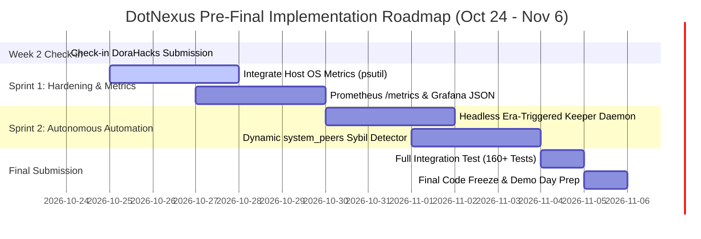

# DotNexus — Technical Gaps & Enhancement Roadmap (Pre-Final Code Freeze)

> **Document Type:** Engineering Technical Specification & Gap Remediation Blueprint  
> **Track:** Node Operations & Tooling — Portaldot Hacker House 2026  
> **Target Network:** Portaldot Network V3.0 (Substrate WASM + EVM `pallet-revive`, SS58: 42, Decimals: 14)  
> **Reference Timeline:** Oct 24 (Check-in) $\rightarrow$ Nov 6, 2026 (Final Submission & Code Freeze)  

---

## 🌟 Executive Summary

Tài liệu này tổng hợp toàn bộ các **khoảng trống kỹ thuật (Technical Gaps)**, **nợ kỹ thuật (Technical Debts)** và **hạng mục nâng cấp bắt buộc** của 4 trụ cột cốt lõi trong dự án **DotNexus**.

Mục tiêu tối thượng là chuyển đổi DotNexus từ một **Bản mẫu khả thi (MVP / Working Prototype đạt chuẩn Week 2 Check-in)** thành một **Bộ công cụ vận hành và bảo mật chuẩn công nghiệp (Enterprise Grade Operations & Maintenance Toolset)** phục vụ trực tiếp cho **Chương trình Node Chất lượng Cao Toàn cầu (Global High-Quality Node Program)** của Portaldot Network V3.0.

---

## 📊 Ma Trận Tổng Hợp Khoảng Trống Kỹ Thuật (4 Pillars Gap Matrix)

| Trụ cột kỹ thuật | Hiện trạng (Đã hoàn thành Week 2) | Khoảng trống kỹ thuật (Technical Gaps) | Giải pháp kiến trúc kỹ thuật | Mức độ ưu tiên | File chịu trách nhiệm |
|---|---|---|---|:---:|---|
| **1. Node Monitoring** | Telemetry song song `:9944` & `:8545`, phân lập 3 tầng desync, mempool segregation, 14 decimals. | **Chưa có Host OS Metrics:** Chưa giám sát CPU, RAM, Disk I/O, tốc độ phình to cơ sở dữ liệu RocksDB/ParityDB của máy chủ. | Tích hợp module `psutil` và file system watcher vào daemon nền Python, đẩy metrics qua WebSocket stream. | 🔥 **CAO (P1)** | `engine/dual_tracker.py`<br/>`front-end/src/views/DualEngineView.tsx` |
| **2. Automated Staking** | Sequential Phragmén mô phỏng, storage map `ErasStakersOverview`, 3 chốt chặn an toàn, Staking Vault contract. | **Chưa tự động hóa chu kỳ 24/7:** Re-nominate và Compound vẫn cần kích hoạt thủ công qua UI/API/DAG, chưa có Keeper Bot tự trị theo Era. | Xây dựng `StakingKeeperDaemon` tự động lắng nghe sự kiện sang Era mới trên Substrate WS để tự động tính toán và re-stake. | 🔥 **CAO (P1)** | `engine/npos_optimizer.py`<br/>`engine/server.py` |
| **3. Data Visualization** | Giao diện HUD Dark Obsidian, Three.js 3D Mesh, D3 Geo Map, Interactive DAG Canvas kéo thả. | **Chưa có Prometheus Exporter & Grafana:** Thiếu endpoint chuẩn `/metrics` và file JSON dashboard mẫu cho các validator doanh nghiệp. | Xây dựng Prometheus metrics generator chuẩn OpenMetrics và xuất bản file `dotnexus-grafana-template.json`. | 🟡 **TRUNG BÌNH (P2)** | `engine/server.py`<br/>`dashboards/grafana-dashboard.json` |
| **4. Network Security** | Dead Man's Switch ($10\text{s} < 12\text{s} < 15\text{s}$), Lease Registry contract on-chain, RPC Shield payload $<256\text{KB}$, batch $\le 20$. | **Peer Topology còn phụ thuộc fallback; chưa có script Firewall eBPF/iptables bảo vệ cổng Libp2p `30333`:** RPC Shield mới bảo vệ cổng HTTP/WS. | Bóc tách 100% live peers từ RPC `system_peers` kết hợp GeoIP offline; cung cấp script Linux hardening cho cổng `30333`. | 🟡 **TRUNG BÌNH (P2)** | `engine/rpc_shield.py`<br/>`scripts/harden_node_firewall.sh` |

---

## 🔬 Chi Tiết Kỹ Thuật & Kế Hoạch Khắc Phục Từng Trụ Cột

---

### 1️⃣ Trụ cột 1: Node Monitoring (Giám sát Node Vật Lý & Máy Ảo)

#### 🛑 Vấn đề hiện tại:
Engine hiện tại (`engine/dual_tracker.py`) phản ánh cực tốt trạng thái **Logic Chuỗi (Protocol Telemetry)**: số khối, mempool, độ lệch thời gian, phí gas. Tuy nhiên, một máy chủ Validator trong chương trình High-Quality Node thường gặp sự cố từ **tầng hạ tầng vật lý** trước khi chuỗi bị ảnh hưởng:
* RAM bị rò rỉ (memory leak) do node cache dữ liệu WASM.
* Đĩa cứng SSD/NVMe bị đầy do dữ liệu khối RocksDB tăng nhanh (~1.5 GB/tuần).
* Nghẽn Disk I/O IOPS khiến node không kịp ghi dữ liệu trạng thái khối mới, dẫn đến rớt block.

#### 🛠️ Giải pháp kỹ thuật nâng cấp:
1. **Host Resource Telemetry Collector:**
   * Bổ sung module thu thập định kỳ (chu kỳ 3 giây) sử dụng `psutil`:
     ```python
     # Logic bổ sung trong engine/dual_tracker.py
     import psutil
     from pathlib import Path

     def get_host_hardware_metrics(db_path: str = "/var/lib/portaldot/chains/portaldot_v3/db/full") -> dict:
         disk_usage = psutil.disk_usage("/")
         db_size_bytes = sum(f.stat().st_size for f in Path(db_path).glob("**/*") if f.is_file()) if Path(db_path).exists() else 0
         return {
             "cpu_percent": psutil.cpu_percent(interval=None),
             "ram_used_percent": psutil.virtual_memory().percent,
             "ram_available_mb": psutil.virtual_memory().available // (1024 * 1024),
             "disk_used_percent": disk_usage.percent,
             "disk_free_gb": disk_usage.free // (1024 * 1024 * 1024),
             "db_size_mb": db_size_bytes // (1024 * 1024),
             "io_counters": psutil.disk_io_counters()._asdict() if psutil.disk_io_counters() else {}
         }
     ```
2. **Causal Lag Index (CLI) 2.0:**
   * Tích hợp thêm trọng số biến động của Disk IOPS vào công thức phát hiện nghẽn `fc-db`:
     $$\text{CLI} = \alpha \cdot \frac{|B_{\text{sub}} - B_{\text{evm}}|}{B_{\text{threshold}}} + \beta \cdot \frac{\text{DiskIO}_{\text{latency}}}{\text{IO}_{\text{max}}} + \gamma \cdot \text{MempoolSaturation}$$

---

### 2️⃣ Trụ cột 2: Automated Staking (Tối ưu & Tự Động Hóa Staking)

#### 🛑 Vấn đề hiện tại:
* Thuật toán Sequential Phragmén và Pre-Flight Checks (`CurrentPhase == 'Off'`, lợi nhuận $> 3 \times \text{Phí}`) chạy rất mượt nhưng chỉ được thực thi khi có sự kiện can thiệp từ người dùng (nhấn nút trên UI hoặc gọi lệnh CLI `python -m engine.cli npos --top16`).
* Một hệ thống quản lý staking chuẩn doanh nghiệp cho Validator cần phải **tự động thức giấc (Autonomous Re-Nomination Keeper)** mỗi khi Runtime Substrate phát sinh sự kiện chuyển kỷ nguyên Era (mỗi 24 giờ trên mainnet hoặc mỗi 1-2 giờ trên testnet).

#### 🛠️ Giải pháp kỹ thuật nâng cấp:
1. **Headless Era-Triggered Staking Keeper (`engine/staking_keeper.py`):**
   * Chạy một tiến trình nền bất đồng bộ (`asyncio`) đăng ký lắng nghe (subscription) storage `Staking.ActiveEra`:
     ```python
     async def watch_active_era_loop(substrate_client, optimizer, vault_contract):
         last_known_era = None
         while True:
             current_era = await get_active_era(substrate_client)
             if last_known_era is not None and current_era > last_known_era:
                 logger.info(f"🚨 New Era Detected: {current_era}. Running Sequential Phragmén re-evaluation...")
                 
                 # 1. Kiểm tra cửa sổ bầu cử an toàn
                 if optimizer.is_election_phase_off(substrate_client):
                     # 2. Tính toán Top 16 tối ưu mới
                     optimal_targets = optimizer.compute_optimal_top16()
                     
                     # 3. Tính toán chênh lệch APY so với Era trước
                     if optimizer.is_profitable_to_renominate(optimal_targets):
                         logger.info("Executing automated re-nomination transaction...")
                         optimizer.dispatch_nomination_extrinsic(optimal_targets)
                         
             last_known_era = current_era
             await asyncio.sleep(30)
     ```
2. **Unbonding Queue & Slashing Insurance Reserve Visualizer:**
   * Thêm hàm truy vấn danh sách các khoản tiền đang trong thời gian mở khóa (Unbonding chunks qua `Staking.Ledger(controller)`).
   * Hiển thị biểu đồ thanh đếm ngược số Era còn lại trước khi tiền về ví an toàn.

---

### 3️⃣ Trụ cột 3: Node Data Visualization (Trực quan hóa Dữ liệu)

#### 🛑 Vấn đề hiện tại:
* UI của DotNexus (`front-end`) được xây dựng xuất sắc với React 19 + Three.js, nhưng mang tính đóng (Standalone Web App).
* Đối với các đơn vị vận hành chuyên nghiệp (như Blockdaemon, Figment, Allnodes tham gia High-Quality Node Program), họ có trung tâm điều hành NOC riêng chạy Grafana / Prometheus tập trung. Nếu DotNexus không xuất được dữ liệu sang Prometheus thì họ buộc phải mở thêm tab web riêng.

#### 🛠️ Giải pháp kỹ thuật nâng cấp:
1. **Chuẩn hóa Endpoint Prometheus (`/metrics`):**
   * Nâng cấp `engine/server.py` xuất bản đầy đủ metrics chuẩn OpenMetrics:
     ```text
     # HELP dotnexus_substrate_block_height Current block height on Substrate WASM layer
     # TYPE dotnexus_substrate_block_height gauge
     dotnexus_substrate_block_height{chain="portaldot_v3"} 161450

     # HELP dotnexus_evm_block_height Current block height on EVM pallet-revive
     # TYPE dotnexus_evm_block_height gauge
     dotnexus_evm_block_height{chain="portaldot_v3"} 161450

     # HELP dotnexus_dual_vm_lag_blocks Block discrepancy between Substrate and EVM
     # TYPE dotnexus_dual_vm_lag_blocks gauge
     dotnexus_dual_vm_lag_blocks{chain="portaldot_v3"} 0

     # HELP dotnexus_lease_ttl_seconds Remaining lease time for active signing authority
     # TYPE dotnexus_lease_ttl_seconds gauge
     dotnexus_lease_ttl_seconds{role="primary"} 11.2

     # HELP dotnexus_rpc_shield_blocked_total Total abusive requests blocked by RPC shield
     # TYPE dotnexus_rpc_shield_blocked_total counter
     dotnexus_rpc_shield_blocked_total 42
     ```
2. **Phát hành file cấu hình mẫu Grafana (`dashboards/dotnexus-grafana-dashboard.json`):**
   * Tạo sẵn 1 file JSON chứa 6 Panels biểu đồ dựng sẵn (Dual-VM Lag, Lease Countdown Gauge, Top 16 APY Radar, Mempool Segregation, RPC Shield Reject Rate). Node Operator chỉ cần 1 click là import thẳng vào Grafana có sẵn.

---

### 4️⃣ Trụ cột 4: Network Security Analysis Tools (Phân tích An ninh Mạng)

#### 🛑 Vấn đề hiện tại:
* File [`engine/rpc_shield.py`](file:///D:/Coding/Portaldot%20Hacker%20house%202026/DotNexus/engine/rpc_shield.py) đã thực hiện xuất sắc việc lọc các truy vấn HTTP JSON-RPC độc hại (như `eth_getLogs` trên diện rộng).
* Tuy nhiên, các Validator trong mạng Substrate còn đối mặt với nguy cơ tấn công từ chối dịch vụ (DDoS) trực tiếp vào **cổng giao thức mạng ngang hàng Libp2p `30333`** (UDP/TCP SYN Flood, Eclipse Attack tập trung kết nối peer giả).
* Danh sách P2P Topology hiện tại có cơ chế fallback dùng danh sách tĩnh khi chưa bắt tay được với node local.

#### 🛠️ Giải pháp kỹ thuật nâng cấp:
1. **100% Dynamic Peer Scraping & Sybil Cluster Detection:**
   * Khi kết nối với node live, gọi trực tiếp lệnh RPC `system_peers`.
   * Bóc tách các trường: `peerId`, `roles`, `bestNumber`, `bestHash`.
   * Chạy giải thuật gom cụm (Clustering) theo dải mạng `/24` hoặc Autonomous System Number (ASN). Nếu phát hiện $> 40\%$ số lượng peer đến từ cùng 1 ASN $\rightarrow$ Cảnh báo nguy cơ **Sybil / Eclipse Attack**.
2. **Kịch bản Linux Firewall Hardening Script (`scripts/harden_node_firewall.sh`):**
   * Cung cấp một shell script tự động cấu hình `iptables` / `ufw` trên máy chủ validator:
     * Cổng `:9944` và `:8545`: Chỉ lắng nghe nội bộ (`127.0.0.1`) hoặc đi qua reverse proxy của DotNexus.
     * Cổng `30333` (Libp2p P2P): Áp dụng luật giới hạn tốc độ kết nối mới (Connection Rate Limit) để chống SYN Flood:
       ```bash
       iptables -A INPUT -p tcp --dport 30333 -m state --state NEW -m recent --set
       iptables -A INPUT -p tcp --dport 30333 -m state --state NEW -m recent --update --seconds 1 --hitcount 20 -j DROP
       ```

---

## 📅 Lộ Trình Triển Khai Chi Tiết Từ Nay Đến Code Freeze (Nov 6)



---

## ✅ Tiêu Chuẩn Nghiệm Thu Kỹ Thuật (Acceptance Criteria)

1. **Bộ test tự động:** Nâng số lượng bài test từ 147 tests hiện tại lên $\ge 160\text{ tests}$, bao phủ thêm module `psutil`, `StakingKeeperDaemon`, và bộ phân tích cụm peer Sybil.
2. **Hiệu năng hệ thống:** Toàn bộ tiến trình thu thập chỉ số (Host + Dual-VM Telemetry) duy trì mức tiêu thụ CPU $< 2\%$ và RAM $< 80\text{ MB}$.
3. **Zero-Downtime Verification:** Kịch bản kiểm thử chuyển giao dự phòng Standby Takeover duy trì tính đúng đắn tuyệt đối, đảm bảo $0\%$ xảy ra tình trạng ký đúp (Equivocation) trên Testnet V3.0.
