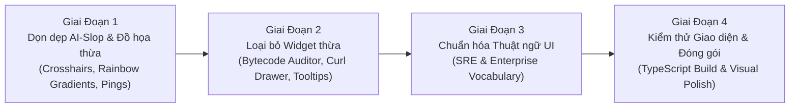

# DotNexus — Kế Hoạch Rà Soát, Chuẩn Hóa Thuật Ngữ & Loại Bỏ UI Slop (Master Declutter Plan)

> **Document Type:** UI/UX Comprehensive Audit & Craft Floor Refactoring Blueprint  
> **Project:** DotNexus (Visual Control Plane & Automated Security Operations Engine for Portaldot V3.0)  
> **Track:** Node Operations & Tooling — Portaldot Hacker House 2026  
> **Standard:** Craft Floor Compliance (`.agents/skills/impeccable/reference/craft-floor.md`)  
> **Date:** October 26, 2026  

---

## 🌟 1. Tổng Quan & Mục Tiêu Rà Soát (Executive Summary)

Sau khi hoàn thiện 100% logic backend và chức năng cốt lõi cho cả 6 trụ cột kỹ thuật, hệ thống giao diện người dùng (UI) cần một đợt chuẩn hóa gắt gao nhằm:
1. **Loại bỏ triệt để các thuật ngữ "đao to búa lớn", từ ngữ khoa học viễn tưởng hoặc buzzwords** không phản ánh đúng bản chất kỹ thuật của công cụ vận hành node (SRE / Node Operations Tooling).
2. **Khắc phục các visual tropes "sặc mùi AI" (AI-slop)** như bảng màu cầu vồng 7 màu, lạm dụng hiệu ứng nhấp nháy (`animate-ping`), dấu chữ thập trang trí vô nghĩa (`CornerCrosshair`), và các thẻ lồng thẻ (nested ghost cards).
3. **Loại bỏ các widget/component thừa thãi** làm rối mắt người vận hành (như trình kiểm tra mã bytecode smart contract hay các hộp câu lệnh curl cồng kềnh) để trả lại không gian thoáng đãng, chuyên nghiệp và tập trung vào dữ liệu sống.

Phạm vi rà soát bao phủ toàn bộ **5 màn hình tác chiến chính**:
* **Màn hình 1:** `Dual Engine Control Plane` ([`DualEngineView.tsx`](file:///D:/Coding/Portaldot%20Hacker%20house%202026/DotNexus/front-end/src/views/DualEngineView.tsx))
* **Màn hình 2:** `Anti-Equivocation & Slashing Guard` ([`SecurityGuardView.tsx`](file:///D:/Coding/Portaldot%20Hacker%20house%202026/DotNexus/front-end/src/views/SecurityGuardView.tsx))
* **Màn hình 3:** `NPoS Phragmén Staking Optimizer` ([`StakingYieldView.tsx`](file:///D:/Coding/Portaldot%20Hacker%20house%202026/DotNexus/front-end/src/views/StakingYieldView.tsx))
* **Màn hình 4:** `RPC Shield & P2P Topology Radar` ([`TopologyRadarView.tsx`](file:///D:/Coding/Portaldot%20Hacker%20house%202026/DotNexus/front-end/src/views/TopologyRadarView.tsx))
* **Màn hình 5:** `Automation Workflow Canvas` ([`CanvasBoard.tsx`](file:///D:/Coding/Portaldot%20Hacker%20house%202026/DotNexus/front-end/src/views/CanvasBoard.tsx))

---

## 📋 2. BẢNG 1: Rà Soát & Chuẩn Hóa Thuật Ngữ UI (Loại Bỏ Fluff / Buzzwords)

| Màn hình | Thuật ngữ hiện tại trên UI | Vấn đề / Tính bất hợp lý | Đề xuất thay thế chuẩn SRE Doanh Nghiệp |
|---|---|---|---|
| **Dual Engine** | `CROSS-VM CAUSAL LAG INDEX (CLI) 2.0` | Quá trừu tượng và đao to búa lớn (nghe như vật lý lượng tử / thuyết tương đối). Bản chất chỉ là chỉ số đo lường độ lệch pha và sức khỏe đồng bộ giữa 2 máy ảo. | **`Dual-VM Sync Health Index`** hoặc **`Parity Health Score`** |
| **Dual Engine** | `3-TIER ROOT-CAUSE ISOLATION FUNNEL MATRIX` | *"Funnel Matrix"* là thuật ngữ marketing phễu bán hàng, hoàn toàn không thuộc từ vựng kỹ thuật hệ thống. Bản chất là bảng chẩn đoán phân tầng. | **`Tiered Sync Diagnostics`** hoặc **`Bottleneck Isolation`** |
| **Dual Engine** | `PALLET-REVIVE STORAGE DEPOSIT & BYTECODE AUDITOR` | Đây là Control Plane vận hành node hạ tầng, không phải IDE lập trình Solidity hay công cụ quét mã bytecode của lập trình viên. | **`Storage Deposit Calculator`** (hoặc loại bỏ hoàn toàn) |
| **Dual Engine** | `100% OPTICAL LOCKSTEP CONDUIT` | Từ *"Optical"* (quang học) và *"Conduit"* bị lạm dụng để tạo cảm giác viễn tưởng, không mang nghĩa kỹ thuật thực tế nào. | **`Live Dual-VM Parity Stream`** |
| **Dual Engine** | `MEMPOOL FLOW SEGREGATION VECTOR` | Thêm từ *"Vector"* vào chỉ để nghe có vẻ cao siêu, trong khi bản chất chỉ là tỷ lệ phân bổ mempool giữa WASM và EVM. | **`Mempool Distribution Ratio`** |
| **Slashing Guard** | `DEAD MAN'S SWITCH: T_fence(10s) < T_ttl(12s) < T_takeover(15s)` | Đưa cả công thức toán học với các ký hiệu $T_{fence}$, $T_{ttl}$ vào thẳng tiêu đề UI gây khó đọc và rườm rà. | **`Failover Grace Period Timeline`** |
| **Slashing Guard** | `KEYSTORE MUTEX LEASE: [ACQUIRED (LOCKED)]` | Lặp từ kỹ thuật liên tục (*Mutex*, *Lease*, *Acquired*, *Locked* cùng xuất hiện một chỗ). | **`Signing Lease: Active`** hoặc **`Signing Lock: Held`** |
| **NPoS Staking** | `PRE-FLIGHT RE-NOMINATION SAFETY GATES` | Dùng thuật ngữ *"Pre-flight launchpad"* của phóng tàu vũ trụ NASA cho việc kiểm tra 3 điều kiện staking on-chain cơ bản. | **`Pre-Nomination Invariants`** hoặc **`Safety Pre-Conditions`** |
| **NPoS Staking** | `FEE EROSION THRESHOLD (> 3x FEE)` | Thuật ngữ *"Erosion"* (xói mòn) tạo cảm giác phức tạp hóa bài toán so sánh Lợi nhuận vs Phí giao dịch. | **`Fee vs Reward Threshold`** |
| **RPC Shield** | `EQUIRECTANGULAR WGS84 • LIVE P2P GOSSIP` | Ghi tên phép chiếu bản đồ đồ họa (*Equirectangular WGS84*) lên tiêu đề tạo cảm giác phô trương công nghệ không liên quan. | **`Global P2P Distribution`** hoặc **`Libp2p Mesh`** |
| **RPC Shield** | `SUB-MILLISECOND AST SANITIZATION` | Từ *"AST Sanitization"* không chính xác (RPC Shield phân tích payload JSON chứ không dựng cây cú pháp trừu tượng AST của ngôn ngữ). | **`Sub-Millisecond JSON-RPC Filter`** |
| **Automation Canvas** | `COMPACT SAFETY LINTER TAG: 0 EQUIVOCATION HAZARDS` | Dùng từ *"Linter"* cho đồ thị DAG (vốn là thuật ngữ của công cụ phân tích tĩnh mã nguồn như ESLint). | **`Topology Validator: Nominal`** |

---

## 🎨 3. BẢNG 2: Thống Kê Các Thành Phần UI Có Màu Sắc Sặc Sỡ "Sặc Mùi AI Slop"

| Màn hình | Thành phần UI bị "AI Slop" | Dấu hiệu nhận biết & Vi phạm thiết kế | Giải pháp chuẩn hóa (Craft Floor) |
|---|---|---|---|
| **Dual Engine** | **Bảng màu cầu vồng 7 màu đồng thời** | Xuất hiện đồng thời Hồng Magenta `#E6007A`, Tím `#8B5CF6`, Tím sáng `#C084FC`, Xanh Neon `#00FF9D`, Xanh trời `#38BDF8`, Vàng Amber, Đỏ Rose `#EF4444`. | Thu gọn về bảng màu **Dark Slate / Monochrome** chủ đạo, chỉ dùng 2 màu trạng thái chuẩn: **Xanh Emerald** (Nominal) và **Đỏ/Hổ phách** (Alert/Critical). |
| **Dual Engine** | **Dấu chữ thập trang trí 4 góc (Corner Crosshairs)** | Đặt 4 dấu `+` ở 4 góc của card `DualBlockConduit` (visual trope kinh điển mà AI hay sinh ra để làm giả phong cách sci-fi/HUD). | **Xóa bỏ các thẻ `<CornerCrosshair />`**, sử dụng viền border 1px tinh tế phẳng chuẩn enterprise console. |
| **Dual Engine & Slashing** | **Lạm dụng chấm nhấp nháy (`animate-ping` / `animate-pulse`)** | Có từ 5 đến 7 chấm tròn nhấp nháy liên tục ở mọi badge trên màn hình, gây phân tán thị giác và mất giá trị cảnh báo sự cố thật. | Chỉ cho phép nhấp nháy **duy nhất khi có Incident thật** (`isHealthy === false` hoặc `isSelfFenced === true`). Mọi trạng thái bình thường phải tĩnh. |
| **Slashing Guard** | **Dải 30 ô vuông "ASCII stepped gauge"** | Chia thanh thời gian thành 30 ô nhỏ đổi màu xanh/vàng/đỏ từng ô mô phỏng giao diện game cyberpunk. | Thay thế bằng **Thanh Progress Bar đơn tuyến mượt mà** với 3 mốc vạch chia rõ ràng (10s / 12s / 15s) kèm nhãn thời gian trực quan. |
| **RPC Shield** | **Tooltip HUD nổi lơ lửng đè lên bản đồ** | Khi rê chuột vào peer trên bản đồ, một hộp đen viền tím phát sáng hiện lên đè lên các nút khác dù bên phải đã có sẵn panel chi tiết. | **Gỡ bỏ floating tooltip**, đưa toàn bộ thông số hover trực tiếp vào bảng `PEER TELEMETRY INSPECTOR` bên cạnh. |
| **Automation Canvas** | **Dây nối Wire phát sáng và chạy hạt liên tục** | Các edge phát sáng neon và animation hạt chạy liên tục ngay cả khi người dùng chưa bấm Execute, làm GPU phải render liên tục. | Giữ dây nối ở trạng thái **tĩnh màu xám/tím đậm**, chỉ chạy animation khi bấm **`EXECUTE WORKFLOW`**. |
| **Toàn bộ 5 Views** | **Thẻ lồng thẻ nhiều tầng (Nested Ghost Cards)** | Thẻ cha bọc thẻ con $\rightarrow$ thẻ con bọc tiếp thẻ cháu (vi phạm mục *Refuse* của Craft Floor: *"nested cards are always wrong"*). | Dỡ bỏ các border con bên trong, dùng khoảng cách đệm (spacing & divider line 1px mờ) để phân chia nhóm dữ liệu. |

---

## ✂️ 4. BẢNG 3: Danh Sách Các Thành Phần/Widget Cần Loại Bỏ Hoặc Tinh Giản Để Tránh Rối Mắt

| Màn hình | Thành phần đề xuất loại bỏ / tinh giản | Lý do vận hành thực tế | Cách xử lý cụ thể |
|---|---|---|---|
| **Dual Engine** | **Khối "PALLET-REVIVE STORAGE DEPOSIT & BYTECODE AUDITOR"** | Kỹ sư vận hành node không bao giờ paste mã bytecode Solidity vào màn hình giám sát để đo kích thước. Widget này chiếm gần 30% diện tích Tab 3 một cách vô ích. | **Loại bỏ hoàn toàn widget này** khỏi Tab 3 để nhường chỗ hiển thị thoáng đãng cho phần cứng và số dư POT. |
| **Dual Engine** | **Collapsible Drawer "DEVELOPER RPC VERIFICATION PROOFS"** | Chiếm một hàng dài dưới chân trang chỉ để hiển thị 2 câu lệnh curl/wscat. | Thay bằng **1 icon nhỏ "Copy RPC curl"** đặt cạnh URL Endpoint ở header, gỡ bỏ toàn bộ hộp collapsible này. |
| **Dual Engine** | **Mục chọn xem Sub-tab 3 tầng (Stream / Diagnostics / Hardware)** | Tab lồng trong Tab (trang ngoài đã có thanh Tab điều hướng chính, bên trong Dual Engine lại có thêm 3 Tab con gây ẩn giấu thông tin). | Gộp các thông số trọng yếu lên cùng một trang dạng Dashboard phẳng, cuộn tự nhiên thay vì bắt người dùng click chuyển tab liên tục. |
| **NPoS Staking** | **Bộ nút chọn thời gian `[1M] [3M] [6M] [12M]`** | NPoS Substrate tính lợi nhuận theo Epoch/Era (6h-24h). Chọn 1-12 tháng là tư duy của app DeFi bán lẻ (lending), không phù hợp với Node Tooling. | Tinh giản chỉ hiển thị **APY tính theo năm** và **Dự phóng thu nhập theo Era**. |
| **NPoS Staking** | **Bộ lọc 4 nút `ALL`, `LIVE_ONCHAIN`, `OPTIMAL`, `LOW_COMM`** | 4 nút chiếm một dải riêng nhưng thực chất danh sách Top 16 tối ưu đã lọc sẵn. | Tích hợp thành một **Dropdown nhỏ gọn** hoặc chỉ giữ lại 2 chế độ: *Tất cả Validator* và *Top 16 Khuyên dùng*. |
| **Automation Canvas** | **Nút "Auto-Fix Wires" và "Reset Canvas" bị trùng lặp** | Nút Auto-Fix xuất hiện ở cả thanh Linter lẫn thanh công cụ bên phải, gây rối mắt. | **Gom gọn về 1 thanh toolbar duy nhất** ở góc phải màn hình. |

---

## 🚀 5. Lộ Trình Triển Khai Thực Hiện (Step-by-Step Execution Plan)

### Chi tiết các bước thực hiện:
1. **Bước 1: Tinh giản `DualEngineView.tsx` & `DualBlockConduit.tsx`**
   - Xóa bỏ `CornerCrosshair` và thu hẹp palette màu về Dark Slate `#080512`, Emerald `#10B981`, Rose `#EF4444`.
   - Gỡ bỏ widget `Storage Deposit & Bytecode Auditor` và drawer `Developer RPC Proofs`.
   - Cập nhật các nhãn: `CROSS-VM CAUSAL LAG INDEX` $\rightarrow$ `Dual-VM Sync Health Index`.
2. **Bước 2: Chuẩn hóa `SecurityGuardView.tsx`**
   - Thay dải 30 ô ASCII bằng thanh progress bar đơn tuyến mượt mà.
   - Sửa tiêu đề timeline công thức thành `Failover Grace Period Timeline`.
   - Tắt các hiệu ứng ping vô tội vạ, chỉ giữ hiệu ứng khi node bị self-fenced.
3. **Bước 3: Tinh giản `StakingYieldView.tsx`**
   - Bỏ bộ nút `[1M] [3M] [6M] [12M]`, chuẩn hóa hiển thị APY năm và lợi tức theo Era.
   - Đổi nhãn `PRE-FLIGHT RE-NOMINATION SAFETY GATES` thành `Pre-Nomination Invariants`.
4. **Bước 4: Tinh giản `TopologyRadarView.tsx`**
   - Gỡ bỏ floating tooltip trên `CyberWorldMap`, chỉ giữ panel bên cạnh.
   - Đổi nhãn `EQUIRECTANGULAR WGS84` thành `Global P2P Distribution`.
5. **Bước 5: Tinh giản `CanvasBoard.tsx`**
   - Gom gọn các nút công cụ trùng lặp (Auto-Fix, Reset) về một thanh toolbar duy nhất.
   - Đổi nhãn `Compact Safety Linter Tag` thành `Topology Validator`.
6. **Bước 6: Nghiệm thu cuối cùng**
   - Chạy `npm --prefix front-end run build` kiểm tra 0 lỗi TypeScript.
   - Kiểm tra hiển thị responsive trên các độ phân giải màn hình từ mobile tới desktop ultra-wide.
