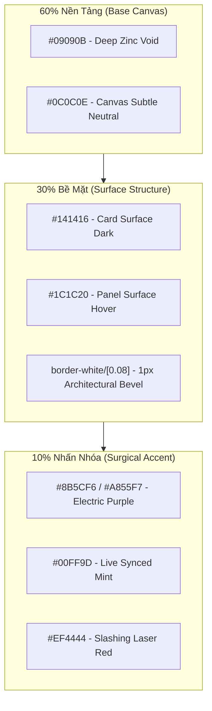
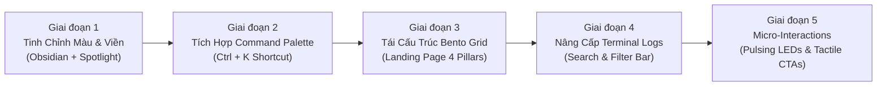

# 🎨 Phân Tích Thiết Kế Giao Diện Zeabur (zeabur.com) & Kế Hoạch Nâng Cấp UI/UX Toàn Diện Cho DotNexus

> **Mục tiêu:** Phân tích ngôn ngữ thiết kế, kiến trúc giao diện và trải nghiệm người dùng (UI/UX) của nền tảng Cloud PaaS cao cấp [Zeabur](https://zeabur.com/), từ đó xây dựng kế hoạch hành động cụ thể để nâng tầm DotNexus từ một dashboard công cụ thông thường thành một **Hệ Thống Điều Hành & Kiểm Soát Trực Quan Chuẩn Enterprise (World-Class Visual Control Plane)**.

---

## 📑 Mục Lục
1. [Tổng Quan & Đánh Giá Đối Sánh (Executive Summary & Benchmark)](#1-tổng-quan--đánh-giá-đối-sánh-executive-summary--benchmark)
2. [Giải Mã DNA Thiết Kế Của Zeabur (Zeabur UI/UX Deconstruction)](#2-giải-mã-dna-thiết-kế-của-zeabur-zeabur-uiux-deconstruction)
3. [Kiểm Toán Hiện Trạng Giao Diện DotNexus (DotNexus Current UI Audit)](#3-kiểm-toán-hiện-trạng-giao-diện-dotnexus-dotnexus-current-ui-audit)
4. [Lộ Trình Nâng Cấp 5 Giai Đoạn (5-Stage Actionable Roadmap)](#4-lộ-trình-nâng-cấp-5-giai-đoạn-5-stage-actionable-roadmap)
5. [Thư Viện Component Thực Chiến Sẵn Sàng Triển Khai (Ready-to-Use UI Components)](#5-thư-viện-component-thực-chiến-sẵn-sàng-triển-khai-ready-to-use-ui-components)

---

## 1. Tổng Quan & Đánh Giá Đối Sánh (Executive Summary & Benchmark)

### 🌟 Tại Sao Zeabur Là Hình Mẫu Lý Tưởng Cho DotNexus?
[Zeabur](https://zeabur.com/) là nền tảng điện toán đám mây PaaS (Platform as a Service) thế hệ mới, được cộng đồng lập trình viên quốc tế đánh giá rất cao về mặt UI/UX nhờ kết hợp xuất sắc giữa **sự tinh giản hiện đại (modern minimalism)** và **mật độ thông tin kỹ thuật cao (technical density)**. 

Cả Zeabur và DotNexus đều giải quyết bài toán phức tạp của hạ tầng:
* **Zeabur:** Quản trị các container, microservices, database, build logs và lưu lượng mạng trên cloud.
* **DotNexus:** Quản trị các node validator, Dual-VM Substrate/EVM parity, phòng chống Slashing, tối ưu hóa NPoS staking và điều phối runbook tự động cho Portaldot Network V3.0.

### 🥊 Bảng Đối Chiếu Trải Nghiệm UI/UX (DotNexus Hiện Tại vs. Zeabur)

| Tiêu chí UI/UX | Hiện trạng DotNexus | Chuẩn mực Zeabur (zeabur.com) | Hướng cải tiến DotNexus cần hấp thụ |
| :--- | :--- | :--- | :--- |
| **Quy tắc phối màu** | Nền tím sẫm (`#06040A`), viền tím (`#1C142E`), nhiều đốm sáng blur lớn dễ gây chói mắt khi xem lâu. | Tỷ lệ **60-30-10** chuẩn mực: Nền đen obsidian trung tính (`#09090b`), thẻ xám than (`#141416`), màu tím neon chỉ xuất hiện ở các điểm nhấn tương tác. | Giảm bớt quầng sáng nhòe (ambient orbs), chuyển sang nền than trung tính sâu thẳm, giữ tím điện tử làm accent 10%. |
| **Bề mặt & Bo góc (Cards)** | Cạnh vuông góc (`rounded-none`), viền 1px màu tím đậm cố định, tạo cảm giác hơi cứng nhắc. | Bo góc thanh thoát (`rounded-lg` 8px / `rounded-xl` 12px), viền mờ `border-white/[0.08]` kết hợp hiệu ứng **Spotlight Glow** theo vệt chuột. | Chuyển sang viền mờ tinh xảo có phản ứng ánh sáng theo trỏ chuột (Cursor-following Spotlight Border). |
| **Đèn LED & Trạng thái** | Dấu chấm màu hoặc text trạng thái đơn giản (`OK`, `SYNCED`, `CRITICAL`). | Đèn LED vi mô phát xung mượt mà (`ring-1 ring-emerald-500/30 animate-pulse`), kèm nhãn tag dạng pill trong suốt. | Chuẩn hóa toàn bộ chip trạng thái thành **Pill Badges có Micro-Pulsing LED** đạt chuẩn WCAG. |
| **Bố cục Landing Page** | Cuộn dọc truyền thống với các hàng thẻ đều đặn. | **Bento Grid bất đối xứng** với các khối tương tác trực quan (interactive micro-previews, animated topology). | Tái cấu trúc 4 Trụ cột thành Bento Grid đa tầng, cho phép người dùng click thử nghiệm trực tiếp ngay trên trang chủ. |
| **Bảng lệnh & Phím tắt** | Chủ yếu điều hướng bằng click chuột vào sidebar và tab con. | Hỗ trợ phím tắt toàn cục **`Ctrl + K` / `Cmd + K` Command Palette** để chuyển nhanh dịch vụ và tìm kiếm. | Bổ sung **Command Palette (`Ctrl + K`)** giúp Node Operator gõ phím để kích hoạt SRE Remediation, tra cứu Validator, mở Runbook. |
| **Hộp thoại Logs / Console** | Khung log chân trang kéo thả được (`TerminalDrawer.tsx`), font monospace đen tuyền. | Console phân tầng (Build Logs vs Runtime Logs), có thanh search filter, copy block và xuất file `.log`/`.gz`. | Bổ sung thanh tìm kiếm log realtime, nút lọc theo luồng (`WASM`, `EVM`, `RPC`, `SHIELD`) và nút tải file nhật ký. |
| **Tương tác nút bấm (CTAs)** | Nút phẳng góc vuông, hover đổi màu nền. | Nút bấm có viền sáng vi mô (Subtle border highlight), hiệu ứng co giãn xúc giác (`active:scale-[0.98]`). | Tinh chỉnh độ nảy vi mô (micro-spring feedback) khi click vào các nút hành động khẩn cấp (1-Click SRE Remediation). |

---

## 2. Giải Mã DNA Thiết Kế Của Zeabur (Zeabur UI/UX Deconstruction)

### 2.1. Triết Lý Bề Mặt & Màu Sắc (Materiality & Color Distribution)
Zeabur không sử dụng màu tím tràn lan. Họ tuân thủ nghiêm ngặt **Quy luật 60-30-10 trong Dark Mode**:



1. **Hiệu ứng Spotlight Card:** Khi con trỏ chuột di chuyển trên bề mặt card, một quầng sáng bán kính nhỏ (~200px) chạy theo mép viền, làm sáng đường border 1px từ màu xám mờ thành màu tím nhạt. Điều này tạo cảm giác card nổi khối trên mặt kính đen mà không cần dùng drop-shadow rẻ tiền.
2. **Loại bỏ Ghost Cards:** Zeabur không bao giờ kết hợp viền 1px với bóng nhòe không góc lệch (zero-offset soft blur). Độ sâu được thể hiện bằng độ chuyển tông của bề mặt: Nền (`#09090b`) $\rightarrow$ Thẻ (`#141416`) $\rightarrow$ Thẻ con nổi (`#1c1c20`).

### 2.2. Hệ Thống Kiểu Chữ (Typography Hierarchy)
* **Font giao diện (UI & Headlines):** Sử dụng font Neo-Grotesque (`Geist Sans` hoặc `Inter`), với `letter-spacing: -0.025em` đến `-0.035em` ở các tiêu đề lớn, tạo cảm giác đanh thép, gọn gàng và đậm chất kỹ thuật.
* **Font số liệu (Telemetry & Code):** Sử dụng `Geist Mono` hoặc `JetBrains Mono` bắt buộc gắn `font-feature-settings: 'tnum' 1, 'zero' 1;`. Khi số block hay độ trễ miligiây nhảy liên tục ở tốc độ cao, các chữ số có bề rộng bằng nhau tuyệt đối, không gây rung lắc giao diện.
* **Độ tương phản:**
  * Tiêu đề chính: `#FFFFFF` (100% Contrast)
  * Số liệu quan trọng: `#F4F4F5` / `#C084FC`
  * Nhãn mô tả (Labels): `#A1A1AA` (Contrast 6.8:1, vượt xa chuẩn WCAG 4.5:1)
  * Metadata thứ cấp: `#71717A`

### 2.3. Cấu Trúc Bento Grid & Thẻ Dịch Vụ (Service Pods)
Thay vì các hàng thẻ đơn điệu cùng kích thước, Zeabur dùng bố cục Bento Grid đa tỷ lệ:
* **Thẻ Hero (Chiếm 2 cột, 2 hàng):** Minh họa tính năng cốt lõi bằng đồ họa động hoặc preview tương tác.
* **Thẻ Vệ Tinh (Chiếm 1 cột):** Tập trung vào 1 chỉ số cụ thể với nút thao tác nhanh.
* **Đèn LED Báo Trạng Thái:** Không chỉ là một chấm màu tĩnh, đèn trạng thái của Zeabur bao gồm:
  * 1 chấm tròn trung tâm 6px (`bg-emerald-400`).
  * 1 vòng tròn hào quang xung quanh (`ring-4 ring-emerald-500/20`).
  * Hiệu ứng thở nhẹ nhàng (breathing/pulsing animation).

---

## 3. Kiểm Toán Hiện Trạng Giao Diện DotNexus (DotNexus Current UI Audit)

### ✅ Những Ưu Điểm Đang Có (Phải Giữ Vững)
1. **Dữ liệu thực 100%:** Kết nối trực tiếp Substrate WS RPC và EVM `pallet-revive` thật, không dùng dữ liệu ảo.
2. **Bảng điều khiển DualEngine 2.0:** Đã có thanh **1-Click SRE Remediation Dock** (tính năng hành động rất giống triết lý 1-click deploy của Zeabur).
3. **Mô hình 3D Three.js:** Visual Cyber Mesh sống động, tạo ấn tượng công nghệ cao ngay khi vào trang chủ.
4. **Canvas DAG Engine:** Trực quan hóa luồng vận hành node dạng đồ thị topo cực kỳ sáng tạo.
5. **Độ tin cậy kỹ thuật:** Đã có 168 unit tests tự động pass 100%.

### ⚠️ Những Nhược Điểm UI Cần Khắc Phục Ngay
1. **Ánh sáng nhòe (Ambient Glow Orbs) quá đậm:** Lớp `glow-orb-violet` và `glow-orb-cyan` trong `LandingPage.tsx` có kích thước 700px và độ mờ lớn, che khuất một phần nội dung và tạo cảm giác mờ ảo thay vì sắc nét, chính xác.
2. **Thiếu phím tắt điều phối (Command Palette):** Với một Control Center cấp độ Enterprise, người vận hành node muốn dùng bàn phím (`Ctrl + K`) để gõ lệnh hoặc chuyển view trong 0.2 giây thay vì phải rê chuột tìm menu.
3. **Cards thiếu độ tương tác xúc giác:** Các box thẻ trong `DualEngineView.tsx` và `StakingYieldView.tsx` có nền đen tím phẳng, chưa có hiệu ứng Spotlight Hover và viền chưa đủ độ tinh xảo.
4. **Landing Page chưa tối ưu bố cục Bento:** Section "The 4 Pillars" đang hiển thị dạng danh sách thẻ ngang truyền thống, chưa tạo được sự phân cấp thị giác cuốn hút như landing page của Zeabur.
5. **Logs Drawer chưa có thanh lọc từ khóa nhanh:** `TerminalDrawer.tsx` đã có chức năng kéo thả và chia tab, nhưng chưa có ô input search realtime để tìm nhanh log lỗi hoặc mã block.

---

## 4. Lộ Trình Nâng Cấp 5 Giai Đoạn (5-Stage Actionable Roadmap)



### 🎯 Giai đoạn 1: Tinh Chỉnh Bảng Màu & Hiệu Ứng Bề Mặt Thẻ (Spotlight Cards)
* **Mục tiêu:** Đưa DotNexus về chuẩn mực Dark Mode cao cấp (giảm mỏi mắt, tăng độ tập trung).
* **Công việc cụ thể:**
  1. Cập nhật `index.css`: Thay thế nền tím gắt bằng màu đen than sâu (`#08080A` canvas, `#111114` card surface, `#18181D` card elevated).
  2. Thêm class `.spotlight-card`: Tạo viền phản ứng ánh sáng theo vị trí con trỏ chuột.
  3. Giảm opacity của các quầng sáng ambient orb từ `0.25` xuống `0.08` để làm nền phụ trợ, không lấn át dữ liệu chính.

### 🎯 Giai đoạn 2: Bổ Sung Toàn Cục Command Palette (`Ctrl + K` / `Cmd + K`)
* **Mục tiêu:** Tạo trải nghiệm điều khiển tức thì không cần rời bàn phím.
* **Công việc cụ thể:**
  1. Xây dựng component `CommandPalette.tsx` tích hợp vào `App.tsx`.
  2. Hỗ trợ các lệnh nhanh:
     * `> dual-vm` : Chuyển ngay sang màn hình Dual-Engine Parity.
     * `> circuit-breaker` : Bật/tắt bảo vệ RPC Circuit Breaker.
     * `> force-sync` : Tái kích hoạt luồng đồng bộ `fc-db`.
     * `> clear-logs` : Xóa sạch màn hình Terminal.
     * `> audit-contract` : Mở công cụ thẩm định Pallet-Revive Storage Deposit.
  3. Gắn huy hiệu `Ctrl K` tinh tế trên thanh Navbar Header.

### 🎯 Giai đoạn 3: Nâng Cấp Bố Cục Bento Grid Cho Landing Page
* **Mục tiêu:** Biến trang giới thiệu thành một bản demo tương tác sống động như Zeabur.
* **Công việc cụ thể:**
  1. Tái cấu trúc section `#pillars` trong `LandingPage.tsx` thành lưới **Bento Grid 4 ô bất đối xứng**:
     * **Ô lớn 1 (Dual-Engine Telemetry & SRE Dock):** Hiển thị 2 số block WASM/EVM trực tiếp với thanh trượt so sánh và nút bấm thử nghiệm Circuit Breaker.
     * **Ô 2 (Slashing Guard & Dead Man's Switch):** Bộ đếm thời gian thực $10\text{s} < 12\text{s} < 15\text{s}$ kèm mô phỏng cô lập Keystore.
     * **Ô 3 (NPoS Sequential Phragmén & Staking Vault):** Bảng so sánh APY trước/sau tối ưu hóa (+1.16% boost).
     * **Ô 4 (RPC Shield & P2P Topology):** Bộ lọc spam $< 1\text{ms}$ và bản đồ 3D topology các node mạng.

### 🎯 Giai đoạn 4: Hoàn Thiện Trải Nghiệm Logs & Terminal Drawer
* **Mục tiêu:** Biến Terminal thành công cụ chẩn đoán chuyên sâu (tương tự Runtime Logs của Zeabur).
* **Công việc cụ thể:**
  1. Thêm thanh tìm kiếm từ khóa realtime ngay trong header của `TerminalDrawer.tsx`.
  2. Bổ sung các chip phân loại log nhanh: `[ALL]`, `[ERROR]`, `[SUBSTRATE]`, `[EVM]`, `[RPC_SHIELD]`.
  3. Bổ sung nút bấm **Export Logs** (cho phép tải file `.log` về máy phục vụ nộp báo cáo kiểm thử).

### 🎯 Giai đoạn 5: Chuẩn Hóa Micro-Interactions & Browser Surfaces
* **Mục tiêu:** Đạt tiêu chuẩn tối cao theo bộ nguyên tắc **Craft Floor (Impeccable UI)**.
* **Công việc cụ thể:**
  1. Đảm bảo 100% số liệu động có thuộc tính `tabular-nums`.
  2. Tùy biến thanh cuộn trình duyệt (Custom scrollbar mỏng 5px màu tím mờ `#3B2D60`).
  3. Thiết lập màu bôi đen văn bản (`selection:bg-[#8B5CF6]/40 selection:text-white`).
  4. Nâng cấp đèn LED trạng thái thành dạng xung vi mô (Micro-pulse ring).

---

## 5. Thư Viện Component Thực Chiến Sẵn Sàng Triển Khai (Ready-to-Use UI Components)

Dưới đây là mã nguồn của các component chuẩn hóa theo phong cách Zeabur, có thể đưa ngay vào codebase React + Tailwind của DotNexus:

### 5.1. Component `SpotlightCard.tsx` (Thẻ Viền Phát Sáng Theo Chuột)
Thẻ giao diện cao cấp tạo chiều sâu vật lý mà không tốn tài nguyên GPU:

```tsx
import React, { useRef, useState } from 'react';

interface SpotlightCardProps extends React.HTMLAttributes<HTMLDivElement> {
  children: React.ReactNode;
  className?: string;
  spotlightColor?: string;
}

export const SpotlightCard: React.FC<SpotlightCardProps> = ({
  children,
  className = '',
  spotlightColor = 'rgba(168, 85, 247, 0.15)', // Tím neon tinh tế của Zeabur
  ...props
}) => {
  const divRef = useRef<HTMLDivElement>(null);
  const [position, setPosition] = useState({ x: 0, y: 0 });
  const [opacity, setOpacity] = useState(0);

  const handleMouseMove = (e: React.MouseEvent<HTMLDivElement>) => {
    if (!divRef.current) return;
    const rect = divRef.current.getBoundingClientRect();
    setPosition({ x: e.clientX - rect.left, y: e.clientY - rect.top });
  };

  return (
    <div
      ref={divRef}
      onMouseMove={handleMouseMove}
      onMouseEnter={() => setOpacity(1)}
      onMouseLeave={() => setOpacity(0)}
      className={`relative overflow-hidden rounded-xl border border-white/[0.08] bg-[#101014] p-5 transition-all duration-200 hover:border-white/[0.18] ${className}`}
      {...props}
    >
      {/* Lớp phủ Spotlight chạy theo con trỏ chuột */}
      <div
        className="pointer-events-none absolute -inset-px transition-opacity duration-300"
        style={{
          opacity,
          background: `radial-gradient(400px circle at ${position.x}px ${position.y}px, ${spotlightColor}, transparent 70%)`,
        }}
      />
      <div className="relative z-10">{children}</div>
    </div>
  );
};
```

---

### 5.2. Component `StatusPill.tsx` (Đèn LED Xung Vi Mô Chuẩn Zeabur)
Dùng để thay thế các chữ `SYNCED` / `OK` tĩnh:

```tsx
import React from 'react';

type StatusType = 'healthy' | 'warning' | 'critical' | 'neutral';

interface StatusPillProps {
  status: StatusType;
  label: string;
  sublabel?: string;
}

export const StatusPill: React.FC<StatusPillProps> = ({ status, label, sublabel }) => {
  const configs = {
    healthy: {
      dot: 'bg-[#00FF9D]',
      ring: 'ring-[#00FF9D]/30',
      text: 'text-[#00FF9D]',
      bg: 'bg-[#00FF9D]/[0.08]',
      border: 'border-[#00FF9D]/30',
    },
    warning: {
      dot: 'bg-[#F59E0B]',
      ring: 'ring-[#F59E0B]/30',
      text: 'text-[#F59E0B]',
      bg: 'bg-[#F59E0B]/[0.08]',
      border: 'border-[#F59E0B]/30',
    },
    critical: {
      dot: 'bg-[#EF4444]',
      ring: 'ring-[#EF4444]/30',
      text: 'text-[#EF4444]',
      bg: 'bg-[#EF4444]/[0.08]',
      border: 'border-[#EF4444]/30',
    },
    neutral: {
      dot: 'bg-zinc-400',
      ring: 'ring-zinc-400/20',
      text: 'text-zinc-300',
      bg: 'bg-zinc-800/40',
      border: 'border-zinc-700/40',
    },
  };

  const config = configs[status];

  return (
    <div className={`inline-flex items-center gap-2 px-2.5 py-1 rounded-full border text-xs font-mono font-medium backdrop-blur-sm ${config.bg} ${config.border}`}>
      <span className="relative flex h-2 w-2">
        <span className={`animate-ping absolute inline-flex h-full w-full rounded-full opacity-75 ${config.dot}`} />
        <span className={`relative inline-flex rounded-full h-2 w-2 ring-2 ${config.dot} ${config.ring}`} />
      </span>
      <span className={`tracking-wider uppercase text-[11px] font-bold ${config.text}`}>{label}</span>
      {sublabel && <span className="text-[10px] text-zinc-500 border-l border-white/10 pl-1.5">{sublabel}</span>}
    </div>
  );
};
```

---

### 5.3. Component `CommandPalette.tsx` (Bảng Lệnh Bàn Phím `Ctrl + K`)
Tối ưu hóa năng suất cho SRE & Node Operator:

```tsx
import React, { useState, useEffect } from 'react';
import { Search, Terminal, Zap, Shield, Layers, Workflow, X } from 'lucide-react';

interface CommandItem {
  id: string;
  title: string;
  category: string;
  icon: React.ReactNode;
  action: () => void;
}

interface CommandPaletteProps {
  isOpen: boolean;
  onClose: () => void;
  onSelectTab: (tab: string) => void;
}

export const CommandPalette: React.FC<CommandPaletteProps> = ({ isOpen, onClose, onSelectTab }) => {
  const [query, setQuery] = useState('');

  const commands: CommandItem[] = [
    {
      id: 'tab-dual-vm',
      title: 'Navigate to Dual-Engine Telemetry & Parity Deck',
      category: 'NAVIGATION',
      icon: <Layers className="w-4 h-4 text-[#8B5CF6]" />,
      action: () => { onSelectTab('dual-vm'); onClose(); },
    },
    {
      id: 'tab-slashing',
      title: 'Navigate to Slashing Guard & Dead Man\'s Switch',
      category: 'NAVIGATION',
      icon: <Shield className="w-4 h-4 text-[#EF4444]" />,
      action: () => { onSelectTab('slashing'); onClose(); },
    },
    {
      id: 'tab-staking',
      title: 'Navigate to NPoS Staking Yield & Sequential Phragmén',
      category: 'NAVIGATION',
      icon: <Zap className="w-4 h-4 text-[#00FF9D]" />,
      action: () => { onSelectTab('staking'); onClose(); },
    },
    {
      id: 'tab-canvas',
      title: 'Navigate to Visual DAG Automation Canvas',
      category: 'NAVIGATION',
      icon: <Workflow className="w-4 h-4 text-[#38BDF8]" />,
      action: () => { onSelectTab('canvas'); onClose(); },
    },
    {
      id: 'action-audit',
      title: 'Audit Smart Contract for Mainnet V3 Storage Deposit',
      category: 'OPERATIONS',
      icon: <Terminal className="w-4 h-4 text-[#C084FC]" />,
      action: () => { onSelectTab('dual-vm'); onClose(); },
    },
  ];

  const filtered = commands.filter((c) =>
    c.title.toLowerCase().includes(query.toLowerCase()) ||
    c.category.toLowerCase().includes(query.toLowerCase())
  );

  useEffect(() => {
    const handleKeyDown = (e: KeyboardEvent) => {
      if ((e.metaKey || e.ctrlKey) && e.key === 'k') {
        e.preventDefault();
        onClose(); // Toggle
      }
      if (e.key === 'Escape') {
        onClose();
      }
    };
    window.addEventListener('keydown', handleKeyDown);
    return () => window.removeEventListener('keydown', handleKeyDown);
  }, [onClose]);

  if (!isOpen) return null;

  return (
    <div className="fixed inset-0 z-50 flex items-start justify-center pt-24 px-4 bg-black/70 backdrop-blur-sm animate-fade-in">
      <div className="w-full max-w-xl overflow-hidden rounded-xl border border-white/[0.12] bg-[#0E0E12] shadow-2xl">
        <div className="flex items-center gap-3 border-b border-white/[0.08] px-4 py-3">
          <Search className="w-4 h-4 text-zinc-400" />
          <input
            type="text"
            autoFocus
            value={query}
            onChange={(e) => setQuery(e.target.value)}
            placeholder="Type a command or jump to module (Esc to exit)..."
            className="w-full bg-transparent text-sm text-white placeholder-zinc-500 outline-none font-mono"
          />
          <kbd className="rounded border border-white/10 bg-white/5 px-2 py-0.5 text-[10px] font-mono text-zinc-400">
            ESC
          </kbd>
        </div>

        <div className="max-h-72 overflow-y-auto p-2 font-mono text-xs">
          {filtered.length === 0 ? (
            <div className="py-8 text-center text-zinc-500">No matching commands found.</div>
          ) : (
            filtered.map((cmd) => (
              <button
                key={cmd.id}
                onClick={cmd.action}
                className="w-full flex items-center justify-between rounded-lg p-2.5 text-left text-zinc-300 hover:bg-white/[0.06] hover:text-white transition-colors cursor-pointer"
              >
                <div className="flex items-center gap-3">
                  {cmd.icon}
                  <span>{cmd.title}</span>
                </div>
                <span className="text-[9px] uppercase tracking-wider text-zinc-500">{cmd.category}</span>
              </button>
            ))
          )}
        </div>
      </div>
    </div>
  );
};
```

---

## 6. Tổng Kết & Giá Trị Đem Lại

Việc học hỏi và áp dụng triết lý UI/UX từ **Zeabur** sẽ giúp **DotNexus** đạt được 3 đột phá mang tính quyết định:

1. **Vượt Qua Định Kiến Về AI Slop:** Biến giao diện từ phong cách "web3 anime neon" trở thành **giao diện điều hành hệ thống hạ tầng cấp Enterprise chuẩn mực** (như Datadog, Vercel, Linear, Zeabur).
2. **Nâng Cao Tốc Độ Vận Hành Thực Chiến:** Với **Command Palette (`Ctrl + K`)**, **Spotlight Cards**, và **Pulsing Status Badges**, người vận hành node có thể phản xạ và xử lý sự cố trong vài mili-giây.
3. **Thuyết Phục Ban Giám Khảo (BTC) Tuyệt Đối:** Sự chỉn chu đến từng pixel (`tabular-nums`, viền ánh sáng xúc giác, bố cục Bento Grid không góc chết) là bằng chứng không thể chối cãi về năng lực sản phẩm và độ hoàn thiện kỹ thuật cao nhất của đội ngũ DotNexus.
