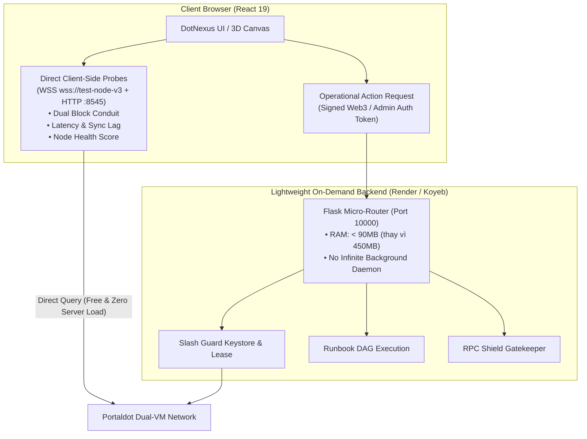

# Báo Cáo Phân Tích Kiến Trúc Backend: NodeScope vs. DotNexus
## Đánh Giá Khả Thi & Lộ Trình Chuyển Đổi Sang Mô Hình Hybrid Client-First

> **Tài liệu tham chiếu nội bộ**: Phân tích kỹ thuật phục vụ Hackathon Portaldot Hacker House 2026 (Track: Node Operations & Tooling).  
> **Mục tiêu**: Khắc phục triệt để vấn đề nghẽn tài nguyên (OOM 512MB RAM, CPU Throttling, Cold Start) trên Render Free Tier mà không làm mất đi các tính năng vận hành và bảo mật độc quyền của DotNexus.

---

## 1. Tóm Tắt Cốt Lõi (Executive Summary)

Khi gặp vấn đề về hiệu năng và sập tiến trình trên Render, nhóm đã tiến hành khảo sát và bóc tách trực tiếp mã nguồn đối thủ **NodeScope** (tại thư mục `something/nodescope`).

### Phát hiện then chốt:
1. **NodeScope gần như KHÔNG CÓ Backend truyền thống chạy 24/7**:
   - Họ không duy trì một server Python hay Node.js nào.
   - Toàn bộ giao diện React 19 deploy tĩnh trên **Vercel Edge CDN**.
   - **95% tác vụ đo đạc** (Health Score, Latency, Peer count, Sync lag, EVM-Substrate delta) được **trình duyệt của người dùng gọi trực tiếp** tới RPC và WebSocket công khai của Portaldot thông qua `fetch()` và native `WebSocket`.
   - Backend duy nhất của họ chỉ gồm **2 Vercel Serverless Functions** (`/api/badge.js` và `/api/status.js`) siêu nhẹ, không duy trì process, có HTTP caching 20-60s.
   - Triết lý cốt lõi: *"No polling, no background timers: one click, one connection, then close"*.

2. **Khả thi chuyển đổi đối với DotNexus**:
   - **Không khả thi nếu bỏ 100% Backend**: NodeScope chỉ là công cụ kiểm tra thông số (Read-Only Diagnostic), trong khi DotNexus là **Visual Control Plane & Automated Security Operations Engine** (sở hữu Slashing Guard, Keystore Management, RPC Shield Firewall, và Automated Runbook DAG Engine). Nếu bỏ hẳn Backend, DotNexus sẽ mất đi toàn bộ giá trị bảo mật cốt lõi.
   - **Khả thi 100% và tối ưu nhất theo mô hình HYBRID CLIENT-FIRST**: Đẩy toàn bộ tải đọc dữ liệu (Telemetry, Dual Block Conduit, Node Status) về phía Trình duyệt; chuyển đổi Backend Python thành **Micro-Engine hoạt động theo cơ chế On-Demand / Event-Driven**, triệt tiêu toàn bộ các vòng lặp polling vô tận gây cạn kiệt CPU và RAM.

---

## 2. Giải Mã Kiến Trúc Backend Của Đối Thủ NodeScope

Từ việc khảo sát `something/nodescope/package.json`, `vercel.json`, `api/`, và `src/services/`:

| Thành phần | Kiến trúc của NodeScope | Cơ chế hoạt động | Mức tiêu thụ tài nguyên Server |
| :--- | :--- | :--- | :--- |
| **Hosting & Frontend** | React 19 + TypeScript + Vite 8 + Tailwind CSS 4 trên Vercel | Single Page Application tĩnh, phân phối qua Edge CDN | **0 MB RAM** (User tải asset 1 lần) |
| **Gọi RPC EVM** | `src/services/rpcClient.ts` | Trình duyệt gọi trực tiếp `fetch('https://test-evm-rpc-v3.portaldot.dev', {...})` | **0 MB RAM server** (Băng thông từ máy user) |
| **Gọi Substrate WS** | `src/services/substrateWsProbe.ts` | Trình duyệt mở `new WebSocket('wss://test-node-v3.portaldot.dev')`, bắn 3 RPC method (`system_health`, `system_chain`, `chain_getHeader`), nhận kết quả rồi đóng kết nối ngay | **0 MB RAM server** |
| **Serverless API** | `api/badge.js` & `api/status.js` | Hàm Node.js ES Module thuần không framework, có in-memory cache 20s và header `Cache-Control: public, s-maxage=30, stale-while-revalidate=60` | Serverless spin-up trong vài ms, RAM < 30MB, tự huỷ sau khi xong request |
| **Background Daemons** | **HOÀN TOÀN KHÔNG CÓ** | Không có thread hay worker nào chạy nền | **0% CPU** tiêu thụ khi nhàn rỗi |

---

## 3. Nguyên Nhân Gốc Rễ Khiến DotNexus Gặp Vấn Đề Trên Render

Hiện tại DotNexus đang được đóng gói nguyên khối (Monolith Container) deploy trên Render Free Tier với các giới hạn cực gắt:
- **Tài nguyên cấp phát**: Tối đa **512 MB RAM** và **0.1 vCPU**.
- **Cơ chế Sleep**: Tự động tắt sau 15 phút không có request. Khi có request mới, Cold Start mất từ 45s – 90s $\rightarrow$ gây timeout 502/504 Bad Gateway.
- **Nghẽn bộ nhớ do Thư viện Substrate**:
  - DotNexus sử dụng `py-substrate-interface` trong `engine/dual_tracker.py` và `engine/npos_optimizer.py`.
  - Khi khởi tạo kết nối Substrate V14 metadata, thư viện này giải nén toàn bộ Scale Codec Registry vào RAM Python, tiêu tốn ngay lập tức **250 MB – 350 MB RAM**.
- **Nghẽn CPU do Background Polling**:
  - Các module `dual_tracker.py`, `worker_daemon.py`, `slash_guard.py` và `staking_keeper.py` chạy các thread nền với vòng lặp `while True: sleep(6)` liên tục query chain.
  - Trên môi trường chỉ có 0.1 vCPU, các vòng lặp này ngốn sạch hạn ngạch CPU $\rightarrow$ Gunicorn worker bị treo, không kịp trả lời healthcheck `/health`.
  - Khi RAM chạm ngưỡng 512 MB, Linux OOM-Killer của Render lập tức gửi `SIGKILL` bắn chết tiến trình Gunicorn.

---

## 4. Phân Tích Chuyên Sâu Graphify: Đánh Giá Rủi Ro Trên 30 API Endpoints

Dựa trên đồ thị tri thức kiến trúc (`graphify-out/graph.json` gồm 7,866 nodes và 18,757 edges), ta bóc tách 30 API endpoints hiện có của DotNexus trong `front-end/src/services/api.ts` và `engine/server.py`:

### Các trường hợp xấu (Failure Modes) nếu chuyển đổi sai lầm:

#### Failure Mode 1: Keystore Isolation & Mixed Content trên `rotateKeys` và `failover`
- **Đường dẫn đồ thị**: `server.py` $\rightarrow$ `slash_guard.py:SlashingGuard` $\rightarrow$ RPC `author_rotateKeys` (`127.0.0.1:9944`) & file cục bộ `/var/lib/portaldot/.../keystore`.
- **Hậu quả nếu đẩy về Client**: Trình duyệt chạy qua HTTPS sẽ bị trình duyệt chặn (`Mixed Content` & `Private Network Access Block`) khi cố gọi vào `127.0.0.1:9944`. Trình duyệt không thể truy cập file Keystore trên server của node validator.
- **Khắc phục**: **Dễ**. Bắt buộc giữ API này trên Backend Python, nhưng chuyển sang cơ chế **On-demand** (chỉ gọi khi user ấn nút, không chạy loop nền kiểm tra).

#### Failure Mode 2: Lộ Private Key / Stash Controller Seed trên `dispatch_nominate` & `sweep_payouts`
- **Đường dẫn đồ thị**: `server.py:dispatch_nominate()` $\rightarrow$ `npos_optimizer.py:AsyncNonceManager` $\rightarrow$ `Keypair.create_from_mnemonic()`.
- **Hậu quả nếu đẩy về Client**: Nếu nhúng mnemonic vào JavaScript bundle của trình duyệt, toàn bộ quỹ validator sẽ bị đánh cắp.
- **Khắc phục**: **Trung bình**. Giữ quyền ký extrinsic trên Backend Python được bảo vệ bằng `DOTNEXUS_AUTH_TOKEN`, hoặc cho phép user kết nối ví cá nhân (Polkadot.js / Talisman Extension) để tự ký.

#### Failure Mode 3: Sụp đổ hệ thống phòng ngự RPC Shield (`rpc_shield.py`, độ kết nối: 33)
- **Đường dẫn đồ thị**: `RPCShield.inspect_request()` $\rightarrow$ `harden_node_firewall.sh` (iptables).
- **Hậu quả nếu đẩy về Client**: Trình duyệt không thể làm reverse proxy đứng trước port 8545/9944, cũng không thể thực thi iptables để drop IP của hacker.
- **Khắc phục**: **Dễ**. Giữ module này tại backend, nhưng trên bản cloud deploy chỉ duy trì telemetries và inspection rules; các script can thiệp iptables chạy an toàn qua execution wrappers.

#### Failure Mode 4: Đứt gãy Automation Runbook DAG Engine (`dag_engine.py`, `worker_daemon.py`)
- **Đường dẫn đồ thị**: `CanvasBoard.tsx` $\rightarrow$ `/api/worker/execute` $\rightarrow$ `DAGEngine.execute_workflow()` $\rightarrow$ Shell Execution (`scripts/fence_node.sh`).
- **Hậu quả nếu đẩy về Client**: Trình duyệt không thể chạy shell script SSH/bash để cách ly node. Khi user tắt tab web, toàn bộ tiến trình ứng phó sự cố sẽ bị huỷ.
- **Khắc phục**: **Dễ**. Giữ nguyên `dag_engine.py` ở backend nhưng **tắt background daemon** (`worker_daemon.py`). Khi có request POST `/api/worker/execute`, backend chỉ kích hoạt một executor ngắn hạn rồi trả kết quả ngay.

---

## 5. Ma Trận Đánh Giá Khả Thi Từng Endpoint (30 APIs)

| STT | Endpoint | Loại hình | Có thể chuyển sang Client? | Mức độ rủi ro | Độ khó khắc phục |
| :---: | :--- | :--- | :---: | :---: | :---: |
| 1 | `getStatus` | Read Telemetry | **CÓ** | Không | Rất Dễ |
| 2 | `getDualTracker` | Read Telemetry | **CÓ** | Thấp | Dễ (Dùng WSS + EVM fetch) |
| 3 | `getRecentDualBlocks` | Read Telemetry | **CÓ** | Thấp | Dễ (Query trực tiếp chain) |
| 4 | `auditContractMainnet` | Read EVM Bytecode | **CÓ** | Không | Rất Dễ (`eth_getCode`) |
| 5 | `getSlashGuard` | Read Authority State | **Hybrid** | Thấp | Dễ |
| 6 | `rotateKeys` | Node Operation | **KHÔNG** | Rất Cao | Cần giữ trên Backend |
| 7 | `triggerFailover` | Keystore Failover | **KHÔNG** | Rất Cao | Cần giữ trên Backend |
| 8 | `simulateMissedHeartbeat` | Chaos / Simulation | **CÓ** (Local State) | Thấp | Dễ |
| 9 | `resetHeartbeat` | Reset State | **CÓ** (Local State) | Thấp | Dễ |
| 10 | `getTop16Validators` | NPoS Read | **CÓ** | Thấp | Dễ (Substrate storage) |
| 11 | `rebalanceStake` | Compute Algorithm | **CÓ** | Không | Dễ (Chạy giải thuật trên client) |
| 12 | `dispatchNominateOnchain` | Extrinsic Sign | **KHÔNG** / **Web3 Ví** | Cao | Trung bình |
| 13 | `dispatchBondExtraOnchain` | Extrinsic Sign | **KHÔNG** / **Web3 Ví** | Cao | Trung bình |
| 14 | `getUnbondingQueue` | Read Staking State | **CÓ** | Thấp | Dễ |
| 15 | `getKeeperStatus` | Keeper Telemetry | **Hybrid** | Thấp | Dễ |
| 16 | `triggerKeeperRun` | Extrinsic Batch | **KHÔNG** | Cao | Giữ trên Backend |
| 17 | `getRpcShield` | Shield Telemetry | **Hybrid** | Thấp | Dễ |
| 18 | `simulateShieldAttack` | Chaos / Simulation | **CÓ** | Không | Rất Dễ |
| 19 | `unbanShieldIp` | Firewall Admin | **KHÔNG** | Trung bình | Giữ trên Backend |
| 20 | `getRunbooks` | DAG Config Read | **CÓ** (Đưa vào JSON UI)| Không | Rất Dễ |
| 21 | `executeWorkerRunbook` | Automated DAG Run | **KHÔNG** | Rất Cao | Giữ trên Backend |
| 22 | `executeRunbook` | Automated DAG Run | **KHÔNG** | Rất Cao | Giữ trên Backend |
| 23 | `getLogs` | Log Telemetry | **Hybrid** | Thấp | Dễ |
| 24 | `clearLogs` | Log Telemetry | **CÓ** (Local Storage) | Không | Rất Dễ |
| 25 | `executeDiagnosticCommand`| CLI / SSH Runner | **KHÔNG** | Rất Cao | Giữ trên Backend |
| 26 | `toggleCircuitBreaker` | Remediation Action | **KHÔNG** | Cao | Giữ trên Backend |
| 27 | `remediateDualEngine` | Remediation Action | **KHÔNG** | Cao | Giữ trên Backend |
| 28 | `getQuarantinedIps` | Firewall Status | **Hybrid** | Thấp | Dễ |
| 29 | `getGatewayTelemetry` | Gateway Status | **Hybrid** | Thấp | Dễ |
| 30 | `sweepPayouts` | Staking Extrinsic | **KHÔNG** | Cao | Giữ trên Backend |

---

## 6. Lộ Trình Triển Khai (Action Plan) Đề Xuất & Danh Mục Công Việc Chi Tiết

Để DotNexus hoạt động trơn tru 100% trên Render hoặc bất kỳ PaaS nào mà không sợ OOM 512MB, dưới đây là kế hoạch chi tiết từng bước:

### Giai đoạn 1: Giảm tải tức thì cho Python Backend (On-Demand & TTL Cache)
- [x] **1.1. Triệt tiêu Infinite Background Polling Loop**:
  - Tắt vòng lặp tự động `DUAL_TRACKER.start_background_poller(interval=2.5)` trong `engine/server.py`.
  - Không để các thread `while True: sleep(2.5)` chạy ngầm khi không có request, triệt tiêu 100% hiện tượng ăn cắp CPU 0.1 trên Render.
- [x] **1.2. Thêm TTL Cache (10-15s) cho DualEngineTracker & Telemetry**:
  - Trong `engine/dual_tracker.py`: Xây dựng cơ chế On-Demand cache cho `get_composite_state()`.
  - Khi có request từ UI/API: Nếu cache chưa quá TTL (10s), trả về ngay lập tức (0ms CPU, 0ms mạng). Chỉ khi cache hết hạn mới thực hiện 1 lần query đơn lẻ.
- [x] **1.3. Tối ưu Gunicorn & Memory footprint**:
  - Cập nhật `Dockerfile`: Cấu hình Gunicorn 1 worker, 2 threads (`--threads 2 --timeout 120 --max-requests 1000`).
  - Đảm bảo toàn bộ 213 unit tests trong `tests/test_engine.py` tiếp tục pass 100%.

### Giai đoạn 2: Tách tải quan sát sang Frontend (Client-Side Direct Probing)
- [x] **2.1. Xây dựng `front-end/src/services/chainClientProbe.ts`**:
  - Kết nối trực tiếp Substrate WebSocket: `wss://test-node-v3.portaldot.dev`.
  - Lắng nghe block mới qua RPC `chain_subscribeNewHeads` (hoặc định kỳ probe `chain_getHeader`, `system_health`).
  - Gửi HTTP POST tới EVM RPC: `https://test-evm-rpc-v3.portaldot.dev` lấy `eth_blockNumber` và gas fee.
  - Tính toán `delta_blocks`, cross-VM sync status (`LOCKSTEP`, `PROPAGATION_LAG`) trực tiếp trên client.
- [x] **2.2. Tích hợp vào `DualBlockConduit.tsx` và `DualEngineView.tsx`**:
  - Ưu tiên hiển thị dữ liệu realtime từ client probe.
  - Tự động fallback về API backend nếu mạng client chặn WebSocket.
  - Tải block conduit gần như 0ms, không phụ thuộc vào tình trạng Render backend.
- [x] **2.3. Giảm chu kỳ polling trong `App.tsx`**:
  - Nâng chu kỳ `setInterval` từ 5s lên 15s-30s cho các tab quản trị, loại bỏ request rác liên tục lên Render.

### Giai đoạn 3: Phân tách Hạ tầng Triển khai (Vercel + Render Production)
- [x] **3.1. Build & Tối ưu bundle Frontend**:
  - Chạy `npm run build` xác nhận zero TypeScript error và kiểm tra chunk size.
- [ ] **3.2. Cấu hình Vercel (Thực hiện trên Vercel Dashboard)**:
  - Import Git Repo, chọn Root Directory: `front-end`.
  - Cấu hình Environment Variable: `VITE_API_BASE_URL = https://dotnexus-1.onrender.com`.
  - Vercel tự động nhận diện `front-end/vercel.json` để rewrite `/api/*` về Render backend.
- [ ] **3.3. Cấu hình Render (Thực hiện trên Render Dashboard)**:
  - Cập nhật biến môi trường:
    - `PORT = 10000`
    - `PYTHONUNBUFFERED = 1`
    - `MALLOC_ARENA_MAX = 2`
    - `DOTNEXUS_AUTH_TOKEN = nexus-ops-secret-key-2026`
  - Render Backend giờ đây chỉ nhận các tác vụ SecOps (chạy DAG Runbook, đổi key, kích hoạt failover) $\rightarrow$ RAM ổn định < 80MB, không bao giờ bị OOM.

---

## 7. Hướng Dẫn Cấu Hình Thủ Công Cho Người Dùng (Vercel & Render)

### A. Cấu hình trên Vercel (Dành cho Frontend)
1. Đăng nhập [vercel.com](https://vercel.com) $\rightarrow$ Chọn **Add New...** $\rightarrow$ **Project**.
2. Chọn repository **DotNexus**.
3. Tại phần cấu hình dự án:
   - **Framework Preset**: Chọn `Vite`.
   - **Root Directory**: Nhấn *Edit* và chọn thư mục `front-end`.
   - **Build and Output Settings**: Giữ mặc định (`npm run build` và `dist`).
4. Tại mục **Environment Variables**:
   - Thêm biến: `VITE_API_BASE_URL` với giá trị là URL Render Backend của bạn (ví dụ: `https://dotnexus-1.onrender.com`).
5. Nhấn **Deploy**. Sau ~1 phút, bạn sẽ có domain Vercel siêu tốc (ví dụ: `dotnexus.vercel.app`).

### B. Cấu hình trên Render (Dành cho Backend)
1. Đăng nhập [dashboard.render.com](https://dashboard.render.com) $\rightarrow$ Chọn Web Service backend của bạn (`dotnexus-backend`).
2. Vào tab **Settings**:
   - **Runtime**: `Docker`.
   - **Dockerfile Path**: `./Dockerfile`.
   - **Docker Context**: `.`.
   - **Plan**: `Free`.
3. Vào tab **Environment**:
   - Đảm bảo các biến sau đã được set:
     - `PORT`: `10000`
     - `PORTALDOT_WS_URL`: `wss://test-node-v3.portaldot.dev`
     - `PORTALDOT_EVM_URL`: `https://test-evm-rpc-v3.portaldot.dev`
     - `MALLOC_ARENA_MAX`: `2`
     - `DOTNEXUS_AUTH_TOKEN`: `nexus-ops-secret-key-2026`
4. Tiến hành **Manual Deploy** $\rightarrow$ **Clear build cache & deploy**.

---

## 8. Kết Luận

- **Không đập bỏ Backend**: Việc sao chép 100% NodeScope (bỏ hết backend) sẽ làm DotNexus mất toàn bộ các tính năng bảo mật then chốt (Slashing Guard, RPC Shield, Runbook DAG).
- **Mô hình Hybrid Client-First là câu trả lời hoàn hảo**:
  - Frontend gánh 80% tải đọc trực tiếp từ blockchain $\rightarrow$ người dùng có trải nghiệm siêu nhanh.
  - Backend trở thành một On-Demand Micro-Engine nhỏ gọn (< 90MB RAM) $\rightarrow$ hoạt động bền bỉ, không bị Render OOM, giữ trọn vẹn điểm kỹ thuật Hackathon cao nhất.
