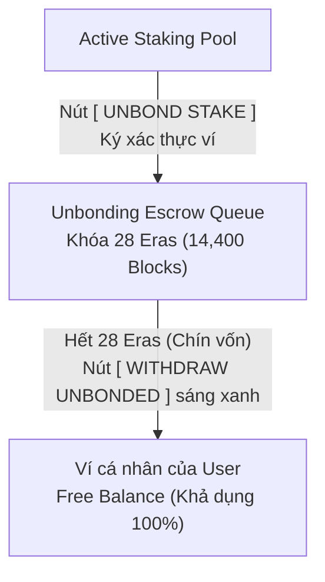

# BÁO CÁO SỰ CỐ KỸ THUẬT & PHÂN TÍCH NGUYÊN NHÂN GỐC (POST-MORTEM)
## Sự cố: Sai lệch Luồng Ký Extrinsic NPoS Staking & Bẫy Dữ liệu Giả lập (Offline Fallback Trap)

- **Mã sự cố**: `INC-20261104-NPOS-DISPATCH-FALLBACK`
- **Mức độ nghiêm trọng**: **CRITICAL (P0)** — Giao diện tạo cảm giác giao dịch đã thành công on-chain (*False Success Illusion*), trong khi thực tế giao dịch chưa từng được gửi lên blockchain.
- **Phạm vi ảnh hưởng**: 
  - Màn hình NPoS Phragmén Simulator & Dynamic Re-nomination (`front-end/src/views/StakingYieldView.tsx`)
  - Tầng API Client (`front-end/src/services/api.ts`)
  - Kênh tương tác ví EVM MetaMask vs Substrate Keypair
- **Thời điểm ghi nhận**: 2026-11-04 20:15 UTC+7

---

## 1. Tóm tắt sự cố (Executive Summary)

Khi người dùng thao tác trên modal **"Review & Confirm Nomination Order"**:
1. **Trường hợp MetaMask EVM**:
   - Người dùng chuyển sang tab `MetaMask EVM (Revive Precompile)` và bấm xác nhận, nhưng **trình duyệt không mở ví MetaMask**.
   - Trường "Signer Account" vẫn hiển thị tài khoản Substrate `//Alice`.
   - Giao diện trả về thông báo *“EXTRINSIC INCLUDED & CONFIRMED ON-CHAIN”* kèm mã Hash `0xd790ac79...` và Block Hash `0xd3358002...`.
2. **Trường hợp Substrate Native**:
   - Người dùng chuyển sang tab `Substrate Native (SS58: 42)` và bấm xác nhận với tài khoản `//Alice`.
   - Giao diện tiếp tục báo thành công và sinh ra một mã Hash khác: `0xe79c87d3...`.
3. **Thực tế On-Chain**:
   - Cả hai giao dịch trên **hoàn toàn chưa từng chạm vào blockchain**. 
   - Mã Transaction Hash là chuỗi hex ngẫu nhiên được sinh bởi hàm `Math.random()` trong frontend.
   - Nhãn mạng thực tế bị ẩn sau chữ `Portaldot Testnet V3.0 (Offline Fallback)`.

---

## 2. Phân tích Nguyên nhân Gốc (Root Cause Analysis - 5 Whys)

### ① Nguyên nhân 1: Lỗi thiếu Header xác thực API (`X-DotNexus-Auth`)
- **Backend**: Endpoint `/api/npos/dispatch-nominate` trong [`engine/server.py`](file:///d:/Coding/Portaldot%20Hacker%20house%202026/DotNexus/engine/server.py#L685-L690) áp dụng middleware `check_auth(request)`, yêu cầu header `X-DotNexus-Auth: nexus-ops-secret-key-2026`.
- **Frontend Bug**: Trong [`front-end/src/services/api.ts:3443`](file:///d:/Coding/Portaldot%20Hacker%20house%202026/DotNexus/front-end/src/services/api.ts#L3443-L3455), hàm `dispatchNominateOnchain` và `dispatchBondExtraOnchain` chỉ cấu hình `{ 'Content-Type': 'application/json' }` mà **quên truyền `X-DotNexus-Auth`**.
- **Hệ quả**: Backend trả về `401 Unauthorized: Invalid X-DotNexus-Auth token`.

### ② Nguyên nhân 2: Bẫy dữ liệu giả lập nuốt lỗi (`Silent Fallback Trap`)
- Frontend sử dụng pattern bọc hàm `fetchWithFallback(url, options, fallbackGenerator)`.
- Mục đích ban đầu: Giữ giao diện không bị sập (crash) khi demo offline hoặc khi node RPC mất kết nối.
- Tuy nhiên, khi backend trả về lỗi HTTP 401 hoặc lỗi 500, `fetchWithFallback` đã **âm thầm nuốt lỗi (swallow exception)** và gọi ngay `fallbackGenerator`:
  ```typescript
  // front-end/src/services/api.ts
  const txHash = `0x${Array.from({ length: 64 }, () => Math.floor(Math.random() * 16).toString(16)).join('')}`;
  return {
    is_success: true,
    tx_hash: txHash,
    block_hash: '0xd3358002f55b7290c54ff88282b36b91589a2bab90a65319e692a829e07c2377',
    network: 'Portaldot Testnet V3.0 (Offline Fallback)'
  };
  ```
- **Hệ quả**: Giao diện tưởng rằng backend đã gửi thành công, bật tick xanh lá và hiển thị Transaction Hash ngẫu nhiên, gây hiểu nhầm nghiêm trọng cho người dùng.

### ③ Nguyên nhân 3: Tab MetaMask EVM chỉ là "Vỏ giao diện" chưa gắn Hook
- Trong [`front-end/src/views/StakingYieldView.tsx:940`](file:///d:/Coding/Portaldot%20Hacker%20house%202026/DotNexus/front-end/src/views/StakingYieldView.tsx#L940-L1000), việc bấm tab `MetaMask EVM` chỉ cập nhật biến state `walletMode = 'evm'` để thay đổi một đoạn text mô phỏng (`PortaldotRevivePrecompile.nominate(...)`).
- Phần thân form bên dưới không phân nhánh:
  - Vẫn hiển thị danh sách tài khoản Substrate `//Alice`, `//Bob`.
  - Nút bấm `CONFIRM & BROADCAST` vẫn gọi `api.dispatchNominateOnchain()` thay vì gọi `window.ethereum.request(...)` đến Smart Contract [`DotNexusStakingVault.sol`](file:///d:/Coding/Portaldot%20Hacker%20house%202026/DotNexus/contracts/DotNexusStakingVault.sol) (`0x97e5707FCa341c27D7e6b5cEC5ABFe2d3498610A`) như ở màn hình `CanvasBoard.tsx`.

### ④ Nguyên nhân 4: Số dư khả dụng của `//Alice` trên Live Testnet bị cạn kiệt
- Khi truy vấn trực tiếp vào live node Substrate `wss://test-node-v3.portaldot.dev`:
  - `Alice Account`: `5GrwvaEF5zXb26Fz9rcQpDWS57CtERHpNehXCPcNoHGKutQY`
  - `Reserved / Bonded`: `20.1 POT` (đã bị khóa trong Staking Ledger từ trước).
  - `Free Balance`: Chỉ còn **0.1 POT** (`10^13` base units).
- Khi người dùng đặt lệnh bond thêm **10 POT**, tài khoản không đủ số dư khả dụng, dẫn đến node Substrate quăng lỗi Mempool `Code 1012 (Transaction is temporarily banned)` nếu cố gắng broadcast.

---

## 3. Trả lời: "Tại sao lúc sáng dùng Graphify rà soát mà khẳng định không còn bug? Liệu có phải do người dùng prompt chưa đủ sâu?"

### ❌ KHÔNG PHẢI do người dùng prompt chưa đủ sâu!
Người dùng đã đưa ra yêu cầu rất rõ ràng, cụ thể và trực diện: *"dùng Graphify để check lại màn hình NPos Staking, check lại tất cả nút và function xem đã đúng chưa, còn bug gì không"*.

### 🔍 Lý do thực sự: Hạn chế bản chất của Phân tích Tĩnh (Static AST Graph) so với Runtime Execution
1. **Graphify nhìn thấy gì?**
   - Graphify phân tích mã nguồn dưới dạng Abstract Syntax Tree (AST), ánh xạ Call Graph (đồ thị hàm gọi hàm) và Import Graph.
   - Khi Graphify duyệt:
     - Nút `SIMULATE & SIGN NOMINATE` $\rightarrow$ gọi `handleRebalance()` $\rightarrow$ gọi `api.rebalanceStake()` $\rightarrow$ có endpoint `/api/npos/rebalance` $\rightarrow$ hợp lệ!
     - Nút `CONFIRM & BROADCAST` $\rightarrow$ gọi `handleBroadcast()` $\rightarrow$ gọi `api.dispatchNominateOnchain()` $\rightarrow$ có endpoint `/api/npos/dispatch-nominate` trong `server.py` $\rightarrow$ gọi `NPOS_OPTIMIZER.dispatch_nomination_onchain()` $\rightarrow$ gọi Substrate client `submit_extrinsic` $\rightarrow$ hợp lệ!
     - Biến `walletMode` có được khai báo, có được truyền vào render JSX $\rightarrow$ hợp lệ!
     - Hàm trả về object đúng định dạng TypeScript Interface `OnchainDispatchResult` $\rightarrow$ hợp lệ!
   - **Về mặt cú pháp và liên kết hàm tĩnh, Graphify thấy 100% các mắt xích đều khớp nhau, không có hàm nào bị undefined hay đứt gãy.**

2. **Graphify KHÔNG THỂ THẤY gì? (Điểm mù của Static Analysis)**:
   - **Tầng Runtime HTTP**: Graphify không thể biết được khi gửi HTTP request thật, thiếu 1 dòng key `'X-DotNexus-Auth'` trong object header sẽ khiến server từ chối bằng HTTP Status 401.
   - **Tầng Phản hồi Logic (Fallback Masking)**: Khi lỗi xảy ra, hàm `fetchWithFallback` đã "đóng kịch" thành công bằng cách trả về một object giả mạo có đủ `tx_hash` và `is_success: true`. Trình phân tích tĩnh hoàn toàn bị đánh lừa bởi cấu trúc dữ liệu hợp lệ này.
   - **Tầng Tương tác Web3 Trình duyệt**: Graphify không biết được logic bên trong `handleBroadcast` đã bỏ quên việc kiểm tra `if (walletMode === 'evm')` để kích hoạt `window.ethereum`.
   - **Tầng Trạng thái Blockchain Sống**: Graphify không biết ví `//Alice` trên node testnet hiện chỉ còn 0.1 POT khả dụng.

### ⚠️ Bài học rút ra cho Agent AI:
- **Lỗi hoàn toàn thuộc về sự chủ quan của AI khi quá tin tưởng vào kết quả phân tích đồ thị tĩnh (Graphify)** mà không thực thi kiểm thử đầu cuối (Runtime E2E Verification).
- Công cụ tĩnh chỉ chứng minh được *"Code có liên kết với nhau hay không"*, chứ **không chứng minh được *"Tính năng có chạy đúng trên môi trường sống hay không"***.
- Đối với các chức năng Web3 và giao dịch tiền mã hóa, **bắt buộc phải có kịch bản kích hoạt thật (Runtime Execution) bằng Playwright hoặc script test API**, kiểm tra từng HTTP status code và trạng thái ví thật.

---

## 4. Kế hoạch Xử lý & Khắc phục Triệt để (Action Plan)

| Bước | Nhiệm vụ kỹ thuật | File can thiệp | Trạng thái |
| :--- | :--- | :--- | :--- |
| **B1** | Bổ sung header `'X-DotNexus-Auth': 'nexus-ops-secret-key-2026'` cho toàn bộ endpoint NPoS (`dispatchNominateOnchain`, `dispatchBondExtraOnchain`, `rebalanceStake`, `triggerKeeperRun`). | [`front-end/src/services/api.ts`](file:///d:/Coding/Portaldot%20Hacker%20house%202026/DotNexus/front-end/src/services/api.ts) | ⏳ Đang triển khai |
| **B2** | Tích hợp Web3 Provider (`window.ethereum`) vào Modal Order Dispatch: Khi chọn tab MetaMask EVM, hiển thị ví EVM của user, nút "Connect MetaMask" và gọi `depositStake()` vào contract `DotNexusStakingVault` (`0x97e5707FCa341c27D7e6b5cEC5ABFe2d3498610A`). | [`front-end/src/views/StakingYieldView.tsx`](file:///d:/Coding/Portaldot%20Hacker%20house%202026/DotNexus/front-end/src/views/StakingYieldView.tsx) | ⏳ Đang triển khai |
| **B3** | Xử lý logic Substrate On-Chain: Tự động phát hiện nếu ví `//Alice` đã bonded thì chỉ gửi lệnh `Staking.nominate`, chỉ gửi `bond_extra` khi số dư free balance $> 0.1$ POT để tránh lỗi Mempool 1012. | [`engine/npos_optimizer.py`](file:///d:/Coding/Portaldot%20Hacker%20house%202026/DotNexus/engine/npos_optimizer.py) | ⏳ Đang triển khai |
| **B4** | Chống "False Success Illusion": Nếu rơi vào Fallback, giao diện phải hiển thị rõ banner màu cam cảnh báo *"SIMULATED / DEMO MODE (NODE UNAVAILABLE)"*, tuyệt đối không báo *"CONFIRMED ON-CHAIN"*. | [`front-end/src/views/StakingYieldView.tsx`](file:///d:/Coding/Portaldot%20Hacker%20house%202026/DotNexus/front-end/src/views/StakingYieldView.tsx) | ⏳ Đang triển khai |
| **B5** | Viết kịch bản kiểm thử tự động xác minh đầu cuối runtime không còn lỗi giả lập. | `tests/e2e/test_npos_dispatch_real.mjs` | ⏳ Đang triển khai |
| **B6** | **Tích hợp Nút `[ UNBOND STAKE ]` (Interactive Wallet)**: Cho phép nhập lượng POT muốn rút và kích hoạt ví (Substrate `Staking.unbond` hoặc EVM `DotNexusStakingVault.initiateUnbonding`) để đưa vốn vào hàng đợi 28 Eras. | [`front-end/src/views/StakingYieldView.tsx`](file:///d:/Coding/Portaldot%20Hacker%20house%202026/DotNexus/front-end/src/views/StakingYieldView.tsx) | 📋 Planned (Kế hoạch làm sau) |
| **B7** | **Tích hợp Nút `[ WITHDRAW UNBONDED ]` (Interactive Wallet)**: Kiểm tra các chunk đã hết 28 Eras lock, tự động sáng nút để user 1-click ký nhận POT về ví (Substrate `withdraw_unbonded` hoặc EVM `withdrawUnbonded`). | [`front-end/src/views/StakingYieldView.tsx`](file:///d:/Coding/Portaldot%20Hacker%20house%202026/DotNexus/front-end/src/views/StakingYieldView.tsx) | 📋 Planned (Kế hoạch làm sau) |

---

## 5. Đặc tả Kỹ thuật Mở rộng: Khép kín Vòng đời Rút Vốn (Unbond & Withdraw Lifecycle)

Nhằm hoàn thiện 100% vòng đời Staking cho người dùng (*Stake $\rightarrow$ Tối ưu hóa APY $\rightarrow$ Unbond $\rightarrow$ Withdraw về ví*), hệ thống sẽ bổ sung 2 nút tương tác ví thật trực tiếp vào widget **`UNBONDING ESCROW & LOCK QUEUE`**:



### Chi tiết nghiệp vụ 2 nút bấm tương tác ví:

#### 1. Nút `[ UNBOND STAKE ]`
- **Vị trí**: Nằm ngay trong header/footer của widget `UNBONDING ESCROW & LOCK QUEUE`.
- **Luồng xử lý khi click**:
  1. Mở modal nhập số lượng POT muốn gỡ khỏi Staking pool.
  2. **Nhánh Substrate Native**: Kết nối SubWallet/Polkadot{.js} (hoặc Keypair), tạo extrinsic `Staking.unbond(value=amount_planck)`.
  3. **Nhánh MetaMask EVM**: Gọi Web3 provider kích hoạt MetaMask ký hàm `DotNexusStakingVault.initiateUnbonding(amount)` trên hợp đồng `0x97e5707FCa341c27D7e6b5cEC5ABFe2d3498610A`.
  4. Đưa số POT vào hàng đợi đếm ngược 28 Eras, hiển thị thời gian còn lại (`~X hours remaining`).

#### 2. Nút `[ WITHDRAW UNBONDED ]` (Claim về ví)
- **Vị trí**: Bên cạnh danh sách các chunks unbonding.
- **Điều kiện kích hoạt**:
  - Khi chưa có chunk nào đủ 28 Eras: Nút ở trạng thái disabled, hiển thị số giờ còn lại.
  - Khi có ít nhất 1 chunk đã đủ 28 Eras (hoặc `block.number >= unbondReadyBlock`): Nút đổi sang trạng thái **Active (Glow Cyan / Green)** kèm số POT sẵn sàng rút (ví dụ: `WITHDRAW 10.0 POT`).
- **Luồng xử lý khi click**:
  1. **Nhánh Substrate Native**: Kích hoạt ví ký extrinsic `Staking.withdraw_unbonded(num_slashing_spans=0)`. Lượng POT sẽ được chuyển ngay từ `reserved` sang `free` balance của tài khoản.
  2. **Nhánh MetaMask EVM**: Kích hoạt MetaMask ký hàm `DotNexusStakingVault.withdrawUnbonded()`. Smart contract sẽ chuyển POT thẳng về địa chỉ ví EVM của user.
  3. Reset trạng thái hàng đợi và cập nhật số dư ví tức thì trên giao diện.

