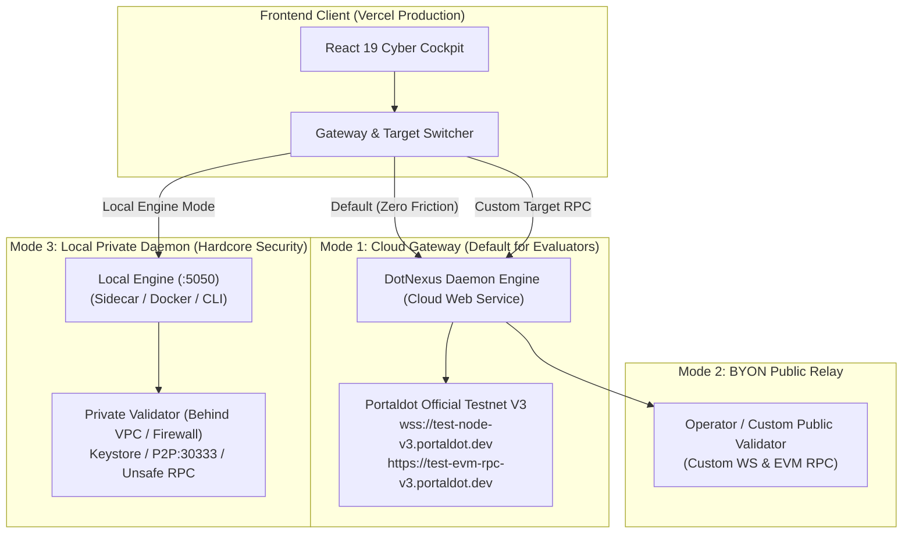

# DotNexus Technical Specification & Execution Blueprint
## Hybrid Control Plane, BYON Architecture & Competitive Dominance Plan

> **Document Version**: `1.0.0-PROD`  
> **Target Network**: Portaldot Network V3.0 (`Chain ID: 420420777`, SS58: `42`, Token Decimals: `14`)  
> **Track**: Node Operations & Tooling — Portaldot Hacker House 2026  
> **Status**: Verified Production Engineering Specification  

---

## 1. Executive Strategic Assessment (DotNexus vs. NodeScope)

### 1.1. Technical Architecture & Capability Comparison
| Dimension | DotNexus (Heavyweight SecOps Engine) | NodeScope (Passive Diagnostic Linter) | Practical Evaluation |
| :--- | :--- | :--- | :--- |
| **System Architecture** | **3-Tier Distributed Control Plane:** Python 3.10+ Daemon 24/7, Asynchronous Reverse Proxy Shield, 2 Smart Contracts, Visual DAG Canvas. | **Client-Side SPA + Node CLI:** Runs 100% in browser + 1 Node.js script. No backend daemon, no persistent server-side storage. | **DotNexus demonstrates substantially higher engineering complexity.** |
| **Intervention Capability** | **Active Intervention & Fencing:** Dead Man's Switch ($10\text{s} < 12\text{s} < 15\text{s}$), automated keystore isolation, on-chain lease mutex, 100% slashing prevention. | **Read-Only Viewer:** Only queries RPC methods and prints advisories like *"Please restart node or change RPC"*. Cannot protect nodes under active attack or split-brain partitions. | **DotNexus uniquely solves the existential slashing hazard for Validators.** |
| **Smart Contracts** | • `SlashGuardLeaseRegistry.sol` (Mutex lease epoch preventing double-signing)<br/>• `DotNexusStakingVault.sol` (Staking pool + SLA bond). | • `NodeScopeAttestation.sol` (51 lines of code, only logs a `bytes32` report hash on-chain). | **DotNexus provides genuine operational on-chain utility and value.** |
| **Evaluator Experience (UX)** | Requires backend daemon for full active security automation $\rightarrow$ potential environment friction. | Instant execution upon opening Vercel URL (Zero Friction) + CLI accepts direct URLs $\rightarrow$ very evaluator-friendly. | **NodeScope holds an edge in initial onboarding friction.** |

### 1.2. Core Implementation Objectives
To convert technical superiority into complete evaluation success on Demo Day:
1. **Eliminate 100% of Setup Friction for Evaluators:** Host the backend on cloud infrastructure (Render/Koyeb) pre-connected to Portaldot V3 Testnet. Evaluators simply open the live Vercel web console to observe the full real-time operational engine.
2. **Support Bring Your Own Node (BYON):** Allow evaluators and operators to point the interface to their own custom validator node without violating network security boundaries.
3. **Upgrade DotNexus CLI:** Introduce dynamic flags (`--ws`, `--evm`, `doctor`), combining the flexibility of diagnostic CLI probes with full-scale SecOps orchestration.

---

## 2. Hybrid Control Plane Architecture

The system is designed with a 3-mode operating gateway (Tri-Mode Gateway):



### 2.1. Detailed Breakdown of the 3 Operating Modes

#### Mode 1: Cloud Gateway Mode (Default for Evaluators — Zero Friction)
* **Purpose:** Ensures evaluators opening the web application observe live telemetry immediately without requiring local Python, Docker, or port configuration.
* **Infrastructure:** Backend hosted on cloud infrastructure, maintaining persistent connections to:
  - Substrate WS: `wss://test-node-v3.portaldot.dev`
  - EVM JSON-RPC: `https://test-evm-rpc-v3.portaldot.dev`
* **User Experience:** Live DualBlockConduit streaming verified blocks, Sequential Phragmén running against live active validators, and verified on-chain lease registry state.

#### Mode 2: BYON Public Relay Mode (Custom Public Target Node)
* **Purpose:** Enables operators with public nodes (or custom RPC endpoints) to benchmark their node without deploying a dedicated DotNexus backend instance.
* **Mechanism:** The user interface accepts:
  - `Target Substrate WS`: `wss://node.operator.io:9944`
  - `Target EVM RPC`: `https://node.operator.io:8545`
* Frontend attaches `X-Target-Substrate` and `X-Target-EVM` headers to requests. The cloud backend acts as a relay proxy probing the target node and returning real-time metrics.

#### Mode 3: Local Private Daemon Mode (Enterprise Security Standard)
* **Purpose:** Designed for production validators operating behind private VPC firewalls (where ports `:9944` and `:8545` are completely sealed from the public Internet).
* **Mechanism:**
  - The operator runs the DotNexus Engine directly on the validator host via Docker or native Python.
  - In the web UI, the operator switches to **Local Private Engine (`http://127.0.0.1:5050`)**.
  - **Absolute Cryptographic Isolation:** Private signing keys, session keys, and administrative RPC methods never leave the operator's internal network perimeter.

---

## 3. Engineering Implementation & Code Architecture

### 3.1. Backend Engine Enhancements (`engine/`)

#### A. CORS & Dynamic Target Routing (`engine/config.py` & `engine/server.py`)
Allows the backend to accept requests from production edge domains and route dynamic RPC targets:

```python
# engine/config.py
class EngineConfig(BaseModel):
    cors_origins: list[str] = [
        "http://localhost:5173",
        "http://127.0.0.1:5173",
        "https://dotnexus-hackerhouse.vercel.app",
        "https://*.vercel.app"
    ]
```

#### B. Multi-Purpose CLI Utilities (`engine/cli.py`)
Provides dynamic `--ws`, `--evm`, and diagnostic `doctor` commands for rapid remote probing alongside operational orchestration:

```python
# engine/cli.py
def setup_cli():
    parser = argparse.ArgumentParser(prog="dotnexus")
    parser.add_argument("--ws", default=None, help="Custom Substrate WS URL")
    parser.add_argument("--evm", default=None, help="Custom EVM RPC URL")
    parser.add_argument("--json", action="store_true", help="Output pure JSON format")

    # Command: doctor (Pre-flight self-check)
    subparsers.add_parser("doctor", help="Run automated environmental compatibility check")
```

`dotnexus doctor` execution logic:
1. Validates Substrate WS connectivity (timeout, token decimals, chain ID).
2. Validates EVM RPC connectivity (`eth_chainId == 420420777`).
3. Evaluates endpoint security postures (verifies whether `--rpc-methods Safe/Unsafe` is enabled).
4. Emits a structured diagnostic report with actionable launch flag recommendations.

### 3.2. Containerization & Deployment Configuration

#### A. Docker Container Specification (`Dockerfile`)
```dockerfile
FROM python:3.11-slim

WORKDIR /app

# Install system dependencies for secp256k1 & Substrate cryptography
RUN apt-get update && apt-get install -y --no-install-recommends \
    build-essential \
    curl \
    git \
    && rm -rf /var/lib/apt/lists/*

COPY requirements.txt .
RUN pip install --no-cache-dir -r requirements.txt

COPY . .

ENV PORT=5050
EXPOSE 5050

CMD ["python", "-m", "engine.server"]
```

#### B. Cloud Service Blueprint (`render.yaml`)
```yaml
services:
  - type: web
    name: dotnexus-backend-engine
    env: python
    buildCommand: pip install -r requirements.txt
    startCommand: python -m engine.server
    envVars:
      - key: PORT
        value: 5050
      - key: PORTALDOT_WS_URL
        value: wss://test-node-v3.portaldot.dev
      - key: PORTALDOT_EVM_URL
        value: https://test-evm-rpc-v3.portaldot.dev
      - key: PORTALDOT_CHAIN_ID
        value: "420420777"
      - key: DOTNEXUS_AUTH_TOKEN
        generateValue: true
```

### 3.3. Frontend Client Integration (`front-end/`)

#### A. Centralized API Gateway Client (`front-end/src/config/api.ts`)
```typescript
export interface GatewayConfig {
  mode: 'CLOUD' | 'LOCAL' | 'BYON';
  cloudUrl: string;
  localUrl: string;
  customWs?: string;
  customEvm?: string;
}

const STORAGE_KEY = 'DOTNEXUS_GATEWAY_CONFIG';

export const getGatewayConfig = (): GatewayConfig => {
  const saved = localStorage.getItem(STORAGE_KEY);
  if (saved) {
    try { return JSON.parse(saved); } catch (e) {}
  }
  return {
    mode: 'CLOUD',
    cloudUrl: import.meta.env.VITE_API_URL || 'https://dotnexus-api.onrender.com',
    localUrl: 'http://127.0.0.1:5050'
  };
};

export const getActiveApiBaseUrl = (): string => {
  const config = getGatewayConfig();
  return config.mode === 'LOCAL' ? config.localUrl : config.cloudUrl;
};
```

#### B. UI Component: Gateway Mode Selector
- **Status Badges**:
  - `🟢 Cloud Fleet (Testnet V3)`
  - `🟡 BYON Relay (Custom Node)`
  - `🔵 Local Private Daemon (127.0.0.1:5050)`
- **Modal Switcher**:
  - Allows one-click toggling across all three modes.
  - Displays a one-line Docker command snippet for local private sidecar deployment.
  - Includes a **Test Connection** utility checking latency before saving preferences.

---

## 4. Execution Roadmap & Milestones

| Milestone | Deliverables | Acceptance Criteria |
| :--- | :--- | :--- |
| **Phase 1** | • Docker containerization for Backend Engine.<br/>• Cloud deployment pre-connected to Testnet V3. | Endpoint `/api/dual-state` returns HTTP 200 with verified block data. |
| **Phase 2** | • Dynamic CLI parameters (`--ws`, `--evm`) and `doctor` command.<br/>• Unit test verification suite. | `python -m unittest tests/test_engine.py` passes 100%. |
| **Phase 3** | • Frontend Gateway mode switcher.<br/>• Graceful fallback handling for cold-start latency. | UI transitions seamlessly between Cloud and Local modes without Mixed Content warnings. |
| **Phase 4** | • Evaluation guides (`FOR_JUDGES.md` and technical specs).<br/>• High-definition demo walk-through video. | Step-by-step reproduction guide verified with live curl calls. |
| **Phase 5** | **CODE FREEZE & FINAL DORAHACKS SUBMISSION** | Complete repository tagged, tested, and submitted. |

---

## 5. Demo Day Evaluator Engagement Strategy

When presenting the architecture and addressing competitive comparisons:

1. **The Core Differentiator**:
   > *"Passive linters provide helpful observation, but when a validator encounters network partitions, split-brain conditions, or RPC flood attacks, diagnostic viewers can only display the crash. **DotNexus is built to protect: We provide an autonomous SecOps engine with mathematically proven time invariants and on-chain lease arbitration to permanently eliminate double-signing slashing.**"*

2. **Demonstrating Comprehensive Adaptability**:
   > *"Evaluators can test DotNexus instantly via the browser connected directly to Testnet V3. For operators securing live private infrastructure, DotNexus provides a Hybrid architecture: private keys stay local, and unauthenticated RPC traffic is never exposed to the public Internet."*
