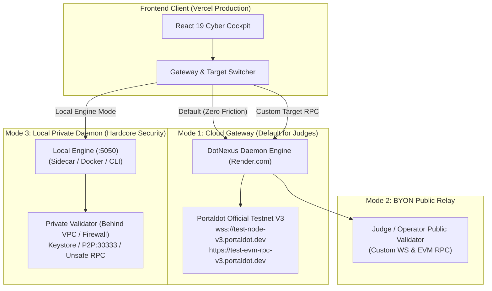

# DotNexus Technical Specification & Execution Blueprint
## Hybrid Control Plane, BYON Architecture & Competitive Dominance Plan

> **Document Version**: `1.0.0-PROD`  
> **Target Network**: Portaldot Network V3.0 (`Chain ID: 420420777`, SS58: `42`, Token Decimals: `14`)  
> **Track**: Node Operations & Tooling — Portaldot Hacker House 2026  
> **Status**: Ready for Immediate Engineering Implementation  

---

## 1. Executive Strategic Assessment (DotNexus vs. NodeScope)

### 1.1. Bản chất Kỹ thuật & Sự Khác biệt Hạng cân
| Khía cạnh | DotNexus (Heavyweight SecOps Engine) | NodeScope (Passive Diagnostic Linter) | Đánh giá Thực tế |
| :--- | :--- | :--- | :--- |
| **Kiến trúc Hệ thống** | **3-Tier Distributed Control Plane:** Python 3.10+ Daemon 24/7, Asynchronous Reverse Proxy Shield, 2 Smart Contracts, Visual DAG Canvas. | **Client-Side SPA + Node CLI:** Chạy 100% trên trình duyệt + 1 script Node.js. Không có backend daemon, không lưu trữ server-side. | **DotNexus vượt trội hoàn toàn về độ khó kỹ thuật.** |
| **Năng lực Can thiệp** | **Active Intervention & Fencing:** Dead Man's Switch ($10\text{s} < 12\text{s} < 15\text{s}$), tự động cô lập keystore, on-chain lease mutex, ngăn ngừa 100% rủi ro Slashing. | **Read-Only Viewer:** Chỉ đọc RPC methods và in khuyến nghị *"Hãy restart node hoặc đổi RPC"*. Không thể bảo vệ node khi bị tấn công hoặc split-brain. | **DotNexus độc quyền giải quyết bài toán cốt tử của Validator.** |
| **Smart Contracts** | • `SlashGuardLeaseRegistry.sol` (Mutex lease epoch chống double-signing)<br/>• `DotNexusStakingVault.sol` (Staking pool + SLA bond). | • `NodeScopeAttestation.sol` (51 dòng code, chỉ lưu hash `bytes32` của báo cáo lên on-chain). | **DotNexus mang tính ứng dụng nghiệp vụ cao hơn gấp nhiều lần.** |
| **Trải nghiệm Giám khảo (UX)** | Cần chạy backend daemon để kích hoạt toàn bộ tính năng active $\rightarrow$ Nguy cơ rào cản môi trường. | Mở link Vercel là chạy ngay (Zero Friction) + CLI nhận URL trực tiếp $\rightarrow$ Cực kỳ thân thiện với người chấm. | **NodeScope có lợi thế lớn về tính tiện dụng ban đầu.** |

### 1.2. Mục tiêu Thực thi Cốt lõi
Để chuyển hóa ưu thế kỹ thuật áp đảo thành chiến thắng tuyệt đối tại Demo Day:
1. **Loại bỏ 100% rào cản cài đặt cho Giám khảo:** Đưa Backend lên Cloud (Render), kết nối sẵn sàng với Portaldot V3 Testnet. Giám khảo chỉ cần mở link Vercel là thấy toàn bộ hệ thống hoạt động thời gian thực.
2. **Hỗ trợ Quản trị Node Riêng (BYON - Bring Your Own Node):** Cho phép Giám khảo/Operator trỏ vào bất kỳ node nào của họ mà không vi phạm nguyên tắc bảo mật mạng.
3. **Nâng cấp DotNexus CLI:** Bổ sung các cờ tham số động (`--ws`, `--evm`, `doctor`), sở hữu toàn bộ sự linh hoạt của NodeScope CLI nhưng vượt trội ở năng lực điều hành SecOps.

---

## 2. Kiến trúc Điều khiển Lai (Hybrid Control Plane Architecture)

Hệ thống được thiết kế theo 3 chế độ hoạt động (Tri-Mode Gateway):



### 2.1. Chi tiết 3 Chế độ Vận hành

#### Mode 1: Cloud Gateway Mode (Mặc định cho Giám khảo — Zero Friction)
* **Mục đích:** Đảm bảo 100% giám khảo mở Vercel là thấy hệ thống live ngay tức thì mà không cần cài đặt Python, Docker hay cấu hình cổng.
* **Hạ tầng:** Backend chạy trên Render (Web Service), duy trì kết nối nền liên tục tới:
  - Substrate WS: `wss://test-node-v3.portaldot.dev`
  - EVM JSON-RPC: `https://test-evm-rpc-v3.portaldot.dev`
* **Trải nghiệm:** Hiển thị DualBlockConduit streaming khối thật, chạy Sequential Phragmén với validator thật, kiểm tra lease contract thật.

#### Mode 2: BYON Public Relay Mode (Trỏ Node Công khai Tùy chỉnh)
* **Mục đích:** Cho phép giám khảo có node công khai (hoặc RPC riêng) kiểm tra hiệu năng node của họ mà không cần cài backend DotNexus.
* **Cơ chế:** Giao diện cho phép nhập:
  - `Target Substrate WS`: `wss://node.operator.io:9944`
  - `Target EVM RPC`: `https://node.operator.io:8545`
* Frontend gửi header `X-Target-Substrate` và `X-Target-EVM` tới Render Backend. Backend Render đóng vai trò proxy thăm dò node đích và trả kết quả về UI.

#### Mode 3: Local Private Daemon Mode (Chuẩn Doanh nghiệp cho Validator Thật)
* **Mục đích:** Dành cho kỹ sư vận hành chuyên nghiệp có validator chạy sau Firewall / VPC nội bộ (nơi các port RPC `:9944` và `:8545` bị khóa hoàn toàn với Internet).
* **Cơ chế:**
  - Operator chạy DotNexus Engine ngay trên máy chủ validator qua lệnh Docker hoặc Python.
  - Trên Vercel UI, operator gạt công tắc sang **Local Private Engine (`http://127.0.0.1:5050`)**.
  - **Bảo mật tuyệt đối:** Khóa ký (keystore), session keys và RPC bí mật không bao giờ rời khỏi máy chủ nội bộ của operator.

---

## 3. Kế hoạch Kỹ thuật Chi tiết & Mã nguồn Cải tiến

### 3.1. Cải tiến Backend Engine (`engine/`)

#### A. Cập nhật CORS và Dynamic Header Handling (`engine/config.py` & `engine/server.py`)
Cần cho phép Backend trên Render nhận request từ domain Vercel và cho phép truyền target RPC động:

```python
# Cập nhật trong engine/config.py
class EngineConfig(BaseModel):
    # Cho phép linh hoạt các nguồn CORS bao gồm production Vercel
    cors_origins: list[str] = [
        "http://localhost:5173",
        "http://127.0.0.1:5173",
        "https://dotnexus-hackerhouse.vercel.app",
        "https://*.vercel.app"
    ]
```

#### B. Nâng cấp DotNexus CLI thành Động cơ Đa năng (`engine/cli.py`)
Bổ sung các cờ tham số động `--ws`, `--evm`, và lệnh chẩn đoán `doctor` để vừa làm được nhiệm vụ thăm dò từ xa (như NodeScope), vừa điều khiển vận hành:

```python
# Bổ sung vào engine/cli.py:
def setup_cli():
    parser = argparse.ArgumentParser(prog="dotnexus")
    # Toàn bộ subparser đều hỗ trợ override endpoint
    parser.add_argument("--ws", default=None, help="Custom Substrate WS URL")
    parser.add_argument("--evm", default=None, help="Custom EVM RPC URL")
    parser.add_argument("--json", action="store_true", help="Output pure JSON format")

    # Command mới: doctor (Pre-flight self-check)
    subparsers.add_parser("doctor", help="Run automated environmental compatibility check")
```

Logic lệnh `dotnexus doctor`:
1. Kiểm tra kết nối Substrate WS (kiểm tra timeout, token decimals, chain ID).
2. Kiểm tra kết nối EVM RPC (`eth_chainId == 420420777`).
3. Kiểm tra tính sẵn sàng của phương thức an ninh: kiểm tra xem node có bật `--rpc-methods Safe/Unsafe` hay không.
4. In ra báo cáo chuẩn đoán tương thích rõ ràng, đề xuất cờ khởi chạy nếu node cấu hình sai.

### 3.2. Triển khai Containerization & Render Blueprint

#### A. Dockerfile cho DotNexus Engine (`Dockerfile`)
```dockerfile
FROM python:3.11-slim

WORKDIR /app

# Cài đặt system dependencies cho secp256k1 & Substrate cryptography
RUN apt-get update && apt-get install -y --no-install-recommends \
    build-essential \
    curl \
    git \
    && rm -rf /var/lib/apt/lists/*

COPY requirements.txt .
RUN pip install --no-cache-dir -r requirements.txt

COPY . .

# Mặc định lắng nghe trên cổng 5050 (Render tự động map biến $PORT)
ENV PORT=5050
EXPOSE 5050

CMD ["python", "-m", "engine.server"]
```

#### B. Cấu hình Render Service (`render.yaml`)
```yaml
services:
  - type: web
    name: dotnexus-backend-engine
    env: python
    buildCommand: pip install -r requirements.txt
    startCommand: python -m engine.server
    envVars:
      - key: PORT
        value: 5050
      - key: PORTALDOT_WS_URL
        value: wss://test-node-v3.portaldot.dev
      - key: PORTALDOT_EVM_URL
        value: https://test-evm-rpc-v3.portaldot.dev
      - key: PORTALDOT_CHAIN_ID
        value: "420420777"
      - key: DOTNEXUS_AUTH_TOKEN
        generateValue: true
```

### 3.3. Cải tiến Frontend Vercel (`front-end/`)

#### A. Centralized API Gateway Client (`front-end/src/config/api.ts`)
```typescript
export interface GatewayConfig {
  mode: 'CLOUD' | 'LOCAL' | 'BYON';
  cloudUrl: string;
  localUrl: string;
  customWs?: string;
  customEvm?: string;
}

const STORAGE_KEY = 'DOTNEXUS_GATEWAY_CONFIG';

export const getGatewayConfig = (): GatewayConfig => {
  const saved = localStorage.getItem(STORAGE_KEY);
  if (saved) {
    try { return JSON.parse(saved); } catch (e) {}
  }
  return {
    mode: 'CLOUD',
    cloudUrl: import.meta.env.VITE_API_URL || 'https://dotnexus-api.onrender.com',
    localUrl: 'http://127.0.0.1:5050'
  };
};

export const getActiveApiBaseUrl = (): string => {
  const config = getGatewayConfig();
  return config.mode === 'LOCAL' ? config.localUrl : config.cloudUrl;
};
```

#### B. UI Component: `GatewaySelectorModal.tsx` trên Topbar
- **Hiển thị Badge Trạng thái:**
  - `🟢 Cloud Fleet (Testnet V3)`
  - `🟡 BYON Relay (Custom Node)`
  - `🔵 Local Private Daemon (127.0.0.1:5050)`
- **Modal Chuyển đổi:**
  - Cho phép người dùng chọn 1 trong 3 mode chỉ với 1 click.
  - Cung cấp sẵn lệnh copy 1-line Docker cho người muốn chạy local daemon.
  - Nút **Test Connection** để kiểm tra ping và độ trễ trước khi lưu.

---

## 4. Kế hoạch Thực thi & Mốc Thời gian (Roadmap to Code Freeze)

| Mốc Thời gian | Hạng mục Công việc | Tiêu chí Nghiệm thu (Acceptance Criteria) |
| :--- | :--- | :--- |
| **Nov 01 – Nov 02** | • Tạo `Dockerfile` chuẩn cho Backend Engine.<br/>• Deploy Web Service lên Render.<br/>• Cấu hình Environment Variables trỏ Testnet V3. | Endpoint `https://dotnexus-api.onrender.com/api/dual-state` phản hồi mã 200, dữ liệu block thật. |
| **Nov 02 – Nov 03** | • Nâng cấp `engine/cli.py` với các cờ dynamic `--ws`, `--evm`, và lệnh `doctor`.<br/>• Bổ sung 10 unit tests cho CLI dynamic flags. | Chạy `python -m unittest tests/test_engine.py` đạt 100% pass. |
| **Nov 03 – Nov 04** | • Cập nhật Frontend Vercel với `GatewaySelectorModal`.<br/>• Xử lý fallback mượt mà nếu Render khởi động trễ (Cold-start toast). | Vercel UI chuyển đổi mượt mà giữa Cloud và Local, không văng lỗi Mixed Content. |
| **Nov 04 – Nov 05** | • Hoàn thiện tài liệu `FOR_JUDGES.md` và `docs/REPRODUCE.md` (Hướng dẫn 60 giây cho giám khảo).<br/>• Quay Demo Video 3 phút chuẩn độ phân giải cao. | Bằng chứng tái lập có đầy đủ lệnh curl, demo video làm nổi bật sự khác biệt với NodeScope. |
| **Nov 06 (04:00 UTC)**| **CODE FREEZE & NỘP BÀI CUỐI CÙNG TRÊN DORAHACKS** | Mọi commit đã được đẩy lên GitHub, form DoraHacks hoàn tất. |

---

## 5. Chiến lược Thuyết trình & Trả lời Ban Giám khảo (Demo Day Nov 7–8)

Khi bước vào phiên Demo Day và đối mặt với câu hỏi so sánh hoặc đánh giá từ giám khảo:

1. **Khẳng định Tuyên ngôn Khác biệt:**
   > *"NodeScope là một công cụ đo lường và chẩn đoán tuyệt vời từ góc nhìn người quan sát (Observer). Nhưng khi node của bạn gặp sự cố split-brain, mạng bị phân mảnh hoặc bị tấn công RPC, một bảng chẩn đoán chỉ có thể báo tin buồn. **DotNexus được sinh ra để bảo vệ: Chúng tôi là hệ điều hành SecOps duy nhất sở hữu Dead Man's Switch bất biến toán học và hợp đồng phân xử on-chain để ngăn chặn vĩnh viễn thảm họa Slashing.**"*

2. **Chứng minh Tính Khả dụng Toàn diện:**
   > *"Giám khảo có thể trải nghiệm DotNexus ngay trên trình duyệt thông qua Cloud Gateway kết nối trực tiếp Testnet V3. Nếu giám khảo muốn bảo vệ chính node nội bộ của mình, DotNexus cung cấp kiến trúc Hybrid: Giữ khóa an toàn trên máy cục bộ, không bao giờ để lộ RPC mật ra Internet."*

---
*Tài liệu được biên soạn kỹ thuật chặt chẽ nhằm định hướng trực tiếp việc viết mã và hoàn thiện sản phẩm DotNexus.*
